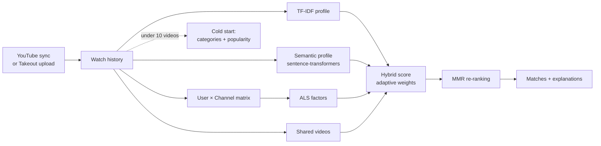

<picture>
  <source media="(prefers-color-scheme: dark)" srcset="assets/header-dark.svg">
  
</picture>

I build AI products end to end — from data and model training to the API and the interface people actually use. I work with LLMs and train my own vision and ranking models, and my full-stack background means they ship as working products, not notebooks.

**Currently:** going deeper into retrieval (RAG) and evaluating LLM output.  
**Open to** AI engineering roles and freelance projects · [LinkedIn](https://www.linkedin.com/in/vadim-tkachenko-19842b241) · [vadim.tkach1378@gmail.com](mailto:vadim.tkach1378@gmail.com)

### Selected work

| Project | Result | Stack |
|---|---|---|
| [**hybrid-recommender**](https://github.com/vadimtkacj1/hybrid-recommendation-system-diplom) · thesis | Matches people by YouTube history: TF-IDF, sentence embeddings and ALS blended, MMR re-ranking, cold start. Full product with OAuth, Takeout import and live chat | FastAPI · sentence-transformers · implicit · React |
| [**vessel-segmentation**](https://github.com/vadimtkacj1/vessel-segmentation) | Retinal vessels on fundus images with DeepLabV3+ / ResNet-101, pixel IoU 0.944 over both classes | PyTorch · segmentation-models · Albumentations |
| [**brain-tumour-segmentation**](https://github.com/vadimtkacj1/brain-tumour-segmentation) | Three tumour sub-regions from 4-sequence MRI. Three architectures compared; Attention U-Net reaches about half the baseline's validation loss | PyTorch · h5py |
| [**lora-fine-tuning-service**](https://github.com/vadimtkacj1/fine-tuning-llama) | REST service that fine-tunes Llama 3 8B with 4-bit QLoRA on uploaded dialogues | FastAPI · Transformers · PEFT · bitsandbytes |
| [**real-estate-appraisal**](https://github.com/vadimtkacj1/real-estate-appraisal-agent) | An LLM parses a free-text listing, XGBoost prices it, the LLM explains the estimate | Gemini · XGBoost · Gradio |
| [**clip-retrieval**](https://github.com/vadimtkacj1/clip-retrieval-ai) | Text-to-image and image-to-image search, CLIP vs ResNet-18, cosine vs Euclidean | CLIP · PyTorch · NumPy |

**Product engineering:** [CRM with a Meta Ads analytics panel](https://github.com/vadimtkacj1/aiterra-crm), running in production · FastAPI · React · Docker

<details>
<summary><b>How the recommender ranks people</b></summary>
<br>



</details>

<details>
<summary><b>Vessel segmentation: input, ground truth, prediction, heatmap</b></summary>
<br>


</details>

<details>
<summary><b>Brain tumour segmentation: what the attention gates look at</b></summary>
<br>


</details>

### Training run

<picture>
  <source media="(prefers-color-scheme: dark)" srcset="assets/training-run-dark.svg">
  
</picture>

### The same year in 3D

Every column is a day, height is the number of contributions. Drag to rotate, scroll to zoom.

<!-- skyline:start -->
```stl
solid contributions
facet normal 0 0 1
outer loop
vertex -1 -1 0
vertex 53.2 -1 0
vertex 53.2 7.2 0
endloop
endfacet
facet normal 0 0 1
outer loop
vertex -1 -1 0
vertex 53.2 7.2 0
vertex -1 7.2 0
endloop
endfacet
facet normal 0 -1 0
outer loop
vertex -1 -1 -1.2
vertex 53.2 -1 -1.2
vertex 53.2 -1 0
endloop
endfacet
facet normal 0 -1 0
outer loop
vertex -1 -1 -1.2
vertex 53.2 -1 0
vertex -1 -1 0
endloop
endfacet
facet normal 0 1 0
outer loop
vertex 53.2 7.2 -1.2
vertex -1 7.2 -1.2
vertex -1 7.2 0
endloop
endfacet
facet normal 0 1 0
outer loop
vertex 53.2 7.2 -1.2
vertex -1 7.2 0
vertex 53.2 7.2 0
endloop
endfacet
facet normal -1 0 0
outer loop
vertex -1 7.2 -1.2
vertex -1 -1 -1.2
vertex -1 -1 0
endloop
endfacet
facet normal -1 0 0
outer loop
vertex -1 7.2 -1.2
vertex -1 -1 0
vertex -1 7.2 0
endloop
endfacet
facet normal 1 0 0
outer loop
vertex 53.2 -1 -1.2
vertex 53.2 7.2 -1.2
vertex 53.2 7.2 0
endloop
endfacet
facet normal 1 0 0
outer loop
vertex 53.2 -1 -1.2
vertex 53.2 7.2 0
vertex 53.2 -1 0
endloop
endfacet
facet normal 0 0 -1
outer loop
vertex -1 7.2 -1.2
vertex 53.2 7.2 -1.2
vertex 53.2 -1 -1.2
endloop
endfacet
facet normal 0 0 -1
outer loop
vertex -1 7.2 -1.2
vertex 53.2 -1 -1.2
vertex -1 -1 -1.2
endloop
endfacet
facet normal 0 0 1
outer loop
vertex 0.1 4.1 2.13
vertex 0.9 4.1 2.13
vertex 0.9 4.9 2.13
endloop
endfacet
facet normal 0 0 1
outer loop
vertex 0.1 4.1 2.13
vertex 0.9 4.9 2.13
vertex 0.1 4.9 2.13
endloop
endfacet
facet normal 0 -1 0
outer loop
vertex 0.1 4.1 0
vertex 0.9 4.1 0
vertex 0.9 4.1 2.13
endloop
endfacet
facet normal 0 -1 0
outer loop
vertex 0.1 4.1 0
vertex 0.9 4.1 2.13
vertex 0.1 4.1 2.13
endloop
endfacet
facet normal 0 1 0
outer loop
vertex 0.9 4.9 0
vertex 0.1 4.9 0
vertex 0.1 4.9 2.13
endloop
endfacet
facet normal 0 1 0
outer loop
vertex 0.9 4.9 0
vertex 0.1 4.9 2.13
vertex 0.9 4.9 2.13
endloop
endfacet
facet normal -1 0 0
outer loop
vertex 0.1 4.9 0
vertex 0.1 4.1 0
vertex 0.1 4.1 2.13
endloop
endfacet
facet normal -1 0 0
outer loop
vertex 0.1 4.9 0
vertex 0.1 4.1 2.13
vertex 0.1 4.9 2.13
endloop
endfacet
facet normal 1 0 0
outer loop
vertex 0.9 4.1 0
vertex 0.9 4.9 0
vertex 0.9 4.9 2.13
endloop
endfacet
facet normal 1 0 0
outer loop
vertex 0.9 4.1 0
vertex 0.9 4.9 2.13
vertex 0.9 4.1 2.13
endloop
endfacet
facet normal 0 0 1
outer loop
vertex 0.1 3.1 1.68
vertex 0.9 3.1 1.68
vertex 0.9 3.9 1.68
endloop
endfacet
facet normal 0 0 1
outer loop
vertex 0.1 3.1 1.68
vertex 0.9 3.9 1.68
vertex 0.1 3.9 1.68
endloop
endfacet
facet normal 0 -1 0
outer loop
vertex 0.1 3.1 0
vertex 0.9 3.1 0
vertex 0.9 3.1 1.68
endloop
endfacet
facet normal 0 -1 0
outer loop
vertex 0.1 3.1 0
vertex 0.9 3.1 1.68
vertex 0.1 3.1 1.68
endloop
endfacet
facet normal 0 1 0
outer loop
vertex 0.9 3.9 0
vertex 0.1 3.9 0
vertex 0.1 3.9 1.68
endloop
endfacet
facet normal 0 1 0
outer loop
vertex 0.9 3.9 0
vertex 0.1 3.9 1.68
vertex 0.9 3.9 1.68
endloop
endfacet
facet normal -1 0 0
outer loop
vertex 0.1 3.9 0
vertex 0.1 3.1 0
vertex 0.1 3.1 1.68
endloop
endfacet
facet normal -1 0 0
outer loop
vertex 0.1 3.9 0
vertex 0.1 3.1 1.68
vertex 0.1 3.9 1.68
endloop
endfacet
facet normal 1 0 0
outer loop
vertex 0.9 3.1 0
vertex 0.9 3.9 0
vertex 0.9 3.9 1.68
endloop
endfacet
facet normal 1 0 0
outer loop
vertex 0.9 3.1 0
vertex 0.9 3.9 1.68
vertex 0.9 3.1 1.68
endloop
endfacet
facet normal 0 0 1
outer loop
vertex 1.1 0.1 2.48
vertex 1.9 0.1 2.48
vertex 1.9 0.9 2.48
endloop
endfacet
facet normal 0 0 1
outer loop
vertex 1.1 0.1 2.48
vertex 1.9 0.9 2.48
vertex 1.1 0.9 2.48
endloop
endfacet
facet normal 0 -1 0
outer loop
vertex 1.1 0.1 0
vertex 1.9 0.1 0
vertex 1.9 0.1 2.48
endloop
endfacet
facet normal 0 -1 0
outer loop
vertex 1.1 0.1 0
vertex 1.9 0.1 2.48
vertex 1.1 0.1 2.48
endloop
endfacet
facet normal 0 1 0
outer loop
vertex 1.9 0.9 0
vertex 1.1 0.9 0
vertex 1.1 0.9 2.48
endloop
endfacet
facet normal 0 1 0
outer loop
vertex 1.9 0.9 0
vertex 1.1 0.9 2.48
vertex 1.9 0.9 2.48
endloop
endfacet
facet normal -1 0 0
outer loop
vertex 1.1 0.9 0
vertex 1.1 0.1 0
vertex 1.1 0.1 2.48
endloop
endfacet
facet normal -1 0 0
outer loop
vertex 1.1 0.9 0
vertex 1.1 0.1 2.48
vertex 1.1 0.9 2.48
endloop
endfacet
facet normal 1 0 0
outer loop
vertex 1.9 0.1 0
vertex 1.9 0.9 0
vertex 1.9 0.9 2.48
endloop
endfacet
facet normal 1 0 0
outer loop
vertex 1.9 0.1 0
vertex 1.9 0.9 2.48
vertex 1.9 0.1 2.48
endloop
endfacet
facet normal 0 0 1
outer loop
vertex 2.1 6.1 3.02
vertex 2.9 6.1 3.02
vertex 2.9 6.9 3.02
endloop
endfacet
facet normal 0 0 1
outer loop
vertex 2.1 6.1 3.02
vertex 2.9 6.9 3.02
vertex 2.1 6.9 3.02
endloop
endfacet
facet normal 0 -1 0
outer loop
vertex 2.1 6.1 0
vertex 2.9 6.1 0
vertex 2.9 6.1 3.02
endloop
endfacet
facet normal 0 -1 0
outer loop
vertex 2.1 6.1 0
vertex 2.9 6.1 3.02
vertex 2.1 6.1 3.02
endloop
endfacet
facet normal 0 1 0
outer loop
vertex 2.9 6.9 0
vertex 2.1 6.9 0
vertex 2.1 6.9 3.02
endloop
endfacet
facet normal 0 1 0
outer loop
vertex 2.9 6.9 0
vertex 2.1 6.9 3.02
vertex 2.9 6.9 3.02
endloop
endfacet
facet normal -1 0 0
outer loop
vertex 2.1 6.9 0
vertex 2.1 6.1 0
vertex 2.1 6.1 3.02
endloop
endfacet
facet normal -1 0 0
outer loop
vertex 2.1 6.9 0
vertex 2.1 6.1 3.02
vertex 2.1 6.9 3.02
endloop
endfacet
facet normal 1 0 0
outer loop
vertex 2.9 6.1 0
vertex 2.9 6.9 0
vertex 2.9 6.9 3.02
endloop
endfacet
facet normal 1 0 0
outer loop
vertex 2.9 6.1 0
vertex 2.9 6.9 3.02
vertex 2.9 6.1 3.02
endloop
endfacet
facet normal 0 0 1
outer loop
vertex 9.1 4.1 2.13
vertex 9.9 4.1 2.13
vertex 9.9 4.9 2.13
endloop
endfacet
facet normal 0 0 1
outer loop
vertex 9.1 4.1 2.13
vertex 9.9 4.9 2.13
vertex 9.1 4.9 2.13
endloop
endfacet
facet normal 0 -1 0
outer loop
vertex 9.1 4.1 0
vertex 9.9 4.1 0
vertex 9.9 4.1 2.13
endloop
endfacet
facet normal 0 -1 0
outer loop
vertex 9.1 4.1 0
vertex 9.9 4.1 2.13
vertex 9.1 4.1 2.13
endloop
endfacet
facet normal 0 1 0
outer loop
vertex 9.9 4.9 0
vertex 9.1 4.9 0
vertex 9.1 4.9 2.13
endloop
endfacet
facet normal 0 1 0
outer loop
vertex 9.9 4.9 0
vertex 9.1 4.9 2.13
vertex 9.9 4.9 2.13
endloop
endfacet
facet normal -1 0 0
outer loop
vertex 9.1 4.9 0
vertex 9.1 4.1 0
vertex 9.1 4.1 2.13
endloop
endfacet
facet normal -1 0 0
outer loop
vertex 9.1 4.9 0
vertex 9.1 4.1 2.13
vertex 9.1 4.9 2.13
endloop
endfacet
facet normal 1 0 0
outer loop
vertex 9.9 4.1 0
vertex 9.9 4.9 0
vertex 9.9 4.9 2.13
endloop
endfacet
facet normal 1 0 0
outer loop
vertex 9.9 4.1 0
vertex 9.9 4.9 2.13
vertex 9.9 4.1 2.13
endloop
endfacet
facet normal 0 0 1
outer loop
vertex 9.1 3.1 1.68
vertex 9.9 3.1 1.68
vertex 9.9 3.9 1.68
endloop
endfacet
facet normal 0 0 1
outer loop
vertex 9.1 3.1 1.68
vertex 9.9 3.9 1.68
vertex 9.1 3.9 1.68
endloop
endfacet
facet normal 0 -1 0
outer loop
vertex 9.1 3.1 0
vertex 9.9 3.1 0
vertex 9.9 3.1 1.68
endloop
endfacet
facet normal 0 -1 0
outer loop
vertex 9.1 3.1 0
vertex 9.9 3.1 1.68
vertex 9.1 3.1 1.68
endloop
endfacet
facet normal 0 1 0
outer loop
vertex 9.9 3.9 0
vertex 9.1 3.9 0
vertex 9.1 3.9 1.68
endloop
endfacet
facet normal 0 1 0
outer loop
vertex 9.9 3.9 0
vertex 9.1 3.9 1.68
vertex 9.9 3.9 1.68
endloop
endfacet
facet normal -1 0 0
outer loop
vertex 9.1 3.9 0
vertex 9.1 3.1 0
vertex 9.1 3.1 1.68
endloop
endfacet
facet normal -1 0 0
outer loop
vertex 9.1 3.9 0
vertex 9.1 3.1 1.68
vertex 9.1 3.9 1.68
endloop
endfacet
facet normal 1 0 0
outer loop
vertex 9.9 3.1 0
vertex 9.9 3.9 0
vertex 9.9 3.9 1.68
endloop
endfacet
facet normal 1 0 0
outer loop
vertex 9.9 3.1 0
vertex 9.9 3.9 1.68
vertex 9.9 3.1 1.68
endloop
endfacet
facet normal 0 0 1
outer loop
vertex 9.1 1.1 2.77
vertex 9.9 1.1 2.77
vertex 9.9 1.9 2.77
endloop
endfacet
facet normal 0 0 1
outer loop
vertex 9.1 1.1 2.77
vertex 9.9 1.9 2.77
vertex 9.1 1.9 2.77
endloop
endfacet
facet normal 0 -1 0
outer loop
vertex 9.1 1.1 0
vertex 9.9 1.1 0
vertex 9.9 1.1 2.77
endloop
endfacet
facet normal 0 -1 0
outer loop
vertex 9.1 1.1 0
vertex 9.9 1.1 2.77
vertex 9.1 1.1 2.77
endloop
endfacet
facet normal 0 1 0
outer loop
vertex 9.9 1.9 0
vertex 9.1 1.9 0
vertex 9.1 1.9 2.77
endloop
endfacet
facet normal 0 1 0
outer loop
vertex 9.9 1.9 0
vertex 9.1 1.9 2.77
vertex 9.9 1.9 2.77
endloop
endfacet
facet normal -1 0 0
outer loop
vertex 9.1 1.9 0
vertex 9.1 1.1 0
vertex 9.1 1.1 2.77
endloop
endfacet
facet normal -1 0 0
outer loop
vertex 9.1 1.9 0
vertex 9.1 1.1 2.77
vertex 9.1 1.9 2.77
endloop
endfacet
facet normal 1 0 0
outer loop
vertex 9.9 1.1 0
vertex 9.9 1.9 0
vertex 9.9 1.9 2.77
endloop
endfacet
facet normal 1 0 0
outer loop
vertex 9.9 1.1 0
vertex 9.9 1.9 2.77
vertex 9.9 1.1 2.77
endloop
endfacet
facet normal 0 0 1
outer loop
vertex 9.1 0.1 1.68
vertex 9.9 0.1 1.68
vertex 9.9 0.9 1.68
endloop
endfacet
facet normal 0 0 1
outer loop
vertex 9.1 0.1 1.68
vertex 9.9 0.9 1.68
vertex 9.1 0.9 1.68
endloop
endfacet
facet normal 0 -1 0
outer loop
vertex 9.1 0.1 0
vertex 9.9 0.1 0
vertex 9.9 0.1 1.68
endloop
endfacet
facet normal 0 -1 0
outer loop
vertex 9.1 0.1 0
vertex 9.9 0.1 1.68
vertex 9.1 0.1 1.68
endloop
endfacet
facet normal 0 1 0
outer loop
vertex 9.9 0.9 0
vertex 9.1 0.9 0
vertex 9.1 0.9 1.68
endloop
endfacet
facet normal 0 1 0
outer loop
vertex 9.9 0.9 0
vertex 9.1 0.9 1.68
vertex 9.9 0.9 1.68
endloop
endfacet
facet normal -1 0 0
outer loop
vertex 9.1 0.9 0
vertex 9.1 0.1 0
vertex 9.1 0.1 1.68
endloop
endfacet
facet normal -1 0 0
outer loop
vertex 9.1 0.9 0
vertex 9.1 0.1 1.68
vertex 9.1 0.9 1.68
endloop
endfacet
facet normal 1 0 0
outer loop
vertex 9.9 0.1 0
vertex 9.9 0.9 0
vertex 9.9 0.9 1.68
endloop
endfacet
facet normal 1 0 0
outer loop
vertex 9.9 0.1 0
vertex 9.9 0.9 1.68
vertex 9.9 0.1 1.68
endloop
endfacet
facet normal 0 0 1
outer loop
vertex 10.1 6.1 4.8
vertex 10.9 6.1 4.8
vertex 10.9 6.9 4.8
endloop
endfacet
facet normal 0 0 1
outer loop
vertex 10.1 6.1 4.8
vertex 10.9 6.9 4.8
vertex 10.1 6.9 4.8
endloop
endfacet
facet normal 0 -1 0
outer loop
vertex 10.1 6.1 0
vertex 10.9 6.1 0
vertex 10.9 6.1 4.8
endloop
endfacet
facet normal 0 -1 0
outer loop
vertex 10.1 6.1 0
vertex 10.9 6.1 4.8
vertex 10.1 6.1 4.8
endloop
endfacet
facet normal 0 1 0
outer loop
vertex 10.9 6.9 0
vertex 10.1 6.9 0
vertex 10.1 6.9 4.8
endloop
endfacet
facet normal 0 1 0
outer loop
vertex 10.9 6.9 0
vertex 10.1 6.9 4.8
vertex 10.9 6.9 4.8
endloop
endfacet
facet normal -1 0 0
outer loop
vertex 10.1 6.9 0
vertex 10.1 6.1 0
vertex 10.1 6.1 4.8
endloop
endfacet
facet normal -1 0 0
outer loop
vertex 10.1 6.9 0
vertex 10.1 6.1 4.8
vertex 10.1 6.9 4.8
endloop
endfacet
facet normal 1 0 0
outer loop
vertex 10.9 6.1 0
vertex 10.9 6.9 0
vertex 10.9 6.9 4.8
endloop
endfacet
facet normal 1 0 0
outer loop
vertex 10.9 6.1 0
vertex 10.9 6.9 4.8
vertex 10.9 6.1 4.8
endloop
endfacet
facet normal 0 0 1
outer loop
vertex 10.1 5.1 2.77
vertex 10.9 5.1 2.77
vertex 10.9 5.9 2.77
endloop
endfacet
facet normal 0 0 1
outer loop
vertex 10.1 5.1 2.77
vertex 10.9 5.9 2.77
vertex 10.1 5.9 2.77
endloop
endfacet
facet normal 0 -1 0
outer loop
vertex 10.1 5.1 0
vertex 10.9 5.1 0
vertex 10.9 5.1 2.77
endloop
endfacet
facet normal 0 -1 0
outer loop
vertex 10.1 5.1 0
vertex 10.9 5.1 2.77
vertex 10.1 5.1 2.77
endloop
endfacet
facet normal 0 1 0
outer loop
vertex 10.9 5.9 0
vertex 10.1 5.9 0
vertex 10.1 5.9 2.77
endloop
endfacet
facet normal 0 1 0
outer loop
vertex 10.9 5.9 0
vertex 10.1 5.9 2.77
vertex 10.9 5.9 2.77
endloop
endfacet
facet normal -1 0 0
outer loop
vertex 10.1 5.9 0
vertex 10.1 5.1 0
vertex 10.1 5.1 2.77
endloop
endfacet
facet normal -1 0 0
outer loop
vertex 10.1 5.9 0
vertex 10.1 5.1 2.77
vertex 10.1 5.9 2.77
endloop
endfacet
facet normal 1 0 0
outer loop
vertex 10.9 5.1 0
vertex 10.9 5.9 0
vertex 10.9 5.9 2.77
endloop
endfacet
facet normal 1 0 0
outer loop
vertex 10.9 5.1 0
vertex 10.9 5.9 2.77
vertex 10.9 5.1 2.77
endloop
endfacet
facet normal 0 0 1
outer loop
vertex 10.1 4.1 2.48
vertex 10.9 4.1 2.48
vertex 10.9 4.9 2.48
endloop
endfacet
facet normal 0 0 1
outer loop
vertex 10.1 4.1 2.48
vertex 10.9 4.9 2.48
vertex 10.1 4.9 2.48
endloop
endfacet
facet normal 0 -1 0
outer loop
vertex 10.1 4.1 0
vertex 10.9 4.1 0
vertex 10.9 4.1 2.48
endloop
endfacet
facet normal 0 -1 0
outer loop
vertex 10.1 4.1 0
vertex 10.9 4.1 2.48
vertex 10.1 4.1 2.48
endloop
endfacet
facet normal 0 1 0
outer loop
vertex 10.9 4.9 0
vertex 10.1 4.9 0
vertex 10.1 4.9 2.48
endloop
endfacet
facet normal 0 1 0
outer loop
vertex 10.9 4.9 0
vertex 10.1 4.9 2.48
vertex 10.9 4.9 2.48
endloop
endfacet
facet normal -1 0 0
outer loop
vertex 10.1 4.9 0
vertex 10.1 4.1 0
vertex 10.1 4.1 2.48
endloop
endfacet
facet normal -1 0 0
outer loop
vertex 10.1 4.9 0
vertex 10.1 4.1 2.48
vertex 10.1 4.9 2.48
endloop
endfacet
facet normal 1 0 0
outer loop
vertex 10.9 4.1 0
vertex 10.9 4.9 0
vertex 10.9 4.9 2.48
endloop
endfacet
facet normal 1 0 0
outer loop
vertex 10.9 4.1 0
vertex 10.9 4.9 2.48
vertex 10.9 4.1 2.48
endloop
endfacet
facet normal 0 0 1
outer loop
vertex 10.1 2.1 1.68
vertex 10.9 2.1 1.68
vertex 10.9 2.9 1.68
endloop
endfacet
facet normal 0 0 1
outer loop
vertex 10.1 2.1 1.68
vertex 10.9 2.9 1.68
vertex 10.1 2.9 1.68
endloop
endfacet
facet normal 0 -1 0
outer loop
vertex 10.1 2.1 0
vertex 10.9 2.1 0
vertex 10.9 2.1 1.68
endloop
endfacet
facet normal 0 -1 0
outer loop
vertex 10.1 2.1 0
vertex 10.9 2.1 1.68
vertex 10.1 2.1 1.68
endloop
endfacet
facet normal 0 1 0
outer loop
vertex 10.9 2.9 0
vertex 10.1 2.9 0
vertex 10.1 2.9 1.68
endloop
endfacet
facet normal 0 1 0
outer loop
vertex 10.9 2.9 0
vertex 10.1 2.9 1.68
vertex 10.9 2.9 1.68
endloop
endfacet
facet normal -1 0 0
outer loop
vertex 10.1 2.9 0
vertex 10.1 2.1 0
vertex 10.1 2.1 1.68
endloop
endfacet
facet normal -1 0 0
outer loop
vertex 10.1 2.9 0
vertex 10.1 2.1 1.68
vertex 10.1 2.9 1.68
endloop
endfacet
facet normal 1 0 0
outer loop
vertex 10.9 2.1 0
vertex 10.9 2.9 0
vertex 10.9 2.9 1.68
endloop
endfacet
facet normal 1 0 0
outer loop
vertex 10.9 2.1 0
vertex 10.9 2.9 1.68
vertex 10.9 2.1 1.68
endloop
endfacet
facet normal 0 0 1
outer loop
vertex 10.1 1.1 2.13
vertex 10.9 1.1 2.13
vertex 10.9 1.9 2.13
endloop
endfacet
facet normal 0 0 1
outer loop
vertex 10.1 1.1 2.13
vertex 10.9 1.9 2.13
vertex 10.1 1.9 2.13
endloop
endfacet
facet normal 0 -1 0
outer loop
vertex 10.1 1.1 0
vertex 10.9 1.1 0
vertex 10.9 1.1 2.13
endloop
endfacet
facet normal 0 -1 0
outer loop
vertex 10.1 1.1 0
vertex 10.9 1.1 2.13
vertex 10.1 1.1 2.13
endloop
endfacet
facet normal 0 1 0
outer loop
vertex 10.9 1.9 0
vertex 10.1 1.9 0
vertex 10.1 1.9 2.13
endloop
endfacet
facet normal 0 1 0
outer loop
vertex 10.9 1.9 0
vertex 10.1 1.9 2.13
vertex 10.9 1.9 2.13
endloop
endfacet
facet normal -1 0 0
outer loop
vertex 10.1 1.9 0
vertex 10.1 1.1 0
vertex 10.1 1.1 2.13
endloop
endfacet
facet normal -1 0 0
outer loop
vertex 10.1 1.9 0
vertex 10.1 1.1 2.13
vertex 10.1 1.9 2.13
endloop
endfacet
facet normal 1 0 0
outer loop
vertex 10.9 1.1 0
vertex 10.9 1.9 0
vertex 10.9 1.9 2.13
endloop
endfacet
facet normal 1 0 0
outer loop
vertex 10.9 1.1 0
vertex 10.9 1.9 2.13
vertex 10.9 1.1 2.13
endloop
endfacet
facet normal 0 0 1
outer loop
vertex 11.1 6.1 3.85
vertex 11.9 6.1 3.85
vertex 11.9 6.9 3.85
endloop
endfacet
facet normal 0 0 1
outer loop
vertex 11.1 6.1 3.85
vertex 11.9 6.9 3.85
vertex 11.1 6.9 3.85
endloop
endfacet
facet normal 0 -1 0
outer loop
vertex 11.1 6.1 0
vertex 11.9 6.1 0
vertex 11.9 6.1 3.85
endloop
endfacet
facet normal 0 -1 0
outer loop
vertex 11.1 6.1 0
vertex 11.9 6.1 3.85
vertex 11.1 6.1 3.85
endloop
endfacet
facet normal 0 1 0
outer loop
vertex 11.9 6.9 0
vertex 11.1 6.9 0
vertex 11.1 6.9 3.85
endloop
endfacet
facet normal 0 1 0
outer loop
vertex 11.9 6.9 0
vertex 11.1 6.9 3.85
vertex 11.9 6.9 3.85
endloop
endfacet
facet normal -1 0 0
outer loop
vertex 11.1 6.9 0
vertex 11.1 6.1 0
vertex 11.1 6.1 3.85
endloop
endfacet
facet normal -1 0 0
outer loop
vertex 11.1 6.9 0
vertex 11.1 6.1 3.85
vertex 11.1 6.9 3.85
endloop
endfacet
facet normal 1 0 0
outer loop
vertex 11.9 6.1 0
vertex 11.9 6.9 0
vertex 11.9 6.9 3.85
endloop
endfacet
facet normal 1 0 0
outer loop
vertex 11.9 6.1 0
vertex 11.9 6.9 3.85
vertex 11.9 6.1 3.85
endloop
endfacet
facet normal 0 0 1
outer loop
vertex 11.1 5.1 6.02
vertex 11.9 5.1 6.02
vertex 11.9 5.9 6.02
endloop
endfacet
facet normal 0 0 1
outer loop
vertex 11.1 5.1 6.02
vertex 11.9 5.9 6.02
vertex 11.1 5.9 6.02
endloop
endfacet
facet normal 0 -1 0
outer loop
vertex 11.1 5.1 0
vertex 11.9 5.1 0
vertex 11.9 5.1 6.02
endloop
endfacet
facet normal 0 -1 0
outer loop
vertex 11.1 5.1 0
vertex 11.9 5.1 6.02
vertex 11.1 5.1 6.02
endloop
endfacet
facet normal 0 1 0
outer loop
vertex 11.9 5.9 0
vertex 11.1 5.9 0
vertex 11.1 5.9 6.02
endloop
endfacet
facet normal 0 1 0
outer loop
vertex 11.9 5.9 0
vertex 11.1 5.9 6.02
vertex 11.9 5.9 6.02
endloop
endfacet
facet normal -1 0 0
outer loop
vertex 11.1 5.9 0
vertex 11.1 5.1 0
vertex 11.1 5.1 6.02
endloop
endfacet
facet normal -1 0 0
outer loop
vertex 11.1 5.9 0
vertex 11.1 5.1 6.02
vertex 11.1 5.9 6.02
endloop
endfacet
facet normal 1 0 0
outer loop
vertex 11.9 5.1 0
vertex 11.9 5.9 0
vertex 11.9 5.9 6.02
endloop
endfacet
facet normal 1 0 0
outer loop
vertex 11.9 5.1 0
vertex 11.9 5.9 6.02
vertex 11.9 5.1 6.02
endloop
endfacet
facet normal 0 0 1
outer loop
vertex 11.1 4.1 3.85
vertex 11.9 4.1 3.85
vertex 11.9 4.9 3.85
endloop
endfacet
facet normal 0 0 1
outer loop
vertex 11.1 4.1 3.85
vertex 11.9 4.9 3.85
vertex 11.1 4.9 3.85
endloop
endfacet
facet normal 0 -1 0
outer loop
vertex 11.1 4.1 0
vertex 11.9 4.1 0
vertex 11.9 4.1 3.85
endloop
endfacet
facet normal 0 -1 0
outer loop
vertex 11.1 4.1 0
vertex 11.9 4.1 3.85
vertex 11.1 4.1 3.85
endloop
endfacet
facet normal 0 1 0
outer loop
vertex 11.9 4.9 0
vertex 11.1 4.9 0
vertex 11.1 4.9 3.85
endloop
endfacet
facet normal 0 1 0
outer loop
vertex 11.9 4.9 0
vertex 11.1 4.9 3.85
vertex 11.9 4.9 3.85
endloop
endfacet
facet normal -1 0 0
outer loop
vertex 11.1 4.9 0
vertex 11.1 4.1 0
vertex 11.1 4.1 3.85
endloop
endfacet
facet normal -1 0 0
outer loop
vertex 11.1 4.9 0
vertex 11.1 4.1 3.85
vertex 11.1 4.9 3.85
endloop
endfacet
facet normal 1 0 0
outer loop
vertex 11.9 4.1 0
vertex 11.9 4.9 0
vertex 11.9 4.9 3.85
endloop
endfacet
facet normal 1 0 0
outer loop
vertex 11.9 4.1 0
vertex 11.9 4.9 3.85
vertex 11.9 4.1 3.85
endloop
endfacet
facet normal 0 0 1
outer loop
vertex 11.1 3.1 3.67
vertex 11.9 3.1 3.67
vertex 11.9 3.9 3.67
endloop
endfacet
facet normal 0 0 1
outer loop
vertex 11.1 3.1 3.67
vertex 11.9 3.9 3.67
vertex 11.1 3.9 3.67
endloop
endfacet
facet normal 0 -1 0
outer loop
vertex 11.1 3.1 0
vertex 11.9 3.1 0
vertex 11.9 3.1 3.67
endloop
endfacet
facet normal 0 -1 0
outer loop
vertex 11.1 3.1 0
vertex 11.9 3.1 3.67
vertex 11.1 3.1 3.67
endloop
endfacet
facet normal 0 1 0
outer loop
vertex 11.9 3.9 0
vertex 11.1 3.9 0
vertex 11.1 3.9 3.67
endloop
endfacet
facet normal 0 1 0
outer loop
vertex 11.9 3.9 0
vertex 11.1 3.9 3.67
vertex 11.9 3.9 3.67
endloop
endfacet
facet normal -1 0 0
outer loop
vertex 11.1 3.9 0
vertex 11.1 3.1 0
vertex 11.1 3.1 3.67
endloop
endfacet
facet normal -1 0 0
outer loop
vertex 11.1 3.9 0
vertex 11.1 3.1 3.67
vertex 11.1 3.9 3.67
endloop
endfacet
facet normal 1 0 0
outer loop
vertex 11.9 3.1 0
vertex 11.9 3.9 0
vertex 11.9 3.9 3.67
endloop
endfacet
facet normal 1 0 0
outer loop
vertex 11.9 3.1 0
vertex 11.9 3.9 3.67
vertex 11.9 3.1 3.67
endloop
endfacet
facet normal 0 0 1
outer loop
vertex 11.1 2.1 2.48
vertex 11.9 2.1 2.48
vertex 11.9 2.9 2.48
endloop
endfacet
facet normal 0 0 1
outer loop
vertex 11.1 2.1 2.48
vertex 11.9 2.9 2.48
vertex 11.1 2.9 2.48
endloop
endfacet
facet normal 0 -1 0
outer loop
vertex 11.1 2.1 0
vertex 11.9 2.1 0
vertex 11.9 2.1 2.48
endloop
endfacet
facet normal 0 -1 0
outer loop
vertex 11.1 2.1 0
vertex 11.9 2.1 2.48
vertex 11.1 2.1 2.48
endloop
endfacet
facet normal 0 1 0
outer loop
vertex 11.9 2.9 0
vertex 11.1 2.9 0
vertex 11.1 2.9 2.48
endloop
endfacet
facet normal 0 1 0
outer loop
vertex 11.9 2.9 0
vertex 11.1 2.9 2.48
vertex 11.9 2.9 2.48
endloop
endfacet
facet normal -1 0 0
outer loop
vertex 11.1 2.9 0
vertex 11.1 2.1 0
vertex 11.1 2.1 2.48
endloop
endfacet
facet normal -1 0 0
outer loop
vertex 11.1 2.9 0
vertex 11.1 2.1 2.48
vertex 11.1 2.9 2.48
endloop
endfacet
facet normal 1 0 0
outer loop
vertex 11.9 2.1 0
vertex 11.9 2.9 0
vertex 11.9 2.9 2.48
endloop
endfacet
facet normal 1 0 0
outer loop
vertex 11.9 2.1 0
vertex 11.9 2.9 2.48
vertex 11.9 2.1 2.48
endloop
endfacet
facet normal 0 0 1
outer loop
vertex 11.1 1.1 3.85
vertex 11.9 1.1 3.85
vertex 11.9 1.9 3.85
endloop
endfacet
facet normal 0 0 1
outer loop
vertex 11.1 1.1 3.85
vertex 11.9 1.9 3.85
vertex 11.1 1.9 3.85
endloop
endfacet
facet normal 0 -1 0
outer loop
vertex 11.1 1.1 0
vertex 11.9 1.1 0
vertex 11.9 1.1 3.85
endloop
endfacet
facet normal 0 -1 0
outer loop
vertex 11.1 1.1 0
vertex 11.9 1.1 3.85
vertex 11.1 1.1 3.85
endloop
endfacet
facet normal 0 1 0
outer loop
vertex 11.9 1.9 0
vertex 11.1 1.9 0
vertex 11.1 1.9 3.85
endloop
endfacet
facet normal 0 1 0
outer loop
vertex 11.9 1.9 0
vertex 11.1 1.9 3.85
vertex 11.9 1.9 3.85
endloop
endfacet
facet normal -1 0 0
outer loop
vertex 11.1 1.9 0
vertex 11.1 1.1 0
vertex 11.1 1.1 3.85
endloop
endfacet
facet normal -1 0 0
outer loop
vertex 11.1 1.9 0
vertex 11.1 1.1 3.85
vertex 11.1 1.9 3.85
endloop
endfacet
facet normal 1 0 0
outer loop
vertex 11.9 1.1 0
vertex 11.9 1.9 0
vertex 11.9 1.9 3.85
endloop
endfacet
facet normal 1 0 0
outer loop
vertex 11.9 1.1 0
vertex 11.9 1.9 3.85
vertex 11.9 1.1 3.85
endloop
endfacet
facet normal 0 0 1
outer loop
vertex 12.1 5.1 3.67
vertex 12.9 5.1 3.67
vertex 12.9 5.9 3.67
endloop
endfacet
facet normal 0 0 1
outer loop
vertex 12.1 5.1 3.67
vertex 12.9 5.9 3.67
vertex 12.1 5.9 3.67
endloop
endfacet
facet normal 0 -1 0
outer loop
vertex 12.1 5.1 0
vertex 12.9 5.1 0
vertex 12.9 5.1 3.67
endloop
endfacet
facet normal 0 -1 0
outer loop
vertex 12.1 5.1 0
vertex 12.9 5.1 3.67
vertex 12.1 5.1 3.67
endloop
endfacet
facet normal 0 1 0
outer loop
vertex 12.9 5.9 0
vertex 12.1 5.9 0
vertex 12.1 5.9 3.67
endloop
endfacet
facet normal 0 1 0
outer loop
vertex 12.9 5.9 0
vertex 12.1 5.9 3.67
vertex 12.9 5.9 3.67
endloop
endfacet
facet normal -1 0 0
outer loop
vertex 12.1 5.9 0
vertex 12.1 5.1 0
vertex 12.1 5.1 3.67
endloop
endfacet
facet normal -1 0 0
outer loop
vertex 12.1 5.9 0
vertex 12.1 5.1 3.67
vertex 12.1 5.9 3.67
endloop
endfacet
facet normal 1 0 0
outer loop
vertex 12.9 5.1 0
vertex 12.9 5.9 0
vertex 12.9 5.9 3.67
endloop
endfacet
facet normal 1 0 0
outer loop
vertex 12.9 5.1 0
vertex 12.9 5.9 3.67
vertex 12.9 5.1 3.67
endloop
endfacet
facet normal 0 0 1
outer loop
vertex 12.1 3.1 6.83
vertex 12.9 3.1 6.83
vertex 12.9 3.9 6.83
endloop
endfacet
facet normal 0 0 1
outer loop
vertex 12.1 3.1 6.83
vertex 12.9 3.9 6.83
vertex 12.1 3.9 6.83
endloop
endfacet
facet normal 0 -1 0
outer loop
vertex 12.1 3.1 0
vertex 12.9 3.1 0
vertex 12.9 3.1 6.83
endloop
endfacet
facet normal 0 -1 0
outer loop
vertex 12.1 3.1 0
vertex 12.9 3.1 6.83
vertex 12.1 3.1 6.83
endloop
endfacet
facet normal 0 1 0
outer loop
vertex 12.9 3.9 0
vertex 12.1 3.9 0
vertex 12.1 3.9 6.83
endloop
endfacet
facet normal 0 1 0
outer loop
vertex 12.9 3.9 0
vertex 12.1 3.9 6.83
vertex 12.9 3.9 6.83
endloop
endfacet
facet normal -1 0 0
outer loop
vertex 12.1 3.9 0
vertex 12.1 3.1 0
vertex 12.1 3.1 6.83
endloop
endfacet
facet normal -1 0 0
outer loop
vertex 12.1 3.9 0
vertex 12.1 3.1 6.83
vertex 12.1 3.9 6.83
endloop
endfacet
facet normal 1 0 0
outer loop
vertex 12.9 3.1 0
vertex 12.9 3.9 0
vertex 12.9 3.9 6.83
endloop
endfacet
facet normal 1 0 0
outer loop
vertex 12.9 3.1 0
vertex 12.9 3.9 6.83
vertex 12.9 3.1 6.83
endloop
endfacet
facet normal 0 0 1
outer loop
vertex 12.1 2.1 5.57
vertex 12.9 2.1 5.57
vertex 12.9 2.9 5.57
endloop
endfacet
facet normal 0 0 1
outer loop
vertex 12.1 2.1 5.57
vertex 12.9 2.9 5.57
vertex 12.1 2.9 5.57
endloop
endfacet
facet normal 0 -1 0
outer loop
vertex 12.1 2.1 0
vertex 12.9 2.1 0
vertex 12.9 2.1 5.57
endloop
endfacet
facet normal 0 -1 0
outer loop
vertex 12.1 2.1 0
vertex 12.9 2.1 5.57
vertex 12.1 2.1 5.57
endloop
endfacet
facet normal 0 1 0
outer loop
vertex 12.9 2.9 0
vertex 12.1 2.9 0
vertex 12.1 2.9 5.57
endloop
endfacet
facet normal 0 1 0
outer loop
vertex 12.9 2.9 0
vertex 12.1 2.9 5.57
vertex 12.9 2.9 5.57
endloop
endfacet
facet normal -1 0 0
outer loop
vertex 12.1 2.9 0
vertex 12.1 2.1 0
vertex 12.1 2.1 5.57
endloop
endfacet
facet normal -1 0 0
outer loop
vertex 12.1 2.9 0
vertex 12.1 2.1 5.57
vertex 12.1 2.9 5.57
endloop
endfacet
facet normal 1 0 0
outer loop
vertex 12.9 2.1 0
vertex 12.9 2.9 0
vertex 12.9 2.9 5.57
endloop
endfacet
facet normal 1 0 0
outer loop
vertex 12.9 2.1 0
vertex 12.9 2.9 5.57
vertex 12.9 2.1 5.57
endloop
endfacet
facet normal 0 0 1
outer loop
vertex 12.1 1.1 5.91
vertex 12.9 1.1 5.91
vertex 12.9 1.9 5.91
endloop
endfacet
facet normal 0 0 1
outer loop
vertex 12.1 1.1 5.91
vertex 12.9 1.9 5.91
vertex 12.1 1.9 5.91
endloop
endfacet
facet normal 0 -1 0
outer loop
vertex 12.1 1.1 0
vertex 12.9 1.1 0
vertex 12.9 1.1 5.91
endloop
endfacet
facet normal 0 -1 0
outer loop
vertex 12.1 1.1 0
vertex 12.9 1.1 5.91
vertex 12.1 1.1 5.91
endloop
endfacet
facet normal 0 1 0
outer loop
vertex 12.9 1.9 0
vertex 12.1 1.9 0
vertex 12.1 1.9 5.91
endloop
endfacet
facet normal 0 1 0
outer loop
vertex 12.9 1.9 0
vertex 12.1 1.9 5.91
vertex 12.9 1.9 5.91
endloop
endfacet
facet normal -1 0 0
outer loop
vertex 12.1 1.9 0
vertex 12.1 1.1 0
vertex 12.1 1.1 5.91
endloop
endfacet
facet normal -1 0 0
outer loop
vertex 12.1 1.9 0
vertex 12.1 1.1 5.91
vertex 12.1 1.9 5.91
endloop
endfacet
facet normal 1 0 0
outer loop
vertex 12.9 1.1 0
vertex 12.9 1.9 0
vertex 12.9 1.9 5.91
endloop
endfacet
facet normal 1 0 0
outer loop
vertex 12.9 1.1 0
vertex 12.9 1.9 5.91
vertex 12.9 1.1 5.91
endloop
endfacet
facet normal 0 0 1
outer loop
vertex 13.1 6.1 4.8
vertex 13.9 6.1 4.8
vertex 13.9 6.9 4.8
endloop
endfacet
facet normal 0 0 1
outer loop
vertex 13.1 6.1 4.8
vertex 13.9 6.9 4.8
vertex 13.1 6.9 4.8
endloop
endfacet
facet normal 0 -1 0
outer loop
vertex 13.1 6.1 0
vertex 13.9 6.1 0
vertex 13.9 6.1 4.8
endloop
endfacet
facet normal 0 -1 0
outer loop
vertex 13.1 6.1 0
vertex 13.9 6.1 4.8
vertex 13.1 6.1 4.8
endloop
endfacet
facet normal 0 1 0
outer loop
vertex 13.9 6.9 0
vertex 13.1 6.9 0
vertex 13.1 6.9 4.8
endloop
endfacet
facet normal 0 1 0
outer loop
vertex 13.9 6.9 0
vertex 13.1 6.9 4.8
vertex 13.9 6.9 4.8
endloop
endfacet
facet normal -1 0 0
outer loop
vertex 13.1 6.9 0
vertex 13.1 6.1 0
vertex 13.1 6.1 4.8
endloop
endfacet
facet normal -1 0 0
outer loop
vertex 13.1 6.9 0
vertex 13.1 6.1 4.8
vertex 13.1 6.9 4.8
endloop
endfacet
facet normal 1 0 0
outer loop
vertex 13.9 6.1 0
vertex 13.9 6.9 0
vertex 13.9 6.9 4.8
endloop
endfacet
facet normal 1 0 0
outer loop
vertex 13.9 6.1 0
vertex 13.9 6.9 4.8
vertex 13.9 6.1 4.8
endloop
endfacet
facet normal 0 0 1
outer loop
vertex 13.1 4.1 2.48
vertex 13.9 4.1 2.48
vertex 13.9 4.9 2.48
endloop
endfacet
facet normal 0 0 1
outer loop
vertex 13.1 4.1 2.48
vertex 13.9 4.9 2.48
vertex 13.1 4.9 2.48
endloop
endfacet
facet normal 0 -1 0
outer loop
vertex 13.1 4.1 0
vertex 13.9 4.1 0
vertex 13.9 4.1 2.48
endloop
endfacet
facet normal 0 -1 0
outer loop
vertex 13.1 4.1 0
vertex 13.9 4.1 2.48
vertex 13.1 4.1 2.48
endloop
endfacet
facet normal 0 1 0
outer loop
vertex 13.9 4.9 0
vertex 13.1 4.9 0
vertex 13.1 4.9 2.48
endloop
endfacet
facet normal 0 1 0
outer loop
vertex 13.9 4.9 0
vertex 13.1 4.9 2.48
vertex 13.9 4.9 2.48
endloop
endfacet
facet normal -1 0 0
outer loop
vertex 13.1 4.9 0
vertex 13.1 4.1 0
vertex 13.1 4.1 2.48
endloop
endfacet
facet normal -1 0 0
outer loop
vertex 13.1 4.9 0
vertex 13.1 4.1 2.48
vertex 13.1 4.9 2.48
endloop
endfacet
facet normal 1 0 0
outer loop
vertex 13.9 4.1 0
vertex 13.9 4.9 0
vertex 13.9 4.9 2.48
endloop
endfacet
facet normal 1 0 0
outer loop
vertex 13.9 4.1 0
vertex 13.9 4.9 2.48
vertex 13.9 4.1 2.48
endloop
endfacet
facet normal 0 0 1
outer loop
vertex 13.1 3.1 5.91
vertex 13.9 3.1 5.91
vertex 13.9 3.9 5.91
endloop
endfacet
facet normal 0 0 1
outer loop
vertex 13.1 3.1 5.91
vertex 13.9 3.9 5.91
vertex 13.1 3.9 5.91
endloop
endfacet
facet normal 0 -1 0
outer loop
vertex 13.1 3.1 0
vertex 13.9 3.1 0
vertex 13.9 3.1 5.91
endloop
endfacet
facet normal 0 -1 0
outer loop
vertex 13.1 3.1 0
vertex 13.9 3.1 5.91
vertex 13.1 3.1 5.91
endloop
endfacet
facet normal 0 1 0
outer loop
vertex 13.9 3.9 0
vertex 13.1 3.9 0
vertex 13.1 3.9 5.91
endloop
endfacet
facet normal 0 1 0
outer loop
vertex 13.9 3.9 0
vertex 13.1 3.9 5.91
vertex 13.9 3.9 5.91
endloop
endfacet
facet normal -1 0 0
outer loop
vertex 13.1 3.9 0
vertex 13.1 3.1 0
vertex 13.1 3.1 5.91
endloop
endfacet
facet normal -1 0 0
outer loop
vertex 13.1 3.9 0
vertex 13.1 3.1 5.91
vertex 13.1 3.9 5.91
endloop
endfacet
facet normal 1 0 0
outer loop
vertex 13.9 3.1 0
vertex 13.9 3.9 0
vertex 13.9 3.9 5.91
endloop
endfacet
facet normal 1 0 0
outer loop
vertex 13.9 3.1 0
vertex 13.9 3.9 5.91
vertex 13.9 3.1 5.91
endloop
endfacet
facet normal 0 0 1
outer loop
vertex 13.1 2.1 3.47
vertex 13.9 2.1 3.47
vertex 13.9 2.9 3.47
endloop
endfacet
facet normal 0 0 1
outer loop
vertex 13.1 2.1 3.47
vertex 13.9 2.9 3.47
vertex 13.1 2.9 3.47
endloop
endfacet
facet normal 0 -1 0
outer loop
vertex 13.1 2.1 0
vertex 13.9 2.1 0
vertex 13.9 2.1 3.47
endloop
endfacet
facet normal 0 -1 0
outer loop
vertex 13.1 2.1 0
vertex 13.9 2.1 3.47
vertex 13.1 2.1 3.47
endloop
endfacet
facet normal 0 1 0
outer loop
vertex 13.9 2.9 0
vertex 13.1 2.9 0
vertex 13.1 2.9 3.47
endloop
endfacet
facet normal 0 1 0
outer loop
vertex 13.9 2.9 0
vertex 13.1 2.9 3.47
vertex 13.9 2.9 3.47
endloop
endfacet
facet normal -1 0 0
outer loop
vertex 13.1 2.9 0
vertex 13.1 2.1 0
vertex 13.1 2.1 3.47
endloop
endfacet
facet normal -1 0 0
outer loop
vertex 13.1 2.9 0
vertex 13.1 2.1 3.47
vertex 13.1 2.9 3.47
endloop
endfacet
facet normal 1 0 0
outer loop
vertex 13.9 2.1 0
vertex 13.9 2.9 0
vertex 13.9 2.9 3.47
endloop
endfacet
facet normal 1 0 0
outer loop
vertex 13.9 2.1 0
vertex 13.9 2.9 3.47
vertex 13.9 2.1 3.47
endloop
endfacet
facet normal 0 0 1
outer loop
vertex 13.1 1.1 3.47
vertex 13.9 1.1 3.47
vertex 13.9 1.9 3.47
endloop
endfacet
facet normal 0 0 1
outer loop
vertex 13.1 1.1 3.47
vertex 13.9 1.9 3.47
vertex 13.1 1.9 3.47
endloop
endfacet
facet normal 0 -1 0
outer loop
vertex 13.1 1.1 0
vertex 13.9 1.1 0
vertex 13.9 1.1 3.47
endloop
endfacet
facet normal 0 -1 0
outer loop
vertex 13.1 1.1 0
vertex 13.9 1.1 3.47
vertex 13.1 1.1 3.47
endloop
endfacet
facet normal 0 1 0
outer loop
vertex 13.9 1.9 0
vertex 13.1 1.9 0
vertex 13.1 1.9 3.47
endloop
endfacet
facet normal 0 1 0
outer loop
vertex 13.9 1.9 0
vertex 13.1 1.9 3.47
vertex 13.9 1.9 3.47
endloop
endfacet
facet normal -1 0 0
outer loop
vertex 13.1 1.9 0
vertex 13.1 1.1 0
vertex 13.1 1.1 3.47
endloop
endfacet
facet normal -1 0 0
outer loop
vertex 13.1 1.9 0
vertex 13.1 1.1 3.47
vertex 13.1 1.9 3.47
endloop
endfacet
facet normal 1 0 0
outer loop
vertex 13.9 1.1 0
vertex 13.9 1.9 0
vertex 13.9 1.9 3.47
endloop
endfacet
facet normal 1 0 0
outer loop
vertex 13.9 1.1 0
vertex 13.9 1.9 3.47
vertex 13.9 1.1 3.47
endloop
endfacet
facet normal 0 0 1
outer loop
vertex 14.1 6.1 3.85
vertex 14.9 6.1 3.85
vertex 14.9 6.9 3.85
endloop
endfacet
facet normal 0 0 1
outer loop
vertex 14.1 6.1 3.85
vertex 14.9 6.9 3.85
vertex 14.1 6.9 3.85
endloop
endfacet
facet normal 0 -1 0
outer loop
vertex 14.1 6.1 0
vertex 14.9 6.1 0
vertex 14.9 6.1 3.85
endloop
endfacet
facet normal 0 -1 0
outer loop
vertex 14.1 6.1 0
vertex 14.9 6.1 3.85
vertex 14.1 6.1 3.85
endloop
endfacet
facet normal 0 1 0
outer loop
vertex 14.9 6.9 0
vertex 14.1 6.9 0
vertex 14.1 6.9 3.85
endloop
endfacet
facet normal 0 1 0
outer loop
vertex 14.9 6.9 0
vertex 14.1 6.9 3.85
vertex 14.9 6.9 3.85
endloop
endfacet
facet normal -1 0 0
outer loop
vertex 14.1 6.9 0
vertex 14.1 6.1 0
vertex 14.1 6.1 3.85
endloop
endfacet
facet normal -1 0 0
outer loop
vertex 14.1 6.9 0
vertex 14.1 6.1 3.85
vertex 14.1 6.9 3.85
endloop
endfacet
facet normal 1 0 0
outer loop
vertex 14.9 6.1 0
vertex 14.9 6.9 0
vertex 14.9 6.9 3.85
endloop
endfacet
facet normal 1 0 0
outer loop
vertex 14.9 6.1 0
vertex 14.9 6.9 3.85
vertex 14.9 6.1 3.85
endloop
endfacet
facet normal 0 0 1
outer loop
vertex 14.1 5.1 4.03
vertex 14.9 5.1 4.03
vertex 14.9 5.9 4.03
endloop
endfacet
facet normal 0 0 1
outer loop
vertex 14.1 5.1 4.03
vertex 14.9 5.9 4.03
vertex 14.1 5.9 4.03
endloop
endfacet
facet normal 0 -1 0
outer loop
vertex 14.1 5.1 0
vertex 14.9 5.1 0
vertex 14.9 5.1 4.03
endloop
endfacet
facet normal 0 -1 0
outer loop
vertex 14.1 5.1 0
vertex 14.9 5.1 4.03
vertex 14.1 5.1 4.03
endloop
endfacet
facet normal 0 1 0
outer loop
vertex 14.9 5.9 0
vertex 14.1 5.9 0
vertex 14.1 5.9 4.03
endloop
endfacet
facet normal 0 1 0
outer loop
vertex 14.9 5.9 0
vertex 14.1 5.9 4.03
vertex 14.9 5.9 4.03
endloop
endfacet
facet normal -1 0 0
outer loop
vertex 14.1 5.9 0
vertex 14.1 5.1 0
vertex 14.1 5.1 4.03
endloop
endfacet
facet normal -1 0 0
outer loop
vertex 14.1 5.9 0
vertex 14.1 5.1 4.03
vertex 14.1 5.9 4.03
endloop
endfacet
facet normal 1 0 0
outer loop
vertex 14.9 5.1 0
vertex 14.9 5.9 0
vertex 14.9 5.9 4.03
endloop
endfacet
facet normal 1 0 0
outer loop
vertex 14.9 5.1 0
vertex 14.9 5.9 4.03
vertex 14.9 5.1 4.03
endloop
endfacet
facet normal 0 0 1
outer loop
vertex 14.1 4.1 3.67
vertex 14.9 4.1 3.67
vertex 14.9 4.9 3.67
endloop
endfacet
facet normal 0 0 1
outer loop
vertex 14.1 4.1 3.67
vertex 14.9 4.9 3.67
vertex 14.1 4.9 3.67
endloop
endfacet
facet normal 0 -1 0
outer loop
vertex 14.1 4.1 0
vertex 14.9 4.1 0
vertex 14.9 4.1 3.67
endloop
endfacet
facet normal 0 -1 0
outer loop
vertex 14.1 4.1 0
vertex 14.9 4.1 3.67
vertex 14.1 4.1 3.67
endloop
endfacet
facet normal 0 1 0
outer loop
vertex 14.9 4.9 0
vertex 14.1 4.9 0
vertex 14.1 4.9 3.67
endloop
endfacet
facet normal 0 1 0
outer loop
vertex 14.9 4.9 0
vertex 14.1 4.9 3.67
vertex 14.9 4.9 3.67
endloop
endfacet
facet normal -1 0 0
outer loop
vertex 14.1 4.9 0
vertex 14.1 4.1 0
vertex 14.1 4.1 3.67
endloop
endfacet
facet normal -1 0 0
outer loop
vertex 14.1 4.9 0
vertex 14.1 4.1 3.67
vertex 14.1 4.9 3.67
endloop
endfacet
facet normal 1 0 0
outer loop
vertex 14.9 4.1 0
vertex 14.9 4.9 0
vertex 14.9 4.9 3.67
endloop
endfacet
facet normal 1 0 0
outer loop
vertex 14.9 4.1 0
vertex 14.9 4.9 3.67
vertex 14.9 4.1 3.67
endloop
endfacet
facet normal 0 0 1
outer loop
vertex 14.1 2.1 2.48
vertex 14.9 2.1 2.48
vertex 14.9 2.9 2.48
endloop
endfacet
facet normal 0 0 1
outer loop
vertex 14.1 2.1 2.48
vertex 14.9 2.9 2.48
vertex 14.1 2.9 2.48
endloop
endfacet
facet normal 0 -1 0
outer loop
vertex 14.1 2.1 0
vertex 14.9 2.1 0
vertex 14.9 2.1 2.48
endloop
endfacet
facet normal 0 -1 0
outer loop
vertex 14.1 2.1 0
vertex 14.9 2.1 2.48
vertex 14.1 2.1 2.48
endloop
endfacet
facet normal 0 1 0
outer loop
vertex 14.9 2.9 0
vertex 14.1 2.9 0
vertex 14.1 2.9 2.48
endloop
endfacet
facet normal 0 1 0
outer loop
vertex 14.9 2.9 0
vertex 14.1 2.9 2.48
vertex 14.9 2.9 2.48
endloop
endfacet
facet normal -1 0 0
outer loop
vertex 14.1 2.9 0
vertex 14.1 2.1 0
vertex 14.1 2.1 2.48
endloop
endfacet
facet normal -1 0 0
outer loop
vertex 14.1 2.9 0
vertex 14.1 2.1 2.48
vertex 14.1 2.9 2.48
endloop
endfacet
facet normal 1 0 0
outer loop
vertex 14.9 2.1 0
vertex 14.9 2.9 0
vertex 14.9 2.9 2.48
endloop
endfacet
facet normal 1 0 0
outer loop
vertex 14.9 2.1 0
vertex 14.9 2.9 2.48
vertex 14.9 2.1 2.48
endloop
endfacet
facet normal 0 0 1
outer loop
vertex 14.1 1.1 2.77
vertex 14.9 1.1 2.77
vertex 14.9 1.9 2.77
endloop
endfacet
facet normal 0 0 1
outer loop
vertex 14.1 1.1 2.77
vertex 14.9 1.9 2.77
vertex 14.1 1.9 2.77
endloop
endfacet
facet normal 0 -1 0
outer loop
vertex 14.1 1.1 0
vertex 14.9 1.1 0
vertex 14.9 1.1 2.77
endloop
endfacet
facet normal 0 -1 0
outer loop
vertex 14.1 1.1 0
vertex 14.9 1.1 2.77
vertex 14.1 1.1 2.77
endloop
endfacet
facet normal 0 1 0
outer loop
vertex 14.9 1.9 0
vertex 14.1 1.9 0
vertex 14.1 1.9 2.77
endloop
endfacet
facet normal 0 1 0
outer loop
vertex 14.9 1.9 0
vertex 14.1 1.9 2.77
vertex 14.9 1.9 2.77
endloop
endfacet
facet normal -1 0 0
outer loop
vertex 14.1 1.9 0
vertex 14.1 1.1 0
vertex 14.1 1.1 2.77
endloop
endfacet
facet normal -1 0 0
outer loop
vertex 14.1 1.9 0
vertex 14.1 1.1 2.77
vertex 14.1 1.9 2.77
endloop
endfacet
facet normal 1 0 0
outer loop
vertex 14.9 1.1 0
vertex 14.9 1.9 0
vertex 14.9 1.9 2.77
endloop
endfacet
facet normal 1 0 0
outer loop
vertex 14.9 1.1 0
vertex 14.9 1.9 2.77
vertex 14.9 1.1 2.77
endloop
endfacet
facet normal 0 0 1
outer loop
vertex 14.1 0.1 2.48
vertex 14.9 0.1 2.48
vertex 14.9 0.9 2.48
endloop
endfacet
facet normal 0 0 1
outer loop
vertex 14.1 0.1 2.48
vertex 14.9 0.9 2.48
vertex 14.1 0.9 2.48
endloop
endfacet
facet normal 0 -1 0
outer loop
vertex 14.1 0.1 0
vertex 14.9 0.1 0
vertex 14.9 0.1 2.48
endloop
endfacet
facet normal 0 -1 0
outer loop
vertex 14.1 0.1 0
vertex 14.9 0.1 2.48
vertex 14.1 0.1 2.48
endloop
endfacet
facet normal 0 1 0
outer loop
vertex 14.9 0.9 0
vertex 14.1 0.9 0
vertex 14.1 0.9 2.48
endloop
endfacet
facet normal 0 1 0
outer loop
vertex 14.9 0.9 0
vertex 14.1 0.9 2.48
vertex 14.9 0.9 2.48
endloop
endfacet
facet normal -1 0 0
outer loop
vertex 14.1 0.9 0
vertex 14.1 0.1 0
vertex 14.1 0.1 2.48
endloop
endfacet
facet normal -1 0 0
outer loop
vertex 14.1 0.9 0
vertex 14.1 0.1 2.48
vertex 14.1 0.9 2.48
endloop
endfacet
facet normal 1 0 0
outer loop
vertex 14.9 0.1 0
vertex 14.9 0.9 0
vertex 14.9 0.9 2.48
endloop
endfacet
facet normal 1 0 0
outer loop
vertex 14.9 0.1 0
vertex 14.9 0.9 2.48
vertex 14.9 0.1 2.48
endloop
endfacet
facet normal 0 0 1
outer loop
vertex 15.1 6.1 5.8
vertex 15.9 6.1 5.8
vertex 15.9 6.9 5.8
endloop
endfacet
facet normal 0 0 1
outer loop
vertex 15.1 6.1 5.8
vertex 15.9 6.9 5.8
vertex 15.1 6.9 5.8
endloop
endfacet
facet normal 0 -1 0
outer loop
vertex 15.1 6.1 0
vertex 15.9 6.1 0
vertex 15.9 6.1 5.8
endloop
endfacet
facet normal 0 -1 0
outer loop
vertex 15.1 6.1 0
vertex 15.9 6.1 5.8
vertex 15.1 6.1 5.8
endloop
endfacet
facet normal 0 1 0
outer loop
vertex 15.9 6.9 0
vertex 15.1 6.9 0
vertex 15.1 6.9 5.8
endloop
endfacet
facet normal 0 1 0
outer loop
vertex 15.9 6.9 0
vertex 15.1 6.9 5.8
vertex 15.9 6.9 5.8
endloop
endfacet
facet normal -1 0 0
outer loop
vertex 15.1 6.9 0
vertex 15.1 6.1 0
vertex 15.1 6.1 5.8
endloop
endfacet
facet normal -1 0 0
outer loop
vertex 15.1 6.9 0
vertex 15.1 6.1 5.8
vertex 15.1 6.9 5.8
endloop
endfacet
facet normal 1 0 0
outer loop
vertex 15.9 6.1 0
vertex 15.9 6.9 0
vertex 15.9 6.9 5.8
endloop
endfacet
facet normal 1 0 0
outer loop
vertex 15.9 6.1 0
vertex 15.9 6.9 5.8
vertex 15.9 6.1 5.8
endloop
endfacet
facet normal 0 0 1
outer loop
vertex 15.1 5.1 4.03
vertex 15.9 5.1 4.03
vertex 15.9 5.9 4.03
endloop
endfacet
facet normal 0 0 1
outer loop
vertex 15.1 5.1 4.03
vertex 15.9 5.9 4.03
vertex 15.1 5.9 4.03
endloop
endfacet
facet normal 0 -1 0
outer loop
vertex 15.1 5.1 0
vertex 15.9 5.1 0
vertex 15.9 5.1 4.03
endloop
endfacet
facet normal 0 -1 0
outer loop
vertex 15.1 5.1 0
vertex 15.9 5.1 4.03
vertex 15.1 5.1 4.03
endloop
endfacet
facet normal 0 1 0
outer loop
vertex 15.9 5.9 0
vertex 15.1 5.9 0
vertex 15.1 5.9 4.03
endloop
endfacet
facet normal 0 1 0
outer loop
vertex 15.9 5.9 0
vertex 15.1 5.9 4.03
vertex 15.9 5.9 4.03
endloop
endfacet
facet normal -1 0 0
outer loop
vertex 15.1 5.9 0
vertex 15.1 5.1 0
vertex 15.1 5.1 4.03
endloop
endfacet
facet normal -1 0 0
outer loop
vertex 15.1 5.9 0
vertex 15.1 5.1 4.03
vertex 15.1 5.9 4.03
endloop
endfacet
facet normal 1 0 0
outer loop
vertex 15.9 5.1 0
vertex 15.9 5.9 0
vertex 15.9 5.9 4.03
endloop
endfacet
facet normal 1 0 0
outer loop
vertex 15.9 5.1 0
vertex 15.9 5.9 4.03
vertex 15.9 5.1 4.03
endloop
endfacet
facet normal 0 0 1
outer loop
vertex 15.1 2.1 1.68
vertex 15.9 2.1 1.68
vertex 15.9 2.9 1.68
endloop
endfacet
facet normal 0 0 1
outer loop
vertex 15.1 2.1 1.68
vertex 15.9 2.9 1.68
vertex 15.1 2.9 1.68
endloop
endfacet
facet normal 0 -1 0
outer loop
vertex 15.1 2.1 0
vertex 15.9 2.1 0
vertex 15.9 2.1 1.68
endloop
endfacet
facet normal 0 -1 0
outer loop
vertex 15.1 2.1 0
vertex 15.9 2.1 1.68
vertex 15.1 2.1 1.68
endloop
endfacet
facet normal 0 1 0
outer loop
vertex 15.9 2.9 0
vertex 15.1 2.9 0
vertex 15.1 2.9 1.68
endloop
endfacet
facet normal 0 1 0
outer loop
vertex 15.9 2.9 0
vertex 15.1 2.9 1.68
vertex 15.9 2.9 1.68
endloop
endfacet
facet normal -1 0 0
outer loop
vertex 15.1 2.9 0
vertex 15.1 2.1 0
vertex 15.1 2.1 1.68
endloop
endfacet
facet normal -1 0 0
outer loop
vertex 15.1 2.9 0
vertex 15.1 2.1 1.68
vertex 15.1 2.9 1.68
endloop
endfacet
facet normal 1 0 0
outer loop
vertex 15.9 2.1 0
vertex 15.9 2.9 0
vertex 15.9 2.9 1.68
endloop
endfacet
facet normal 1 0 0
outer loop
vertex 15.9 2.1 0
vertex 15.9 2.9 1.68
vertex 15.9 2.1 1.68
endloop
endfacet
facet normal 0 0 1
outer loop
vertex 15.1 1.1 5.57
vertex 15.9 1.1 5.57
vertex 15.9 1.9 5.57
endloop
endfacet
facet normal 0 0 1
outer loop
vertex 15.1 1.1 5.57
vertex 15.9 1.9 5.57
vertex 15.1 1.9 5.57
endloop
endfacet
facet normal 0 -1 0
outer loop
vertex 15.1 1.1 0
vertex 15.9 1.1 0
vertex 15.9 1.1 5.57
endloop
endfacet
facet normal 0 -1 0
outer loop
vertex 15.1 1.1 0
vertex 15.9 1.1 5.57
vertex 15.1 1.1 5.57
endloop
endfacet
facet normal 0 1 0
outer loop
vertex 15.9 1.9 0
vertex 15.1 1.9 0
vertex 15.1 1.9 5.57
endloop
endfacet
facet normal 0 1 0
outer loop
vertex 15.9 1.9 0
vertex 15.1 1.9 5.57
vertex 15.9 1.9 5.57
endloop
endfacet
facet normal -1 0 0
outer loop
vertex 15.1 1.9 0
vertex 15.1 1.1 0
vertex 15.1 1.1 5.57
endloop
endfacet
facet normal -1 0 0
outer loop
vertex 15.1 1.9 0
vertex 15.1 1.1 5.57
vertex 15.1 1.9 5.57
endloop
endfacet
facet normal 1 0 0
outer loop
vertex 15.9 1.1 0
vertex 15.9 1.9 0
vertex 15.9 1.9 5.57
endloop
endfacet
facet normal 1 0 0
outer loop
vertex 15.9 1.1 0
vertex 15.9 1.9 5.57
vertex 15.9 1.1 5.57
endloop
endfacet
facet normal 0 0 1
outer loop
vertex 16.1 6.1 5.32
vertex 16.9 6.1 5.32
vertex 16.9 6.9 5.32
endloop
endfacet
facet normal 0 0 1
outer loop
vertex 16.1 6.1 5.32
vertex 16.9 6.9 5.32
vertex 16.1 6.9 5.32
endloop
endfacet
facet normal 0 -1 0
outer loop
vertex 16.1 6.1 0
vertex 16.9 6.1 0
vertex 16.9 6.1 5.32
endloop
endfacet
facet normal 0 -1 0
outer loop
vertex 16.1 6.1 0
vertex 16.9 6.1 5.32
vertex 16.1 6.1 5.32
endloop
endfacet
facet normal 0 1 0
outer loop
vertex 16.9 6.9 0
vertex 16.1 6.9 0
vertex 16.1 6.9 5.32
endloop
endfacet
facet normal 0 1 0
outer loop
vertex 16.9 6.9 0
vertex 16.1 6.9 5.32
vertex 16.9 6.9 5.32
endloop
endfacet
facet normal -1 0 0
outer loop
vertex 16.1 6.9 0
vertex 16.1 6.1 0
vertex 16.1 6.1 5.32
endloop
endfacet
facet normal -1 0 0
outer loop
vertex 16.1 6.9 0
vertex 16.1 6.1 5.32
vertex 16.1 6.9 5.32
endloop
endfacet
facet normal 1 0 0
outer loop
vertex 16.9 6.1 0
vertex 16.9 6.9 0
vertex 16.9 6.9 5.32
endloop
endfacet
facet normal 1 0 0
outer loop
vertex 16.9 6.1 0
vertex 16.9 6.9 5.32
vertex 16.9 6.1 5.32
endloop
endfacet
facet normal 0 0 1
outer loop
vertex 16.1 5.1 6.54
vertex 16.9 5.1 6.54
vertex 16.9 5.9 6.54
endloop
endfacet
facet normal 0 0 1
outer loop
vertex 16.1 5.1 6.54
vertex 16.9 5.9 6.54
vertex 16.1 5.9 6.54
endloop
endfacet
facet normal 0 -1 0
outer loop
vertex 16.1 5.1 0
vertex 16.9 5.1 0
vertex 16.9 5.1 6.54
endloop
endfacet
facet normal 0 -1 0
outer loop
vertex 16.1 5.1 0
vertex 16.9 5.1 6.54
vertex 16.1 5.1 6.54
endloop
endfacet
facet normal 0 1 0
outer loop
vertex 16.9 5.9 0
vertex 16.1 5.9 0
vertex 16.1 5.9 6.54
endloop
endfacet
facet normal 0 1 0
outer loop
vertex 16.9 5.9 0
vertex 16.1 5.9 6.54
vertex 16.9 5.9 6.54
endloop
endfacet
facet normal -1 0 0
outer loop
vertex 16.1 5.9 0
vertex 16.1 5.1 0
vertex 16.1 5.1 6.54
endloop
endfacet
facet normal -1 0 0
outer loop
vertex 16.1 5.9 0
vertex 16.1 5.1 6.54
vertex 16.1 5.9 6.54
endloop
endfacet
facet normal 1 0 0
outer loop
vertex 16.9 5.1 0
vertex 16.9 5.9 0
vertex 16.9 5.9 6.54
endloop
endfacet
facet normal 1 0 0
outer loop
vertex 16.9 5.1 0
vertex 16.9 5.9 6.54
vertex 16.9 5.1 6.54
endloop
endfacet
facet normal 0 0 1
outer loop
vertex 16.1 4.1 7.01
vertex 16.9 4.1 7.01
vertex 16.9 4.9 7.01
endloop
endfacet
facet normal 0 0 1
outer loop
vertex 16.1 4.1 7.01
vertex 16.9 4.9 7.01
vertex 16.1 4.9 7.01
endloop
endfacet
facet normal 0 -1 0
outer loop
vertex 16.1 4.1 0
vertex 16.9 4.1 0
vertex 16.9 4.1 7.01
endloop
endfacet
facet normal 0 -1 0
outer loop
vertex 16.1 4.1 0
vertex 16.9 4.1 7.01
vertex 16.1 4.1 7.01
endloop
endfacet
facet normal 0 1 0
outer loop
vertex 16.9 4.9 0
vertex 16.1 4.9 0
vertex 16.1 4.9 7.01
endloop
endfacet
facet normal 0 1 0
outer loop
vertex 16.9 4.9 0
vertex 16.1 4.9 7.01
vertex 16.9 4.9 7.01
endloop
endfacet
facet normal -1 0 0
outer loop
vertex 16.1 4.9 0
vertex 16.1 4.1 0
vertex 16.1 4.1 7.01
endloop
endfacet
facet normal -1 0 0
outer loop
vertex 16.1 4.9 0
vertex 16.1 4.1 7.01
vertex 16.1 4.9 7.01
endloop
endfacet
facet normal 1 0 0
outer loop
vertex 16.9 4.1 0
vertex 16.9 4.9 0
vertex 16.9 4.9 7.01
endloop
endfacet
facet normal 1 0 0
outer loop
vertex 16.9 4.1 0
vertex 16.9 4.9 7.01
vertex 16.9 4.1 7.01
endloop
endfacet
facet normal 0 0 1
outer loop
vertex 16.1 3.1 7.95
vertex 16.9 3.1 7.95
vertex 16.9 3.9 7.95
endloop
endfacet
facet normal 0 0 1
outer loop
vertex 16.1 3.1 7.95
vertex 16.9 3.9 7.95
vertex 16.1 3.9 7.95
endloop
endfacet
facet normal 0 -1 0
outer loop
vertex 16.1 3.1 0
vertex 16.9 3.1 0
vertex 16.9 3.1 7.95
endloop
endfacet
facet normal 0 -1 0
outer loop
vertex 16.1 3.1 0
vertex 16.9 3.1 7.95
vertex 16.1 3.1 7.95
endloop
endfacet
facet normal 0 1 0
outer loop
vertex 16.9 3.9 0
vertex 16.1 3.9 0
vertex 16.1 3.9 7.95
endloop
endfacet
facet normal 0 1 0
outer loop
vertex 16.9 3.9 0
vertex 16.1 3.9 7.95
vertex 16.9 3.9 7.95
endloop
endfacet
facet normal -1 0 0
outer loop
vertex 16.1 3.9 0
vertex 16.1 3.1 0
vertex 16.1 3.1 7.95
endloop
endfacet
facet normal -1 0 0
outer loop
vertex 16.1 3.9 0
vertex 16.1 3.1 7.95
vertex 16.1 3.9 7.95
endloop
endfacet
facet normal 1 0 0
outer loop
vertex 16.9 3.1 0
vertex 16.9 3.9 0
vertex 16.9 3.9 7.95
endloop
endfacet
facet normal 1 0 0
outer loop
vertex 16.9 3.1 0
vertex 16.9 3.9 7.95
vertex 16.9 3.1 7.95
endloop
endfacet
facet normal 0 0 1
outer loop
vertex 16.1 2.1 3.02
vertex 16.9 2.1 3.02
vertex 16.9 2.9 3.02
endloop
endfacet
facet normal 0 0 1
outer loop
vertex 16.1 2.1 3.02
vertex 16.9 2.9 3.02
vertex 16.1 2.9 3.02
endloop
endfacet
facet normal 0 -1 0
outer loop
vertex 16.1 2.1 0
vertex 16.9 2.1 0
vertex 16.9 2.1 3.02
endloop
endfacet
facet normal 0 -1 0
outer loop
vertex 16.1 2.1 0
vertex 16.9 2.1 3.02
vertex 16.1 2.1 3.02
endloop
endfacet
facet normal 0 1 0
outer loop
vertex 16.9 2.9 0
vertex 16.1 2.9 0
vertex 16.1 2.9 3.02
endloop
endfacet
facet normal 0 1 0
outer loop
vertex 16.9 2.9 0
vertex 16.1 2.9 3.02
vertex 16.9 2.9 3.02
endloop
endfacet
facet normal -1 0 0
outer loop
vertex 16.1 2.9 0
vertex 16.1 2.1 0
vertex 16.1 2.1 3.02
endloop
endfacet
facet normal -1 0 0
outer loop
vertex 16.1 2.9 0
vertex 16.1 2.1 3.02
vertex 16.1 2.9 3.02
endloop
endfacet
facet normal 1 0 0
outer loop
vertex 16.9 2.1 0
vertex 16.9 2.9 0
vertex 16.9 2.9 3.02
endloop
endfacet
facet normal 1 0 0
outer loop
vertex 16.9 2.1 0
vertex 16.9 2.9 3.02
vertex 16.9 2.1 3.02
endloop
endfacet
facet normal 0 0 1
outer loop
vertex 16.1 1.1 1.68
vertex 16.9 1.1 1.68
vertex 16.9 1.9 1.68
endloop
endfacet
facet normal 0 0 1
outer loop
vertex 16.1 1.1 1.68
vertex 16.9 1.9 1.68
vertex 16.1 1.9 1.68
endloop
endfacet
facet normal 0 -1 0
outer loop
vertex 16.1 1.1 0
vertex 16.9 1.1 0
vertex 16.9 1.1 1.68
endloop
endfacet
facet normal 0 -1 0
outer loop
vertex 16.1 1.1 0
vertex 16.9 1.1 1.68
vertex 16.1 1.1 1.68
endloop
endfacet
facet normal 0 1 0
outer loop
vertex 16.9 1.9 0
vertex 16.1 1.9 0
vertex 16.1 1.9 1.68
endloop
endfacet
facet normal 0 1 0
outer loop
vertex 16.9 1.9 0
vertex 16.1 1.9 1.68
vertex 16.9 1.9 1.68
endloop
endfacet
facet normal -1 0 0
outer loop
vertex 16.1 1.9 0
vertex 16.1 1.1 0
vertex 16.1 1.1 1.68
endloop
endfacet
facet normal -1 0 0
outer loop
vertex 16.1 1.9 0
vertex 16.1 1.1 1.68
vertex 16.1 1.9 1.68
endloop
endfacet
facet normal 1 0 0
outer loop
vertex 16.9 1.1 0
vertex 16.9 1.9 0
vertex 16.9 1.9 1.68
endloop
endfacet
facet normal 1 0 0
outer loop
vertex 16.9 1.1 0
vertex 16.9 1.9 1.68
vertex 16.9 1.1 1.68
endloop
endfacet
facet normal 0 0 1
outer loop
vertex 17.1 5.1 7.01
vertex 17.9 5.1 7.01
vertex 17.9 5.9 7.01
endloop
endfacet
facet normal 0 0 1
outer loop
vertex 17.1 5.1 7.01
vertex 17.9 5.9 7.01
vertex 17.1 5.9 7.01
endloop
endfacet
facet normal 0 -1 0
outer loop
vertex 17.1 5.1 0
vertex 17.9 5.1 0
vertex 17.9 5.1 7.01
endloop
endfacet
facet normal 0 -1 0
outer loop
vertex 17.1 5.1 0
vertex 17.9 5.1 7.01
vertex 17.1 5.1 7.01
endloop
endfacet
facet normal 0 1 0
outer loop
vertex 17.9 5.9 0
vertex 17.1 5.9 0
vertex 17.1 5.9 7.01
endloop
endfacet
facet normal 0 1 0
outer loop
vertex 17.9 5.9 0
vertex 17.1 5.9 7.01
vertex 17.9 5.9 7.01
endloop
endfacet
facet normal -1 0 0
outer loop
vertex 17.1 5.9 0
vertex 17.1 5.1 0
vertex 17.1 5.1 7.01
endloop
endfacet
facet normal -1 0 0
outer loop
vertex 17.1 5.9 0
vertex 17.1 5.1 7.01
vertex 17.1 5.9 7.01
endloop
endfacet
facet normal 1 0 0
outer loop
vertex 17.9 5.1 0
vertex 17.9 5.9 0
vertex 17.9 5.9 7.01
endloop
endfacet
facet normal 1 0 0
outer loop
vertex 17.9 5.1 0
vertex 17.9 5.9 7.01
vertex 17.9 5.1 7.01
endloop
endfacet
facet normal 0 0 1
outer loop
vertex 17.1 4.1 2.77
vertex 17.9 4.1 2.77
vertex 17.9 4.9 2.77
endloop
endfacet
facet normal 0 0 1
outer loop
vertex 17.1 4.1 2.77
vertex 17.9 4.9 2.77
vertex 17.1 4.9 2.77
endloop
endfacet
facet normal 0 -1 0
outer loop
vertex 17.1 4.1 0
vertex 17.9 4.1 0
vertex 17.9 4.1 2.77
endloop
endfacet
facet normal 0 -1 0
outer loop
vertex 17.1 4.1 0
vertex 17.9 4.1 2.77
vertex 17.1 4.1 2.77
endloop
endfacet
facet normal 0 1 0
outer loop
vertex 17.9 4.9 0
vertex 17.1 4.9 0
vertex 17.1 4.9 2.77
endloop
endfacet
facet normal 0 1 0
outer loop
vertex 17.9 4.9 0
vertex 17.1 4.9 2.77
vertex 17.9 4.9 2.77
endloop
endfacet
facet normal -1 0 0
outer loop
vertex 17.1 4.9 0
vertex 17.1 4.1 0
vertex 17.1 4.1 2.77
endloop
endfacet
facet normal -1 0 0
outer loop
vertex 17.1 4.9 0
vertex 17.1 4.1 2.77
vertex 17.1 4.9 2.77
endloop
endfacet
facet normal 1 0 0
outer loop
vertex 17.9 4.1 0
vertex 17.9 4.9 0
vertex 17.9 4.9 2.77
endloop
endfacet
facet normal 1 0 0
outer loop
vertex 17.9 4.1 0
vertex 17.9 4.9 2.77
vertex 17.9 4.1 2.77
endloop
endfacet
facet normal 0 0 1
outer loop
vertex 17.1 3.1 6.23
vertex 17.9 3.1 6.23
vertex 17.9 3.9 6.23
endloop
endfacet
facet normal 0 0 1
outer loop
vertex 17.1 3.1 6.23
vertex 17.9 3.9 6.23
vertex 17.1 3.9 6.23
endloop
endfacet
facet normal 0 -1 0
outer loop
vertex 17.1 3.1 0
vertex 17.9 3.1 0
vertex 17.9 3.1 6.23
endloop
endfacet
facet normal 0 -1 0
outer loop
vertex 17.1 3.1 0
vertex 17.9 3.1 6.23
vertex 17.1 3.1 6.23
endloop
endfacet
facet normal 0 1 0
outer loop
vertex 17.9 3.9 0
vertex 17.1 3.9 0
vertex 17.1 3.9 6.23
endloop
endfacet
facet normal 0 1 0
outer loop
vertex 17.9 3.9 0
vertex 17.1 3.9 6.23
vertex 17.9 3.9 6.23
endloop
endfacet
facet normal -1 0 0
outer loop
vertex 17.1 3.9 0
vertex 17.1 3.1 0
vertex 17.1 3.1 6.23
endloop
endfacet
facet normal -1 0 0
outer loop
vertex 17.1 3.9 0
vertex 17.1 3.1 6.23
vertex 17.1 3.9 6.23
endloop
endfacet
facet normal 1 0 0
outer loop
vertex 17.9 3.1 0
vertex 17.9 3.9 0
vertex 17.9 3.9 6.23
endloop
endfacet
facet normal 1 0 0
outer loop
vertex 17.9 3.1 0
vertex 17.9 3.9 6.23
vertex 17.9 3.1 6.23
endloop
endfacet
facet normal 0 0 1
outer loop
vertex 17.1 2.1 4.51
vertex 17.9 2.1 4.51
vertex 17.9 2.9 4.51
endloop
endfacet
facet normal 0 0 1
outer loop
vertex 17.1 2.1 4.51
vertex 17.9 2.9 4.51
vertex 17.1 2.9 4.51
endloop
endfacet
facet normal 0 -1 0
outer loop
vertex 17.1 2.1 0
vertex 17.9 2.1 0
vertex 17.9 2.1 4.51
endloop
endfacet
facet normal 0 -1 0
outer loop
vertex 17.1 2.1 0
vertex 17.9 2.1 4.51
vertex 17.1 2.1 4.51
endloop
endfacet
facet normal 0 1 0
outer loop
vertex 17.9 2.9 0
vertex 17.1 2.9 0
vertex 17.1 2.9 4.51
endloop
endfacet
facet normal 0 1 0
outer loop
vertex 17.9 2.9 0
vertex 17.1 2.9 4.51
vertex 17.9 2.9 4.51
endloop
endfacet
facet normal -1 0 0
outer loop
vertex 17.1 2.9 0
vertex 17.1 2.1 0
vertex 17.1 2.1 4.51
endloop
endfacet
facet normal -1 0 0
outer loop
vertex 17.1 2.9 0
vertex 17.1 2.1 4.51
vertex 17.1 2.9 4.51
endloop
endfacet
facet normal 1 0 0
outer loop
vertex 17.9 2.1 0
vertex 17.9 2.9 0
vertex 17.9 2.9 4.51
endloop
endfacet
facet normal 1 0 0
outer loop
vertex 17.9 2.1 0
vertex 17.9 2.9 4.51
vertex 17.9 2.1 4.51
endloop
endfacet
facet normal 0 0 1
outer loop
vertex 17.1 1.1 1.68
vertex 17.9 1.1 1.68
vertex 17.9 1.9 1.68
endloop
endfacet
facet normal 0 0 1
outer loop
vertex 17.1 1.1 1.68
vertex 17.9 1.9 1.68
vertex 17.1 1.9 1.68
endloop
endfacet
facet normal 0 -1 0
outer loop
vertex 17.1 1.1 0
vertex 17.9 1.1 0
vertex 17.9 1.1 1.68
endloop
endfacet
facet normal 0 -1 0
outer loop
vertex 17.1 1.1 0
vertex 17.9 1.1 1.68
vertex 17.1 1.1 1.68
endloop
endfacet
facet normal 0 1 0
outer loop
vertex 17.9 1.9 0
vertex 17.1 1.9 0
vertex 17.1 1.9 1.68
endloop
endfacet
facet normal 0 1 0
outer loop
vertex 17.9 1.9 0
vertex 17.1 1.9 1.68
vertex 17.9 1.9 1.68
endloop
endfacet
facet normal -1 0 0
outer loop
vertex 17.1 1.9 0
vertex 17.1 1.1 0
vertex 17.1 1.1 1.68
endloop
endfacet
facet normal -1 0 0
outer loop
vertex 17.1 1.9 0
vertex 17.1 1.1 1.68
vertex 17.1 1.9 1.68
endloop
endfacet
facet normal 1 0 0
outer loop
vertex 17.9 1.1 0
vertex 17.9 1.9 0
vertex 17.9 1.9 1.68
endloop
endfacet
facet normal 1 0 0
outer loop
vertex 17.9 1.1 0
vertex 17.9 1.9 1.68
vertex 17.9 1.1 1.68
endloop
endfacet
facet normal 0 0 1
outer loop
vertex 18.1 6.1 5.8
vertex 18.9 6.1 5.8
vertex 18.9 6.9 5.8
endloop
endfacet
facet normal 0 0 1
outer loop
vertex 18.1 6.1 5.8
vertex 18.9 6.9 5.8
vertex 18.1 6.9 5.8
endloop
endfacet
facet normal 0 -1 0
outer loop
vertex 18.1 6.1 0
vertex 18.9 6.1 0
vertex 18.9 6.1 5.8
endloop
endfacet
facet normal 0 -1 0
outer loop
vertex 18.1 6.1 0
vertex 18.9 6.1 5.8
vertex 18.1 6.1 5.8
endloop
endfacet
facet normal 0 1 0
outer loop
vertex 18.9 6.9 0
vertex 18.1 6.9 0
vertex 18.1 6.9 5.8
endloop
endfacet
facet normal 0 1 0
outer loop
vertex 18.9 6.9 0
vertex 18.1 6.9 5.8
vertex 18.9 6.9 5.8
endloop
endfacet
facet normal -1 0 0
outer loop
vertex 18.1 6.9 0
vertex 18.1 6.1 0
vertex 18.1 6.1 5.8
endloop
endfacet
facet normal -1 0 0
outer loop
vertex 18.1 6.9 0
vertex 18.1 6.1 5.8
vertex 18.1 6.9 5.8
endloop
endfacet
facet normal 1 0 0
outer loop
vertex 18.9 6.1 0
vertex 18.9 6.9 0
vertex 18.9 6.9 5.8
endloop
endfacet
facet normal 1 0 0
outer loop
vertex 18.9 6.1 0
vertex 18.9 6.9 5.8
vertex 18.9 6.1 5.8
endloop
endfacet
facet normal 0 0 1
outer loop
vertex 18.1 5.1 11.22
vertex 18.9 5.1 11.22
vertex 18.9 5.9 11.22
endloop
endfacet
facet normal 0 0 1
outer loop
vertex 18.1 5.1 11.22
vertex 18.9 5.9 11.22
vertex 18.1 5.9 11.22
endloop
endfacet
facet normal 0 -1 0
outer loop
vertex 18.1 5.1 0
vertex 18.9 5.1 0
vertex 18.9 5.1 11.22
endloop
endfacet
facet normal 0 -1 0
outer loop
vertex 18.1 5.1 0
vertex 18.9 5.1 11.22
vertex 18.1 5.1 11.22
endloop
endfacet
facet normal 0 1 0
outer loop
vertex 18.9 5.9 0
vertex 18.1 5.9 0
vertex 18.1 5.9 11.22
endloop
endfacet
facet normal 0 1 0
outer loop
vertex 18.9 5.9 0
vertex 18.1 5.9 11.22
vertex 18.9 5.9 11.22
endloop
endfacet
facet normal -1 0 0
outer loop
vertex 18.1 5.9 0
vertex 18.1 5.1 0
vertex 18.1 5.1 11.22
endloop
endfacet
facet normal -1 0 0
outer loop
vertex 18.1 5.9 0
vertex 18.1 5.1 11.22
vertex 18.1 5.9 11.22
endloop
endfacet
facet normal 1 0 0
outer loop
vertex 18.9 5.1 0
vertex 18.9 5.9 0
vertex 18.9 5.9 11.22
endloop
endfacet
facet normal 1 0 0
outer loop
vertex 18.9 5.1 0
vertex 18.9 5.9 11.22
vertex 18.9 5.1 11.22
endloop
endfacet
facet normal 0 0 1
outer loop
vertex 18.1 4.1 11.6
vertex 18.9 4.1 11.6
vertex 18.9 4.9 11.6
endloop
endfacet
facet normal 0 0 1
outer loop
vertex 18.1 4.1 11.6
vertex 18.9 4.9 11.6
vertex 18.1 4.9 11.6
endloop
endfacet
facet normal 0 -1 0
outer loop
vertex 18.1 4.1 0
vertex 18.9 4.1 0
vertex 18.9 4.1 11.6
endloop
endfacet
facet normal 0 -1 0
outer loop
vertex 18.1 4.1 0
vertex 18.9 4.1 11.6
vertex 18.1 4.1 11.6
endloop
endfacet
facet normal 0 1 0
outer loop
vertex 18.9 4.9 0
vertex 18.1 4.9 0
vertex 18.1 4.9 11.6
endloop
endfacet
facet normal 0 1 0
outer loop
vertex 18.9 4.9 0
vertex 18.1 4.9 11.6
vertex 18.9 4.9 11.6
endloop
endfacet
facet normal -1 0 0
outer loop
vertex 18.1 4.9 0
vertex 18.1 4.1 0
vertex 18.1 4.1 11.6
endloop
endfacet
facet normal -1 0 0
outer loop
vertex 18.1 4.9 0
vertex 18.1 4.1 11.6
vertex 18.1 4.9 11.6
endloop
endfacet
facet normal 1 0 0
outer loop
vertex 18.9 4.1 0
vertex 18.9 4.9 0
vertex 18.9 4.9 11.6
endloop
endfacet
facet normal 1 0 0
outer loop
vertex 18.9 4.1 0
vertex 18.9 4.9 11.6
vertex 18.9 4.1 11.6
endloop
endfacet
facet normal 0 0 1
outer loop
vertex 18.1 3.1 6.44
vertex 18.9 3.1 6.44
vertex 18.9 3.9 6.44
endloop
endfacet
facet normal 0 0 1
outer loop
vertex 18.1 3.1 6.44
vertex 18.9 3.9 6.44
vertex 18.1 3.9 6.44
endloop
endfacet
facet normal 0 -1 0
outer loop
vertex 18.1 3.1 0
vertex 18.9 3.1 0
vertex 18.9 3.1 6.44
endloop
endfacet
facet normal 0 -1 0
outer loop
vertex 18.1 3.1 0
vertex 18.9 3.1 6.44
vertex 18.1 3.1 6.44
endloop
endfacet
facet normal 0 1 0
outer loop
vertex 18.9 3.9 0
vertex 18.1 3.9 0
vertex 18.1 3.9 6.44
endloop
endfacet
facet normal 0 1 0
outer loop
vertex 18.9 3.9 0
vertex 18.1 3.9 6.44
vertex 18.9 3.9 6.44
endloop
endfacet
facet normal -1 0 0
outer loop
vertex 18.1 3.9 0
vertex 18.1 3.1 0
vertex 18.1 3.1 6.44
endloop
endfacet
facet normal -1 0 0
outer loop
vertex 18.1 3.9 0
vertex 18.1 3.1 6.44
vertex 18.1 3.9 6.44
endloop
endfacet
facet normal 1 0 0
outer loop
vertex 18.9 3.1 0
vertex 18.9 3.9 0
vertex 18.9 3.9 6.44
endloop
endfacet
facet normal 1 0 0
outer loop
vertex 18.9 3.1 0
vertex 18.9 3.9 6.44
vertex 18.9 3.1 6.44
endloop
endfacet
facet normal 0 0 1
outer loop
vertex 18.1 2.1 3.67
vertex 18.9 2.1 3.67
vertex 18.9 2.9 3.67
endloop
endfacet
facet normal 0 0 1
outer loop
vertex 18.1 2.1 3.67
vertex 18.9 2.9 3.67
vertex 18.1 2.9 3.67
endloop
endfacet
facet normal 0 -1 0
outer loop
vertex 18.1 2.1 0
vertex 18.9 2.1 0
vertex 18.9 2.1 3.67
endloop
endfacet
facet normal 0 -1 0
outer loop
vertex 18.1 2.1 0
vertex 18.9 2.1 3.67
vertex 18.1 2.1 3.67
endloop
endfacet
facet normal 0 1 0
outer loop
vertex 18.9 2.9 0
vertex 18.1 2.9 0
vertex 18.1 2.9 3.67
endloop
endfacet
facet normal 0 1 0
outer loop
vertex 18.9 2.9 0
vertex 18.1 2.9 3.67
vertex 18.9 2.9 3.67
endloop
endfacet
facet normal -1 0 0
outer loop
vertex 18.1 2.9 0
vertex 18.1 2.1 0
vertex 18.1 2.1 3.67
endloop
endfacet
facet normal -1 0 0
outer loop
vertex 18.1 2.9 0
vertex 18.1 2.1 3.67
vertex 18.1 2.9 3.67
endloop
endfacet
facet normal 1 0 0
outer loop
vertex 18.9 2.1 0
vertex 18.9 2.9 0
vertex 18.9 2.9 3.67
endloop
endfacet
facet normal 1 0 0
outer loop
vertex 18.9 2.1 0
vertex 18.9 2.9 3.67
vertex 18.9 2.1 3.67
endloop
endfacet
facet normal 0 0 1
outer loop
vertex 18.1 1.1 3.67
vertex 18.9 1.1 3.67
vertex 18.9 1.9 3.67
endloop
endfacet
facet normal 0 0 1
outer loop
vertex 18.1 1.1 3.67
vertex 18.9 1.9 3.67
vertex 18.1 1.9 3.67
endloop
endfacet
facet normal 0 -1 0
outer loop
vertex 18.1 1.1 0
vertex 18.9 1.1 0
vertex 18.9 1.1 3.67
endloop
endfacet
facet normal 0 -1 0
outer loop
vertex 18.1 1.1 0
vertex 18.9 1.1 3.67
vertex 18.1 1.1 3.67
endloop
endfacet
facet normal 0 1 0
outer loop
vertex 18.9 1.9 0
vertex 18.1 1.9 0
vertex 18.1 1.9 3.67
endloop
endfacet
facet normal 0 1 0
outer loop
vertex 18.9 1.9 0
vertex 18.1 1.9 3.67
vertex 18.9 1.9 3.67
endloop
endfacet
facet normal -1 0 0
outer loop
vertex 18.1 1.9 0
vertex 18.1 1.1 0
vertex 18.1 1.1 3.67
endloop
endfacet
facet normal -1 0 0
outer loop
vertex 18.1 1.9 0
vertex 18.1 1.1 3.67
vertex 18.1 1.9 3.67
endloop
endfacet
facet normal 1 0 0
outer loop
vertex 18.9 1.1 0
vertex 18.9 1.9 0
vertex 18.9 1.9 3.67
endloop
endfacet
facet normal 1 0 0
outer loop
vertex 18.9 1.1 0
vertex 18.9 1.9 3.67
vertex 18.9 1.1 3.67
endloop
endfacet
facet normal 0 0 1
outer loop
vertex 19.1 6.1 3.85
vertex 19.9 6.1 3.85
vertex 19.9 6.9 3.85
endloop
endfacet
facet normal 0 0 1
outer loop
vertex 19.1 6.1 3.85
vertex 19.9 6.9 3.85
vertex 19.1 6.9 3.85
endloop
endfacet
facet normal 0 -1 0
outer loop
vertex 19.1 6.1 0
vertex 19.9 6.1 0
vertex 19.9 6.1 3.85
endloop
endfacet
facet normal 0 -1 0
outer loop
vertex 19.1 6.1 0
vertex 19.9 6.1 3.85
vertex 19.1 6.1 3.85
endloop
endfacet
facet normal 0 1 0
outer loop
vertex 19.9 6.9 0
vertex 19.1 6.9 0
vertex 19.1 6.9 3.85
endloop
endfacet
facet normal 0 1 0
outer loop
vertex 19.9 6.9 0
vertex 19.1 6.9 3.85
vertex 19.9 6.9 3.85
endloop
endfacet
facet normal -1 0 0
outer loop
vertex 19.1 6.9 0
vertex 19.1 6.1 0
vertex 19.1 6.1 3.85
endloop
endfacet
facet normal -1 0 0
outer loop
vertex 19.1 6.9 0
vertex 19.1 6.1 3.85
vertex 19.1 6.9 3.85
endloop
endfacet
facet normal 1 0 0
outer loop
vertex 19.9 6.1 0
vertex 19.9 6.9 0
vertex 19.9 6.9 3.85
endloop
endfacet
facet normal 1 0 0
outer loop
vertex 19.9 6.1 0
vertex 19.9 6.9 3.85
vertex 19.9 6.1 3.85
endloop
endfacet
facet normal 0 0 1
outer loop
vertex 19.1 5.1 7.1
vertex 19.9 5.1 7.1
vertex 19.9 5.9 7.1
endloop
endfacet
facet normal 0 0 1
outer loop
vertex 19.1 5.1 7.1
vertex 19.9 5.9 7.1
vertex 19.1 5.9 7.1
endloop
endfacet
facet normal 0 -1 0
outer loop
vertex 19.1 5.1 0
vertex 19.9 5.1 0
vertex 19.9 5.1 7.1
endloop
endfacet
facet normal 0 -1 0
outer loop
vertex 19.1 5.1 0
vertex 19.9 5.1 7.1
vertex 19.1 5.1 7.1
endloop
endfacet
facet normal 0 1 0
outer loop
vertex 19.9 5.9 0
vertex 19.1 5.9 0
vertex 19.1 5.9 7.1
endloop
endfacet
facet normal 0 1 0
outer loop
vertex 19.9 5.9 0
vertex 19.1 5.9 7.1
vertex 19.9 5.9 7.1
endloop
endfacet
facet normal -1 0 0
outer loop
vertex 19.1 5.9 0
vertex 19.1 5.1 0
vertex 19.1 5.1 7.1
endloop
endfacet
facet normal -1 0 0
outer loop
vertex 19.1 5.9 0
vertex 19.1 5.1 7.1
vertex 19.1 5.9 7.1
endloop
endfacet
facet normal 1 0 0
outer loop
vertex 19.9 5.1 0
vertex 19.9 5.9 0
vertex 19.9 5.9 7.1
endloop
endfacet
facet normal 1 0 0
outer loop
vertex 19.9 5.1 0
vertex 19.9 5.9 7.1
vertex 19.9 5.1 7.1
endloop
endfacet
facet normal 0 0 1
outer loop
vertex 19.1 4.1 6.13
vertex 19.9 4.1 6.13
vertex 19.9 4.9 6.13
endloop
endfacet
facet normal 0 0 1
outer loop
vertex 19.1 4.1 6.13
vertex 19.9 4.9 6.13
vertex 19.1 4.9 6.13
endloop
endfacet
facet normal 0 -1 0
outer loop
vertex 19.1 4.1 0
vertex 19.9 4.1 0
vertex 19.9 4.1 6.13
endloop
endfacet
facet normal 0 -1 0
outer loop
vertex 19.1 4.1 0
vertex 19.9 4.1 6.13
vertex 19.1 4.1 6.13
endloop
endfacet
facet normal 0 1 0
outer loop
vertex 19.9 4.9 0
vertex 19.1 4.9 0
vertex 19.1 4.9 6.13
endloop
endfacet
facet normal 0 1 0
outer loop
vertex 19.9 4.9 0
vertex 19.1 4.9 6.13
vertex 19.9 4.9 6.13
endloop
endfacet
facet normal -1 0 0
outer loop
vertex 19.1 4.9 0
vertex 19.1 4.1 0
vertex 19.1 4.1 6.13
endloop
endfacet
facet normal -1 0 0
outer loop
vertex 19.1 4.9 0
vertex 19.1 4.1 6.13
vertex 19.1 4.9 6.13
endloop
endfacet
facet normal 1 0 0
outer loop
vertex 19.9 4.1 0
vertex 19.9 4.9 0
vertex 19.9 4.9 6.13
endloop
endfacet
facet normal 1 0 0
outer loop
vertex 19.9 4.1 0
vertex 19.9 4.9 6.13
vertex 19.9 4.1 6.13
endloop
endfacet
facet normal 0 0 1
outer loop
vertex 19.1 3.1 5.57
vertex 19.9 3.1 5.57
vertex 19.9 3.9 5.57
endloop
endfacet
facet normal 0 0 1
outer loop
vertex 19.1 3.1 5.57
vertex 19.9 3.9 5.57
vertex 19.1 3.9 5.57
endloop
endfacet
facet normal 0 -1 0
outer loop
vertex 19.1 3.1 0
vertex 19.9 3.1 0
vertex 19.9 3.1 5.57
endloop
endfacet
facet normal 0 -1 0
outer loop
vertex 19.1 3.1 0
vertex 19.9 3.1 5.57
vertex 19.1 3.1 5.57
endloop
endfacet
facet normal 0 1 0
outer loop
vertex 19.9 3.9 0
vertex 19.1 3.9 0
vertex 19.1 3.9 5.57
endloop
endfacet
facet normal 0 1 0
outer loop
vertex 19.9 3.9 0
vertex 19.1 3.9 5.57
vertex 19.9 3.9 5.57
endloop
endfacet
facet normal -1 0 0
outer loop
vertex 19.1 3.9 0
vertex 19.1 3.1 0
vertex 19.1 3.1 5.57
endloop
endfacet
facet normal -1 0 0
outer loop
vertex 19.1 3.9 0
vertex 19.1 3.1 5.57
vertex 19.1 3.9 5.57
endloop
endfacet
facet normal 1 0 0
outer loop
vertex 19.9 3.1 0
vertex 19.9 3.9 0
vertex 19.9 3.9 5.57
endloop
endfacet
facet normal 1 0 0
outer loop
vertex 19.9 3.1 0
vertex 19.9 3.9 5.57
vertex 19.9 3.1 5.57
endloop
endfacet
facet normal 0 0 1
outer loop
vertex 19.1 2.1 9.54
vertex 19.9 2.1 9.54
vertex 19.9 2.9 9.54
endloop
endfacet
facet normal 0 0 1
outer loop
vertex 19.1 2.1 9.54
vertex 19.9 2.9 9.54
vertex 19.1 2.9 9.54
endloop
endfacet
facet normal 0 -1 0
outer loop
vertex 19.1 2.1 0
vertex 19.9 2.1 0
vertex 19.9 2.1 9.54
endloop
endfacet
facet normal 0 -1 0
outer loop
vertex 19.1 2.1 0
vertex 19.9 2.1 9.54
vertex 19.1 2.1 9.54
endloop
endfacet
facet normal 0 1 0
outer loop
vertex 19.9 2.9 0
vertex 19.1 2.9 0
vertex 19.1 2.9 9.54
endloop
endfacet
facet normal 0 1 0
outer loop
vertex 19.9 2.9 0
vertex 19.1 2.9 9.54
vertex 19.9 2.9 9.54
endloop
endfacet
facet normal -1 0 0
outer loop
vertex 19.1 2.9 0
vertex 19.1 2.1 0
vertex 19.1 2.1 9.54
endloop
endfacet
facet normal -1 0 0
outer loop
vertex 19.1 2.9 0
vertex 19.1 2.1 9.54
vertex 19.1 2.9 9.54
endloop
endfacet
facet normal 1 0 0
outer loop
vertex 19.9 2.1 0
vertex 19.9 2.9 0
vertex 19.9 2.9 9.54
endloop
endfacet
facet normal 1 0 0
outer loop
vertex 19.9 2.1 0
vertex 19.9 2.9 9.54
vertex 19.9 2.1 9.54
endloop
endfacet
facet normal 0 0 1
outer loop
vertex 19.1 1.1 3.25
vertex 19.9 1.1 3.25
vertex 19.9 1.9 3.25
endloop
endfacet
facet normal 0 0 1
outer loop
vertex 19.1 1.1 3.25
vertex 19.9 1.9 3.25
vertex 19.1 1.9 3.25
endloop
endfacet
facet normal 0 -1 0
outer loop
vertex 19.1 1.1 0
vertex 19.9 1.1 0
vertex 19.9 1.1 3.25
endloop
endfacet
facet normal 0 -1 0
outer loop
vertex 19.1 1.1 0
vertex 19.9 1.1 3.25
vertex 19.1 1.1 3.25
endloop
endfacet
facet normal 0 1 0
outer loop
vertex 19.9 1.9 0
vertex 19.1 1.9 0
vertex 19.1 1.9 3.25
endloop
endfacet
facet normal 0 1 0
outer loop
vertex 19.9 1.9 0
vertex 19.1 1.9 3.25
vertex 19.9 1.9 3.25
endloop
endfacet
facet normal -1 0 0
outer loop
vertex 19.1 1.9 0
vertex 19.1 1.1 0
vertex 19.1 1.1 3.25
endloop
endfacet
facet normal -1 0 0
outer loop
vertex 19.1 1.9 0
vertex 19.1 1.1 3.25
vertex 19.1 1.9 3.25
endloop
endfacet
facet normal 1 0 0
outer loop
vertex 19.9 1.1 0
vertex 19.9 1.9 0
vertex 19.9 1.9 3.25
endloop
endfacet
facet normal 1 0 0
outer loop
vertex 19.9 1.1 0
vertex 19.9 1.9 3.25
vertex 19.9 1.1 3.25
endloop
endfacet
facet normal 0 0 1
outer loop
vertex 19.1 0.1 6.63
vertex 19.9 0.1 6.63
vertex 19.9 0.9 6.63
endloop
endfacet
facet normal 0 0 1
outer loop
vertex 19.1 0.1 6.63
vertex 19.9 0.9 6.63
vertex 19.1 0.9 6.63
endloop
endfacet
facet normal 0 -1 0
outer loop
vertex 19.1 0.1 0
vertex 19.9 0.1 0
vertex 19.9 0.1 6.63
endloop
endfacet
facet normal 0 -1 0
outer loop
vertex 19.1 0.1 0
vertex 19.9 0.1 6.63
vertex 19.1 0.1 6.63
endloop
endfacet
facet normal 0 1 0
outer loop
vertex 19.9 0.9 0
vertex 19.1 0.9 0
vertex 19.1 0.9 6.63
endloop
endfacet
facet normal 0 1 0
outer loop
vertex 19.9 0.9 0
vertex 19.1 0.9 6.63
vertex 19.9 0.9 6.63
endloop
endfacet
facet normal -1 0 0
outer loop
vertex 19.1 0.9 0
vertex 19.1 0.1 0
vertex 19.1 0.1 6.63
endloop
endfacet
facet normal -1 0 0
outer loop
vertex 19.1 0.9 0
vertex 19.1 0.1 6.63
vertex 19.1 0.9 6.63
endloop
endfacet
facet normal 1 0 0
outer loop
vertex 19.9 0.1 0
vertex 19.9 0.9 0
vertex 19.9 0.9 6.63
endloop
endfacet
facet normal 1 0 0
outer loop
vertex 19.9 0.1 0
vertex 19.9 0.9 6.63
vertex 19.9 0.1 6.63
endloop
endfacet
facet normal 0 0 1
outer loop
vertex 20.1 6.1 6.92
vertex 20.9 6.1 6.92
vertex 20.9 6.9 6.92
endloop
endfacet
facet normal 0 0 1
outer loop
vertex 20.1 6.1 6.92
vertex 20.9 6.9 6.92
vertex 20.1 6.9 6.92
endloop
endfacet
facet normal 0 -1 0
outer loop
vertex 20.1 6.1 0
vertex 20.9 6.1 0
vertex 20.9 6.1 6.92
endloop
endfacet
facet normal 0 -1 0
outer loop
vertex 20.1 6.1 0
vertex 20.9 6.1 6.92
vertex 20.1 6.1 6.92
endloop
endfacet
facet normal 0 1 0
outer loop
vertex 20.9 6.9 0
vertex 20.1 6.9 0
vertex 20.1 6.9 6.92
endloop
endfacet
facet normal 0 1 0
outer loop
vertex 20.9 6.9 0
vertex 20.1 6.9 6.92
vertex 20.9 6.9 6.92
endloop
endfacet
facet normal -1 0 0
outer loop
vertex 20.1 6.9 0
vertex 20.1 6.1 0
vertex 20.1 6.1 6.92
endloop
endfacet
facet normal -1 0 0
outer loop
vertex 20.1 6.9 0
vertex 20.1 6.1 6.92
vertex 20.1 6.9 6.92
endloop
endfacet
facet normal 1 0 0
outer loop
vertex 20.9 6.1 0
vertex 20.9 6.9 0
vertex 20.9 6.9 6.92
endloop
endfacet
facet normal 1 0 0
outer loop
vertex 20.9 6.1 0
vertex 20.9 6.9 6.92
vertex 20.9 6.1 6.92
endloop
endfacet
facet normal 0 0 1
outer loop
vertex 20.1 5.1 3.85
vertex 20.9 5.1 3.85
vertex 20.9 5.9 3.85
endloop
endfacet
facet normal 0 0 1
outer loop
vertex 20.1 5.1 3.85
vertex 20.9 5.9 3.85
vertex 20.1 5.9 3.85
endloop
endfacet
facet normal 0 -1 0
outer loop
vertex 20.1 5.1 0
vertex 20.9 5.1 0
vertex 20.9 5.1 3.85
endloop
endfacet
facet normal 0 -1 0
outer loop
vertex 20.1 5.1 0
vertex 20.9 5.1 3.85
vertex 20.1 5.1 3.85
endloop
endfacet
facet normal 0 1 0
outer loop
vertex 20.9 5.9 0
vertex 20.1 5.9 0
vertex 20.1 5.9 3.85
endloop
endfacet
facet normal 0 1 0
outer loop
vertex 20.9 5.9 0
vertex 20.1 5.9 3.85
vertex 20.9 5.9 3.85
endloop
endfacet
facet normal -1 0 0
outer loop
vertex 20.1 5.9 0
vertex 20.1 5.1 0
vertex 20.1 5.1 3.85
endloop
endfacet
facet normal -1 0 0
outer loop
vertex 20.1 5.9 0
vertex 20.1 5.1 3.85
vertex 20.1 5.9 3.85
endloop
endfacet
facet normal 1 0 0
outer loop
vertex 20.9 5.1 0
vertex 20.9 5.9 0
vertex 20.9 5.9 3.85
endloop
endfacet
facet normal 1 0 0
outer loop
vertex 20.9 5.1 0
vertex 20.9 5.9 3.85
vertex 20.9 5.1 3.85
endloop
endfacet
facet normal 0 0 1
outer loop
vertex 20.1 3.1 4.8
vertex 20.9 3.1 4.8
vertex 20.9 3.9 4.8
endloop
endfacet
facet normal 0 0 1
outer loop
vertex 20.1 3.1 4.8
vertex 20.9 3.9 4.8
vertex 20.1 3.9 4.8
endloop
endfacet
facet normal 0 -1 0
outer loop
vertex 20.1 3.1 0
vertex 20.9 3.1 0
vertex 20.9 3.1 4.8
endloop
endfacet
facet normal 0 -1 0
outer loop
vertex 20.1 3.1 0
vertex 20.9 3.1 4.8
vertex 20.1 3.1 4.8
endloop
endfacet
facet normal 0 1 0
outer loop
vertex 20.9 3.9 0
vertex 20.1 3.9 0
vertex 20.1 3.9 4.8
endloop
endfacet
facet normal 0 1 0
outer loop
vertex 20.9 3.9 0
vertex 20.1 3.9 4.8
vertex 20.9 3.9 4.8
endloop
endfacet
facet normal -1 0 0
outer loop
vertex 20.1 3.9 0
vertex 20.1 3.1 0
vertex 20.1 3.1 4.8
endloop
endfacet
facet normal -1 0 0
outer loop
vertex 20.1 3.9 0
vertex 20.1 3.1 4.8
vertex 20.1 3.9 4.8
endloop
endfacet
facet normal 1 0 0
outer loop
vertex 20.9 3.1 0
vertex 20.9 3.9 0
vertex 20.9 3.9 4.8
endloop
endfacet
facet normal 1 0 0
outer loop
vertex 20.9 3.1 0
vertex 20.9 3.9 4.8
vertex 20.9 3.1 4.8
endloop
endfacet
facet normal 0 0 1
outer loop
vertex 20.1 2.1 4.35
vertex 20.9 2.1 4.35
vertex 20.9 2.9 4.35
endloop
endfacet
facet normal 0 0 1
outer loop
vertex 20.1 2.1 4.35
vertex 20.9 2.9 4.35
vertex 20.1 2.9 4.35
endloop
endfacet
facet normal 0 -1 0
outer loop
vertex 20.1 2.1 0
vertex 20.9 2.1 0
vertex 20.9 2.1 4.35
endloop
endfacet
facet normal 0 -1 0
outer loop
vertex 20.1 2.1 0
vertex 20.9 2.1 4.35
vertex 20.1 2.1 4.35
endloop
endfacet
facet normal 0 1 0
outer loop
vertex 20.9 2.9 0
vertex 20.1 2.9 0
vertex 20.1 2.9 4.35
endloop
endfacet
facet normal 0 1 0
outer loop
vertex 20.9 2.9 0
vertex 20.1 2.9 4.35
vertex 20.9 2.9 4.35
endloop
endfacet
facet normal -1 0 0
outer loop
vertex 20.1 2.9 0
vertex 20.1 2.1 0
vertex 20.1 2.1 4.35
endloop
endfacet
facet normal -1 0 0
outer loop
vertex 20.1 2.9 0
vertex 20.1 2.1 4.35
vertex 20.1 2.9 4.35
endloop
endfacet
facet normal 1 0 0
outer loop
vertex 20.9 2.1 0
vertex 20.9 2.9 0
vertex 20.9 2.9 4.35
endloop
endfacet
facet normal 1 0 0
outer loop
vertex 20.9 2.1 0
vertex 20.9 2.9 4.35
vertex 20.9 2.1 4.35
endloop
endfacet
facet normal 0 0 1
outer loop
vertex 21.1 6.1 2.48
vertex 21.9 6.1 2.48
vertex 21.9 6.9 2.48
endloop
endfacet
facet normal 0 0 1
outer loop
vertex 21.1 6.1 2.48
vertex 21.9 6.9 2.48
vertex 21.1 6.9 2.48
endloop
endfacet
facet normal 0 -1 0
outer loop
vertex 21.1 6.1 0
vertex 21.9 6.1 0
vertex 21.9 6.1 2.48
endloop
endfacet
facet normal 0 -1 0
outer loop
vertex 21.1 6.1 0
vertex 21.9 6.1 2.48
vertex 21.1 6.1 2.48
endloop
endfacet
facet normal 0 1 0
outer loop
vertex 21.9 6.9 0
vertex 21.1 6.9 0
vertex 21.1 6.9 2.48
endloop
endfacet
facet normal 0 1 0
outer loop
vertex 21.9 6.9 0
vertex 21.1 6.9 2.48
vertex 21.9 6.9 2.48
endloop
endfacet
facet normal -1 0 0
outer loop
vertex 21.1 6.9 0
vertex 21.1 6.1 0
vertex 21.1 6.1 2.48
endloop
endfacet
facet normal -1 0 0
outer loop
vertex 21.1 6.9 0
vertex 21.1 6.1 2.48
vertex 21.1 6.9 2.48
endloop
endfacet
facet normal 1 0 0
outer loop
vertex 21.9 6.1 0
vertex 21.9 6.9 0
vertex 21.9 6.9 2.48
endloop
endfacet
facet normal 1 0 0
outer loop
vertex 21.9 6.1 0
vertex 21.9 6.9 2.48
vertex 21.9 6.1 2.48
endloop
endfacet
facet normal 0 0 1
outer loop
vertex 21.1 2.1 3.67
vertex 21.9 2.1 3.67
vertex 21.9 2.9 3.67
endloop
endfacet
facet normal 0 0 1
outer loop
vertex 21.1 2.1 3.67
vertex 21.9 2.9 3.67
vertex 21.1 2.9 3.67
endloop
endfacet
facet normal 0 -1 0
outer loop
vertex 21.1 2.1 0
vertex 21.9 2.1 0
vertex 21.9 2.1 3.67
endloop
endfacet
facet normal 0 -1 0
outer loop
vertex 21.1 2.1 0
vertex 21.9 2.1 3.67
vertex 21.1 2.1 3.67
endloop
endfacet
facet normal 0 1 0
outer loop
vertex 21.9 2.9 0
vertex 21.1 2.9 0
vertex 21.1 2.9 3.67
endloop
endfacet
facet normal 0 1 0
outer loop
vertex 21.9 2.9 0
vertex 21.1 2.9 3.67
vertex 21.9 2.9 3.67
endloop
endfacet
facet normal -1 0 0
outer loop
vertex 21.1 2.9 0
vertex 21.1 2.1 0
vertex 21.1 2.1 3.67
endloop
endfacet
facet normal -1 0 0
outer loop
vertex 21.1 2.9 0
vertex 21.1 2.1 3.67
vertex 21.1 2.9 3.67
endloop
endfacet
facet normal 1 0 0
outer loop
vertex 21.9 2.1 0
vertex 21.9 2.9 0
vertex 21.9 2.9 3.67
endloop
endfacet
facet normal 1 0 0
outer loop
vertex 21.9 2.1 0
vertex 21.9 2.9 3.67
vertex 21.9 2.1 3.67
endloop
endfacet
facet normal 0 0 1
outer loop
vertex 21.1 1.1 2.77
vertex 21.9 1.1 2.77
vertex 21.9 1.9 2.77
endloop
endfacet
facet normal 0 0 1
outer loop
vertex 21.1 1.1 2.77
vertex 21.9 1.9 2.77
vertex 21.1 1.9 2.77
endloop
endfacet
facet normal 0 -1 0
outer loop
vertex 21.1 1.1 0
vertex 21.9 1.1 0
vertex 21.9 1.1 2.77
endloop
endfacet
facet normal 0 -1 0
outer loop
vertex 21.1 1.1 0
vertex 21.9 1.1 2.77
vertex 21.1 1.1 2.77
endloop
endfacet
facet normal 0 1 0
outer loop
vertex 21.9 1.9 0
vertex 21.1 1.9 0
vertex 21.1 1.9 2.77
endloop
endfacet
facet normal 0 1 0
outer loop
vertex 21.9 1.9 0
vertex 21.1 1.9 2.77
vertex 21.9 1.9 2.77
endloop
endfacet
facet normal -1 0 0
outer loop
vertex 21.1 1.9 0
vertex 21.1 1.1 0
vertex 21.1 1.1 2.77
endloop
endfacet
facet normal -1 0 0
outer loop
vertex 21.1 1.9 0
vertex 21.1 1.1 2.77
vertex 21.1 1.9 2.77
endloop
endfacet
facet normal 1 0 0
outer loop
vertex 21.9 1.1 0
vertex 21.9 1.9 0
vertex 21.9 1.9 2.77
endloop
endfacet
facet normal 1 0 0
outer loop
vertex 21.9 1.1 0
vertex 21.9 1.9 2.77
vertex 21.9 1.1 2.77
endloop
endfacet
facet normal 0 0 1
outer loop
vertex 22.1 6.1 4.51
vertex 22.9 6.1 4.51
vertex 22.9 6.9 4.51
endloop
endfacet
facet normal 0 0 1
outer loop
vertex 22.1 6.1 4.51
vertex 22.9 6.9 4.51
vertex 22.1 6.9 4.51
endloop
endfacet
facet normal 0 -1 0
outer loop
vertex 22.1 6.1 0
vertex 22.9 6.1 0
vertex 22.9 6.1 4.51
endloop
endfacet
facet normal 0 -1 0
outer loop
vertex 22.1 6.1 0
vertex 22.9 6.1 4.51
vertex 22.1 6.1 4.51
endloop
endfacet
facet normal 0 1 0
outer loop
vertex 22.9 6.9 0
vertex 22.1 6.9 0
vertex 22.1 6.9 4.51
endloop
endfacet
facet normal 0 1 0
outer loop
vertex 22.9 6.9 0
vertex 22.1 6.9 4.51
vertex 22.9 6.9 4.51
endloop
endfacet
facet normal -1 0 0
outer loop
vertex 22.1 6.9 0
vertex 22.1 6.1 0
vertex 22.1 6.1 4.51
endloop
endfacet
facet normal -1 0 0
outer loop
vertex 22.1 6.9 0
vertex 22.1 6.1 4.51
vertex 22.1 6.9 4.51
endloop
endfacet
facet normal 1 0 0
outer loop
vertex 22.9 6.1 0
vertex 22.9 6.9 0
vertex 22.9 6.9 4.51
endloop
endfacet
facet normal 1 0 0
outer loop
vertex 22.9 6.1 0
vertex 22.9 6.9 4.51
vertex 22.9 6.1 4.51
endloop
endfacet
facet normal 0 0 1
outer loop
vertex 22.1 5.1 3.25
vertex 22.9 5.1 3.25
vertex 22.9 5.9 3.25
endloop
endfacet
facet normal 0 0 1
outer loop
vertex 22.1 5.1 3.25
vertex 22.9 5.9 3.25
vertex 22.1 5.9 3.25
endloop
endfacet
facet normal 0 -1 0
outer loop
vertex 22.1 5.1 0
vertex 22.9 5.1 0
vertex 22.9 5.1 3.25
endloop
endfacet
facet normal 0 -1 0
outer loop
vertex 22.1 5.1 0
vertex 22.9 5.1 3.25
vertex 22.1 5.1 3.25
endloop
endfacet
facet normal 0 1 0
outer loop
vertex 22.9 5.9 0
vertex 22.1 5.9 0
vertex 22.1 5.9 3.25
endloop
endfacet
facet normal 0 1 0
outer loop
vertex 22.9 5.9 0
vertex 22.1 5.9 3.25
vertex 22.9 5.9 3.25
endloop
endfacet
facet normal -1 0 0
outer loop
vertex 22.1 5.9 0
vertex 22.1 5.1 0
vertex 22.1 5.1 3.25
endloop
endfacet
facet normal -1 0 0
outer loop
vertex 22.1 5.9 0
vertex 22.1 5.1 3.25
vertex 22.1 5.9 3.25
endloop
endfacet
facet normal 1 0 0
outer loop
vertex 22.9 5.1 0
vertex 22.9 5.9 0
vertex 22.9 5.9 3.25
endloop
endfacet
facet normal 1 0 0
outer loop
vertex 22.9 5.1 0
vertex 22.9 5.9 3.25
vertex 22.9 5.1 3.25
endloop
endfacet
facet normal 0 0 1
outer loop
vertex 22.1 4.1 4.51
vertex 22.9 4.1 4.51
vertex 22.9 4.9 4.51
endloop
endfacet
facet normal 0 0 1
outer loop
vertex 22.1 4.1 4.51
vertex 22.9 4.9 4.51
vertex 22.1 4.9 4.51
endloop
endfacet
facet normal 0 -1 0
outer loop
vertex 22.1 4.1 0
vertex 22.9 4.1 0
vertex 22.9 4.1 4.51
endloop
endfacet
facet normal 0 -1 0
outer loop
vertex 22.1 4.1 0
vertex 22.9 4.1 4.51
vertex 22.1 4.1 4.51
endloop
endfacet
facet normal 0 1 0
outer loop
vertex 22.9 4.9 0
vertex 22.1 4.9 0
vertex 22.1 4.9 4.51
endloop
endfacet
facet normal 0 1 0
outer loop
vertex 22.9 4.9 0
vertex 22.1 4.9 4.51
vertex 22.9 4.9 4.51
endloop
endfacet
facet normal -1 0 0
outer loop
vertex 22.1 4.9 0
vertex 22.1 4.1 0
vertex 22.1 4.1 4.51
endloop
endfacet
facet normal -1 0 0
outer loop
vertex 22.1 4.9 0
vertex 22.1 4.1 4.51
vertex 22.1 4.9 4.51
endloop
endfacet
facet normal 1 0 0
outer loop
vertex 22.9 4.1 0
vertex 22.9 4.9 0
vertex 22.9 4.9 4.51
endloop
endfacet
facet normal 1 0 0
outer loop
vertex 22.9 4.1 0
vertex 22.9 4.9 4.51
vertex 22.9 4.1 4.51
endloop
endfacet
facet normal 0 0 1
outer loop
vertex 23.1 6.1 1.68
vertex 23.9 6.1 1.68
vertex 23.9 6.9 1.68
endloop
endfacet
facet normal 0 0 1
outer loop
vertex 23.1 6.1 1.68
vertex 23.9 6.9 1.68
vertex 23.1 6.9 1.68
endloop
endfacet
facet normal 0 -1 0
outer loop
vertex 23.1 6.1 0
vertex 23.9 6.1 0
vertex 23.9 6.1 1.68
endloop
endfacet
facet normal 0 -1 0
outer loop
vertex 23.1 6.1 0
vertex 23.9 6.1 1.68
vertex 23.1 6.1 1.68
endloop
endfacet
facet normal 0 1 0
outer loop
vertex 23.9 6.9 0
vertex 23.1 6.9 0
vertex 23.1 6.9 1.68
endloop
endfacet
facet normal 0 1 0
outer loop
vertex 23.9 6.9 0
vertex 23.1 6.9 1.68
vertex 23.9 6.9 1.68
endloop
endfacet
facet normal -1 0 0
outer loop
vertex 23.1 6.9 0
vertex 23.1 6.1 0
vertex 23.1 6.1 1.68
endloop
endfacet
facet normal -1 0 0
outer loop
vertex 23.1 6.9 0
vertex 23.1 6.1 1.68
vertex 23.1 6.9 1.68
endloop
endfacet
facet normal 1 0 0
outer loop
vertex 23.9 6.1 0
vertex 23.9 6.9 0
vertex 23.9 6.9 1.68
endloop
endfacet
facet normal 1 0 0
outer loop
vertex 23.9 6.1 0
vertex 23.9 6.9 1.68
vertex 23.9 6.1 1.68
endloop
endfacet
facet normal 0 0 1
outer loop
vertex 24.1 5.1 2.13
vertex 24.9 5.1 2.13
vertex 24.9 5.9 2.13
endloop
endfacet
facet normal 0 0 1
outer loop
vertex 24.1 5.1 2.13
vertex 24.9 5.9 2.13
vertex 24.1 5.9 2.13
endloop
endfacet
facet normal 0 -1 0
outer loop
vertex 24.1 5.1 0
vertex 24.9 5.1 0
vertex 24.9 5.1 2.13
endloop
endfacet
facet normal 0 -1 0
outer loop
vertex 24.1 5.1 0
vertex 24.9 5.1 2.13
vertex 24.1 5.1 2.13
endloop
endfacet
facet normal 0 1 0
outer loop
vertex 24.9 5.9 0
vertex 24.1 5.9 0
vertex 24.1 5.9 2.13
endloop
endfacet
facet normal 0 1 0
outer loop
vertex 24.9 5.9 0
vertex 24.1 5.9 2.13
vertex 24.9 5.9 2.13
endloop
endfacet
facet normal -1 0 0
outer loop
vertex 24.1 5.9 0
vertex 24.1 5.1 0
vertex 24.1 5.1 2.13
endloop
endfacet
facet normal -1 0 0
outer loop
vertex 24.1 5.9 0
vertex 24.1 5.1 2.13
vertex 24.1 5.9 2.13
endloop
endfacet
facet normal 1 0 0
outer loop
vertex 24.9 5.1 0
vertex 24.9 5.9 0
vertex 24.9 5.9 2.13
endloop
endfacet
facet normal 1 0 0
outer loop
vertex 24.9 5.1 0
vertex 24.9 5.9 2.13
vertex 24.9 5.1 2.13
endloop
endfacet
facet normal 0 0 1
outer loop
vertex 24.1 1.1 1.68
vertex 24.9 1.1 1.68
vertex 24.9 1.9 1.68
endloop
endfacet
facet normal 0 0 1
outer loop
vertex 24.1 1.1 1.68
vertex 24.9 1.9 1.68
vertex 24.1 1.9 1.68
endloop
endfacet
facet normal 0 -1 0
outer loop
vertex 24.1 1.1 0
vertex 24.9 1.1 0
vertex 24.9 1.1 1.68
endloop
endfacet
facet normal 0 -1 0
outer loop
vertex 24.1 1.1 0
vertex 24.9 1.1 1.68
vertex 24.1 1.1 1.68
endloop
endfacet
facet normal 0 1 0
outer loop
vertex 24.9 1.9 0
vertex 24.1 1.9 0
vertex 24.1 1.9 1.68
endloop
endfacet
facet normal 0 1 0
outer loop
vertex 24.9 1.9 0
vertex 24.1 1.9 1.68
vertex 24.9 1.9 1.68
endloop
endfacet
facet normal -1 0 0
outer loop
vertex 24.1 1.9 0
vertex 24.1 1.1 0
vertex 24.1 1.1 1.68
endloop
endfacet
facet normal -1 0 0
outer loop
vertex 24.1 1.9 0
vertex 24.1 1.1 1.68
vertex 24.1 1.9 1.68
endloop
endfacet
facet normal 1 0 0
outer loop
vertex 24.9 1.1 0
vertex 24.9 1.9 0
vertex 24.9 1.9 1.68
endloop
endfacet
facet normal 1 0 0
outer loop
vertex 24.9 1.1 0
vertex 24.9 1.9 1.68
vertex 24.9 1.1 1.68
endloop
endfacet
facet normal 0 0 1
outer loop
vertex 25.1 4.1 5.45
vertex 25.9 4.1 5.45
vertex 25.9 4.9 5.45
endloop
endfacet
facet normal 0 0 1
outer loop
vertex 25.1 4.1 5.45
vertex 25.9 4.9 5.45
vertex 25.1 4.9 5.45
endloop
endfacet
facet normal 0 -1 0
outer loop
vertex 25.1 4.1 0
vertex 25.9 4.1 0
vertex 25.9 4.1 5.45
endloop
endfacet
facet normal 0 -1 0
outer loop
vertex 25.1 4.1 0
vertex 25.9 4.1 5.45
vertex 25.1 4.1 5.45
endloop
endfacet
facet normal 0 1 0
outer loop
vertex 25.9 4.9 0
vertex 25.1 4.9 0
vertex 25.1 4.9 5.45
endloop
endfacet
facet normal 0 1 0
outer loop
vertex 25.9 4.9 0
vertex 25.1 4.9 5.45
vertex 25.9 4.9 5.45
endloop
endfacet
facet normal -1 0 0
outer loop
vertex 25.1 4.9 0
vertex 25.1 4.1 0
vertex 25.1 4.1 5.45
endloop
endfacet
facet normal -1 0 0
outer loop
vertex 25.1 4.9 0
vertex 25.1 4.1 5.45
vertex 25.1 4.9 5.45
endloop
endfacet
facet normal 1 0 0
outer loop
vertex 25.9 4.1 0
vertex 25.9 4.9 0
vertex 25.9 4.9 5.45
endloop
endfacet
facet normal 1 0 0
outer loop
vertex 25.9 4.1 0
vertex 25.9 4.9 5.45
vertex 25.9 4.1 5.45
endloop
endfacet
facet normal 0 0 1
outer loop
vertex 25.1 3.1 3.02
vertex 25.9 3.1 3.02
vertex 25.9 3.9 3.02
endloop
endfacet
facet normal 0 0 1
outer loop
vertex 25.1 3.1 3.02
vertex 25.9 3.9 3.02
vertex 25.1 3.9 3.02
endloop
endfacet
facet normal 0 -1 0
outer loop
vertex 25.1 3.1 0
vertex 25.9 3.1 0
vertex 25.9 3.1 3.02
endloop
endfacet
facet normal 0 -1 0
outer loop
vertex 25.1 3.1 0
vertex 25.9 3.1 3.02
vertex 25.1 3.1 3.02
endloop
endfacet
facet normal 0 1 0
outer loop
vertex 25.9 3.9 0
vertex 25.1 3.9 0
vertex 25.1 3.9 3.02
endloop
endfacet
facet normal 0 1 0
outer loop
vertex 25.9 3.9 0
vertex 25.1 3.9 3.02
vertex 25.9 3.9 3.02
endloop
endfacet
facet normal -1 0 0
outer loop
vertex 25.1 3.9 0
vertex 25.1 3.1 0
vertex 25.1 3.1 3.02
endloop
endfacet
facet normal -1 0 0
outer loop
vertex 25.1 3.9 0
vertex 25.1 3.1 3.02
vertex 25.1 3.9 3.02
endloop
endfacet
facet normal 1 0 0
outer loop
vertex 25.9 3.1 0
vertex 25.9 3.9 0
vertex 25.9 3.9 3.02
endloop
endfacet
facet normal 1 0 0
outer loop
vertex 25.9 3.1 0
vertex 25.9 3.9 3.02
vertex 25.9 3.1 3.02
endloop
endfacet
facet normal 0 0 1
outer loop
vertex 25.1 1.1 4.19
vertex 25.9 1.1 4.19
vertex 25.9 1.9 4.19
endloop
endfacet
facet normal 0 0 1
outer loop
vertex 25.1 1.1 4.19
vertex 25.9 1.9 4.19
vertex 25.1 1.9 4.19
endloop
endfacet
facet normal 0 -1 0
outer loop
vertex 25.1 1.1 0
vertex 25.9 1.1 0
vertex 25.9 1.1 4.19
endloop
endfacet
facet normal 0 -1 0
outer loop
vertex 25.1 1.1 0
vertex 25.9 1.1 4.19
vertex 25.1 1.1 4.19
endloop
endfacet
facet normal 0 1 0
outer loop
vertex 25.9 1.9 0
vertex 25.1 1.9 0
vertex 25.1 1.9 4.19
endloop
endfacet
facet normal 0 1 0
outer loop
vertex 25.9 1.9 0
vertex 25.1 1.9 4.19
vertex 25.9 1.9 4.19
endloop
endfacet
facet normal -1 0 0
outer loop
vertex 25.1 1.9 0
vertex 25.1 1.1 0
vertex 25.1 1.1 4.19
endloop
endfacet
facet normal -1 0 0
outer loop
vertex 25.1 1.9 0
vertex 25.1 1.1 4.19
vertex 25.1 1.9 4.19
endloop
endfacet
facet normal 1 0 0
outer loop
vertex 25.9 1.1 0
vertex 25.9 1.9 0
vertex 25.9 1.9 4.19
endloop
endfacet
facet normal 1 0 0
outer loop
vertex 25.9 1.1 0
vertex 25.9 1.9 4.19
vertex 25.9 1.1 4.19
endloop
endfacet
facet normal 0 0 1
outer loop
vertex 25.1 0.1 2.48
vertex 25.9 0.1 2.48
vertex 25.9 0.9 2.48
endloop
endfacet
facet normal 0 0 1
outer loop
vertex 25.1 0.1 2.48
vertex 25.9 0.9 2.48
vertex 25.1 0.9 2.48
endloop
endfacet
facet normal 0 -1 0
outer loop
vertex 25.1 0.1 0
vertex 25.9 0.1 0
vertex 25.9 0.1 2.48
endloop
endfacet
facet normal 0 -1 0
outer loop
vertex 25.1 0.1 0
vertex 25.9 0.1 2.48
vertex 25.1 0.1 2.48
endloop
endfacet
facet normal 0 1 0
outer loop
vertex 25.9 0.9 0
vertex 25.1 0.9 0
vertex 25.1 0.9 2.48
endloop
endfacet
facet normal 0 1 0
outer loop
vertex 25.9 0.9 0
vertex 25.1 0.9 2.48
vertex 25.9 0.9 2.48
endloop
endfacet
facet normal -1 0 0
outer loop
vertex 25.1 0.9 0
vertex 25.1 0.1 0
vertex 25.1 0.1 2.48
endloop
endfacet
facet normal -1 0 0
outer loop
vertex 25.1 0.9 0
vertex 25.1 0.1 2.48
vertex 25.1 0.9 2.48
endloop
endfacet
facet normal 1 0 0
outer loop
vertex 25.9 0.1 0
vertex 25.9 0.9 0
vertex 25.9 0.9 2.48
endloop
endfacet
facet normal 1 0 0
outer loop
vertex 25.9 0.1 0
vertex 25.9 0.9 2.48
vertex 25.9 0.1 2.48
endloop
endfacet
facet normal 0 0 1
outer loop
vertex 26.1 6.1 3.02
vertex 26.9 6.1 3.02
vertex 26.9 6.9 3.02
endloop
endfacet
facet normal 0 0 1
outer loop
vertex 26.1 6.1 3.02
vertex 26.9 6.9 3.02
vertex 26.1 6.9 3.02
endloop
endfacet
facet normal 0 -1 0
outer loop
vertex 26.1 6.1 0
vertex 26.9 6.1 0
vertex 26.9 6.1 3.02
endloop
endfacet
facet normal 0 -1 0
outer loop
vertex 26.1 6.1 0
vertex 26.9 6.1 3.02
vertex 26.1 6.1 3.02
endloop
endfacet
facet normal 0 1 0
outer loop
vertex 26.9 6.9 0
vertex 26.1 6.9 0
vertex 26.1 6.9 3.02
endloop
endfacet
facet normal 0 1 0
outer loop
vertex 26.9 6.9 0
vertex 26.1 6.9 3.02
vertex 26.9 6.9 3.02
endloop
endfacet
facet normal -1 0 0
outer loop
vertex 26.1 6.9 0
vertex 26.1 6.1 0
vertex 26.1 6.1 3.02
endloop
endfacet
facet normal -1 0 0
outer loop
vertex 26.1 6.9 0
vertex 26.1 6.1 3.02
vertex 26.1 6.9 3.02
endloop
endfacet
facet normal 1 0 0
outer loop
vertex 26.9 6.1 0
vertex 26.9 6.9 0
vertex 26.9 6.9 3.02
endloop
endfacet
facet normal 1 0 0
outer loop
vertex 26.9 6.1 0
vertex 26.9 6.9 3.02
vertex 26.9 6.1 3.02
endloop
endfacet
facet normal 0 0 1
outer loop
vertex 26.1 5.1 4.66
vertex 26.9 5.1 4.66
vertex 26.9 5.9 4.66
endloop
endfacet
facet normal 0 0 1
outer loop
vertex 26.1 5.1 4.66
vertex 26.9 5.9 4.66
vertex 26.1 5.9 4.66
endloop
endfacet
facet normal 0 -1 0
outer loop
vertex 26.1 5.1 0
vertex 26.9 5.1 0
vertex 26.9 5.1 4.66
endloop
endfacet
facet normal 0 -1 0
outer loop
vertex 26.1 5.1 0
vertex 26.9 5.1 4.66
vertex 26.1 5.1 4.66
endloop
endfacet
facet normal 0 1 0
outer loop
vertex 26.9 5.9 0
vertex 26.1 5.9 0
vertex 26.1 5.9 4.66
endloop
endfacet
facet normal 0 1 0
outer loop
vertex 26.9 5.9 0
vertex 26.1 5.9 4.66
vertex 26.9 5.9 4.66
endloop
endfacet
facet normal -1 0 0
outer loop
vertex 26.1 5.9 0
vertex 26.1 5.1 0
vertex 26.1 5.1 4.66
endloop
endfacet
facet normal -1 0 0
outer loop
vertex 26.1 5.9 0
vertex 26.1 5.1 4.66
vertex 26.1 5.9 4.66
endloop
endfacet
facet normal 1 0 0
outer loop
vertex 26.9 5.1 0
vertex 26.9 5.9 0
vertex 26.9 5.9 4.66
endloop
endfacet
facet normal 1 0 0
outer loop
vertex 26.9 5.1 0
vertex 26.9 5.9 4.66
vertex 26.9 5.1 4.66
endloop
endfacet
facet normal 0 0 1
outer loop
vertex 26.1 4.1 3.25
vertex 26.9 4.1 3.25
vertex 26.9 4.9 3.25
endloop
endfacet
facet normal 0 0 1
outer loop
vertex 26.1 4.1 3.25
vertex 26.9 4.9 3.25
vertex 26.1 4.9 3.25
endloop
endfacet
facet normal 0 -1 0
outer loop
vertex 26.1 4.1 0
vertex 26.9 4.1 0
vertex 26.9 4.1 3.25
endloop
endfacet
facet normal 0 -1 0
outer loop
vertex 26.1 4.1 0
vertex 26.9 4.1 3.25
vertex 26.1 4.1 3.25
endloop
endfacet
facet normal 0 1 0
outer loop
vertex 26.9 4.9 0
vertex 26.1 4.9 0
vertex 26.1 4.9 3.25
endloop
endfacet
facet normal 0 1 0
outer loop
vertex 26.9 4.9 0
vertex 26.1 4.9 3.25
vertex 26.9 4.9 3.25
endloop
endfacet
facet normal -1 0 0
outer loop
vertex 26.1 4.9 0
vertex 26.1 4.1 0
vertex 26.1 4.1 3.25
endloop
endfacet
facet normal -1 0 0
outer loop
vertex 26.1 4.9 0
vertex 26.1 4.1 3.25
vertex 26.1 4.9 3.25
endloop
endfacet
facet normal 1 0 0
outer loop
vertex 26.9 4.1 0
vertex 26.9 4.9 0
vertex 26.9 4.9 3.25
endloop
endfacet
facet normal 1 0 0
outer loop
vertex 26.9 4.1 0
vertex 26.9 4.9 3.25
vertex 26.9 4.1 3.25
endloop
endfacet
facet normal 0 0 1
outer loop
vertex 26.1 3.1 4.51
vertex 26.9 3.1 4.51
vertex 26.9 3.9 4.51
endloop
endfacet
facet normal 0 0 1
outer loop
vertex 26.1 3.1 4.51
vertex 26.9 3.9 4.51
vertex 26.1 3.9 4.51
endloop
endfacet
facet normal 0 -1 0
outer loop
vertex 26.1 3.1 0
vertex 26.9 3.1 0
vertex 26.9 3.1 4.51
endloop
endfacet
facet normal 0 -1 0
outer loop
vertex 26.1 3.1 0
vertex 26.9 3.1 4.51
vertex 26.1 3.1 4.51
endloop
endfacet
facet normal 0 1 0
outer loop
vertex 26.9 3.9 0
vertex 26.1 3.9 0
vertex 26.1 3.9 4.51
endloop
endfacet
facet normal 0 1 0
outer loop
vertex 26.9 3.9 0
vertex 26.1 3.9 4.51
vertex 26.9 3.9 4.51
endloop
endfacet
facet normal -1 0 0
outer loop
vertex 26.1 3.9 0
vertex 26.1 3.1 0
vertex 26.1 3.1 4.51
endloop
endfacet
facet normal -1 0 0
outer loop
vertex 26.1 3.9 0
vertex 26.1 3.1 4.51
vertex 26.1 3.9 4.51
endloop
endfacet
facet normal 1 0 0
outer loop
vertex 26.9 3.1 0
vertex 26.9 3.9 0
vertex 26.9 3.9 4.51
endloop
endfacet
facet normal 1 0 0
outer loop
vertex 26.9 3.1 0
vertex 26.9 3.9 4.51
vertex 26.9 3.1 4.51
endloop
endfacet
facet normal 0 0 1
outer loop
vertex 26.1 2.1 4.19
vertex 26.9 2.1 4.19
vertex 26.9 2.9 4.19
endloop
endfacet
facet normal 0 0 1
outer loop
vertex 26.1 2.1 4.19
vertex 26.9 2.9 4.19
vertex 26.1 2.9 4.19
endloop
endfacet
facet normal 0 -1 0
outer loop
vertex 26.1 2.1 0
vertex 26.9 2.1 0
vertex 26.9 2.1 4.19
endloop
endfacet
facet normal 0 -1 0
outer loop
vertex 26.1 2.1 0
vertex 26.9 2.1 4.19
vertex 26.1 2.1 4.19
endloop
endfacet
facet normal 0 1 0
outer loop
vertex 26.9 2.9 0
vertex 26.1 2.9 0
vertex 26.1 2.9 4.19
endloop
endfacet
facet normal 0 1 0
outer loop
vertex 26.9 2.9 0
vertex 26.1 2.9 4.19
vertex 26.9 2.9 4.19
endloop
endfacet
facet normal -1 0 0
outer loop
vertex 26.1 2.9 0
vertex 26.1 2.1 0
vertex 26.1 2.1 4.19
endloop
endfacet
facet normal -1 0 0
outer loop
vertex 26.1 2.9 0
vertex 26.1 2.1 4.19
vertex 26.1 2.9 4.19
endloop
endfacet
facet normal 1 0 0
outer loop
vertex 26.9 2.1 0
vertex 26.9 2.9 0
vertex 26.9 2.9 4.19
endloop
endfacet
facet normal 1 0 0
outer loop
vertex 26.9 2.1 0
vertex 26.9 2.9 4.19
vertex 26.9 2.1 4.19
endloop
endfacet
facet normal 0 0 1
outer loop
vertex 27.1 6.1 2.48
vertex 27.9 6.1 2.48
vertex 27.9 6.9 2.48
endloop
endfacet
facet normal 0 0 1
outer loop
vertex 27.1 6.1 2.48
vertex 27.9 6.9 2.48
vertex 27.1 6.9 2.48
endloop
endfacet
facet normal 0 -1 0
outer loop
vertex 27.1 6.1 0
vertex 27.9 6.1 0
vertex 27.9 6.1 2.48
endloop
endfacet
facet normal 0 -1 0
outer loop
vertex 27.1 6.1 0
vertex 27.9 6.1 2.48
vertex 27.1 6.1 2.48
endloop
endfacet
facet normal 0 1 0
outer loop
vertex 27.9 6.9 0
vertex 27.1 6.9 0
vertex 27.1 6.9 2.48
endloop
endfacet
facet normal 0 1 0
outer loop
vertex 27.9 6.9 0
vertex 27.1 6.9 2.48
vertex 27.9 6.9 2.48
endloop
endfacet
facet normal -1 0 0
outer loop
vertex 27.1 6.9 0
vertex 27.1 6.1 0
vertex 27.1 6.1 2.48
endloop
endfacet
facet normal -1 0 0
outer loop
vertex 27.1 6.9 0
vertex 27.1 6.1 2.48
vertex 27.1 6.9 2.48
endloop
endfacet
facet normal 1 0 0
outer loop
vertex 27.9 6.1 0
vertex 27.9 6.9 0
vertex 27.9 6.9 2.48
endloop
endfacet
facet normal 1 0 0
outer loop
vertex 27.9 6.1 0
vertex 27.9 6.9 2.48
vertex 27.9 6.1 2.48
endloop
endfacet
facet normal 0 0 1
outer loop
vertex 27.1 5.1 5.2
vertex 27.9 5.1 5.2
vertex 27.9 5.9 5.2
endloop
endfacet
facet normal 0 0 1
outer loop
vertex 27.1 5.1 5.2
vertex 27.9 5.9 5.2
vertex 27.1 5.9 5.2
endloop
endfacet
facet normal 0 -1 0
outer loop
vertex 27.1 5.1 0
vertex 27.9 5.1 0
vertex 27.9 5.1 5.2
endloop
endfacet
facet normal 0 -1 0
outer loop
vertex 27.1 5.1 0
vertex 27.9 5.1 5.2
vertex 27.1 5.1 5.2
endloop
endfacet
facet normal 0 1 0
outer loop
vertex 27.9 5.9 0
vertex 27.1 5.9 0
vertex 27.1 5.9 5.2
endloop
endfacet
facet normal 0 1 0
outer loop
vertex 27.9 5.9 0
vertex 27.1 5.9 5.2
vertex 27.9 5.9 5.2
endloop
endfacet
facet normal -1 0 0
outer loop
vertex 27.1 5.9 0
vertex 27.1 5.1 0
vertex 27.1 5.1 5.2
endloop
endfacet
facet normal -1 0 0
outer loop
vertex 27.1 5.9 0
vertex 27.1 5.1 5.2
vertex 27.1 5.9 5.2
endloop
endfacet
facet normal 1 0 0
outer loop
vertex 27.9 5.1 0
vertex 27.9 5.9 0
vertex 27.9 5.9 5.2
endloop
endfacet
facet normal 1 0 0
outer loop
vertex 27.9 5.1 0
vertex 27.9 5.9 5.2
vertex 27.9 5.1 5.2
endloop
endfacet
facet normal 0 0 1
outer loop
vertex 27.1 4.1 1.68
vertex 27.9 4.1 1.68
vertex 27.9 4.9 1.68
endloop
endfacet
facet normal 0 0 1
outer loop
vertex 27.1 4.1 1.68
vertex 27.9 4.9 1.68
vertex 27.1 4.9 1.68
endloop
endfacet
facet normal 0 -1 0
outer loop
vertex 27.1 4.1 0
vertex 27.9 4.1 0
vertex 27.9 4.1 1.68
endloop
endfacet
facet normal 0 -1 0
outer loop
vertex 27.1 4.1 0
vertex 27.9 4.1 1.68
vertex 27.1 4.1 1.68
endloop
endfacet
facet normal 0 1 0
outer loop
vertex 27.9 4.9 0
vertex 27.1 4.9 0
vertex 27.1 4.9 1.68
endloop
endfacet
facet normal 0 1 0
outer loop
vertex 27.9 4.9 0
vertex 27.1 4.9 1.68
vertex 27.9 4.9 1.68
endloop
endfacet
facet normal -1 0 0
outer loop
vertex 27.1 4.9 0
vertex 27.1 4.1 0
vertex 27.1 4.1 1.68
endloop
endfacet
facet normal -1 0 0
outer loop
vertex 27.1 4.9 0
vertex 27.1 4.1 1.68
vertex 27.1 4.9 1.68
endloop
endfacet
facet normal 1 0 0
outer loop
vertex 27.9 4.1 0
vertex 27.9 4.9 0
vertex 27.9 4.9 1.68
endloop
endfacet
facet normal 1 0 0
outer loop
vertex 27.9 4.1 0
vertex 27.9 4.9 1.68
vertex 27.9 4.1 1.68
endloop
endfacet
facet normal 0 0 1
outer loop
vertex 27.1 3.1 3.02
vertex 27.9 3.1 3.02
vertex 27.9 3.9 3.02
endloop
endfacet
facet normal 0 0 1
outer loop
vertex 27.1 3.1 3.02
vertex 27.9 3.9 3.02
vertex 27.1 3.9 3.02
endloop
endfacet
facet normal 0 -1 0
outer loop
vertex 27.1 3.1 0
vertex 27.9 3.1 0
vertex 27.9 3.1 3.02
endloop
endfacet
facet normal 0 -1 0
outer loop
vertex 27.1 3.1 0
vertex 27.9 3.1 3.02
vertex 27.1 3.1 3.02
endloop
endfacet
facet normal 0 1 0
outer loop
vertex 27.9 3.9 0
vertex 27.1 3.9 0
vertex 27.1 3.9 3.02
endloop
endfacet
facet normal 0 1 0
outer loop
vertex 27.9 3.9 0
vertex 27.1 3.9 3.02
vertex 27.9 3.9 3.02
endloop
endfacet
facet normal -1 0 0
outer loop
vertex 27.1 3.9 0
vertex 27.1 3.1 0
vertex 27.1 3.1 3.02
endloop
endfacet
facet normal -1 0 0
outer loop
vertex 27.1 3.9 0
vertex 27.1 3.1 3.02
vertex 27.1 3.9 3.02
endloop
endfacet
facet normal 1 0 0
outer loop
vertex 27.9 3.1 0
vertex 27.9 3.9 0
vertex 27.9 3.9 3.02
endloop
endfacet
facet normal 1 0 0
outer loop
vertex 27.9 3.1 0
vertex 27.9 3.9 3.02
vertex 27.9 3.1 3.02
endloop
endfacet
facet normal 0 0 1
outer loop
vertex 28.1 6.1 4.03
vertex 28.9 6.1 4.03
vertex 28.9 6.9 4.03
endloop
endfacet
facet normal 0 0 1
outer loop
vertex 28.1 6.1 4.03
vertex 28.9 6.9 4.03
vertex 28.1 6.9 4.03
endloop
endfacet
facet normal 0 -1 0
outer loop
vertex 28.1 6.1 0
vertex 28.9 6.1 0
vertex 28.9 6.1 4.03
endloop
endfacet
facet normal 0 -1 0
outer loop
vertex 28.1 6.1 0
vertex 28.9 6.1 4.03
vertex 28.1 6.1 4.03
endloop
endfacet
facet normal 0 1 0
outer loop
vertex 28.9 6.9 0
vertex 28.1 6.9 0
vertex 28.1 6.9 4.03
endloop
endfacet
facet normal 0 1 0
outer loop
vertex 28.9 6.9 0
vertex 28.1 6.9 4.03
vertex 28.9 6.9 4.03
endloop
endfacet
facet normal -1 0 0
outer loop
vertex 28.1 6.9 0
vertex 28.1 6.1 0
vertex 28.1 6.1 4.03
endloop
endfacet
facet normal -1 0 0
outer loop
vertex 28.1 6.9 0
vertex 28.1 6.1 4.03
vertex 28.1 6.9 4.03
endloop
endfacet
facet normal 1 0 0
outer loop
vertex 28.9 6.1 0
vertex 28.9 6.9 0
vertex 28.9 6.9 4.03
endloop
endfacet
facet normal 1 0 0
outer loop
vertex 28.9 6.1 0
vertex 28.9 6.9 4.03
vertex 28.9 6.1 4.03
endloop
endfacet
facet normal 0 0 1
outer loop
vertex 28.1 5.1 2.77
vertex 28.9 5.1 2.77
vertex 28.9 5.9 2.77
endloop
endfacet
facet normal 0 0 1
outer loop
vertex 28.1 5.1 2.77
vertex 28.9 5.9 2.77
vertex 28.1 5.9 2.77
endloop
endfacet
facet normal 0 -1 0
outer loop
vertex 28.1 5.1 0
vertex 28.9 5.1 0
vertex 28.9 5.1 2.77
endloop
endfacet
facet normal 0 -1 0
outer loop
vertex 28.1 5.1 0
vertex 28.9 5.1 2.77
vertex 28.1 5.1 2.77
endloop
endfacet
facet normal 0 1 0
outer loop
vertex 28.9 5.9 0
vertex 28.1 5.9 0
vertex 28.1 5.9 2.77
endloop
endfacet
facet normal 0 1 0
outer loop
vertex 28.9 5.9 0
vertex 28.1 5.9 2.77
vertex 28.9 5.9 2.77
endloop
endfacet
facet normal -1 0 0
outer loop
vertex 28.1 5.9 0
vertex 28.1 5.1 0
vertex 28.1 5.1 2.77
endloop
endfacet
facet normal -1 0 0
outer loop
vertex 28.1 5.9 0
vertex 28.1 5.1 2.77
vertex 28.1 5.9 2.77
endloop
endfacet
facet normal 1 0 0
outer loop
vertex 28.9 5.1 0
vertex 28.9 5.9 0
vertex 28.9 5.9 2.77
endloop
endfacet
facet normal 1 0 0
outer loop
vertex 28.9 5.1 0
vertex 28.9 5.9 2.77
vertex 28.9 5.1 2.77
endloop
endfacet
facet normal 0 0 1
outer loop
vertex 28.1 4.1 3.47
vertex 28.9 4.1 3.47
vertex 28.9 4.9 3.47
endloop
endfacet
facet normal 0 0 1
outer loop
vertex 28.1 4.1 3.47
vertex 28.9 4.9 3.47
vertex 28.1 4.9 3.47
endloop
endfacet
facet normal 0 -1 0
outer loop
vertex 28.1 4.1 0
vertex 28.9 4.1 0
vertex 28.9 4.1 3.47
endloop
endfacet
facet normal 0 -1 0
outer loop
vertex 28.1 4.1 0
vertex 28.9 4.1 3.47
vertex 28.1 4.1 3.47
endloop
endfacet
facet normal 0 1 0
outer loop
vertex 28.9 4.9 0
vertex 28.1 4.9 0
vertex 28.1 4.9 3.47
endloop
endfacet
facet normal 0 1 0
outer loop
vertex 28.9 4.9 0
vertex 28.1 4.9 3.47
vertex 28.9 4.9 3.47
endloop
endfacet
facet normal -1 0 0
outer loop
vertex 28.1 4.9 0
vertex 28.1 4.1 0
vertex 28.1 4.1 3.47
endloop
endfacet
facet normal -1 0 0
outer loop
vertex 28.1 4.9 0
vertex 28.1 4.1 3.47
vertex 28.1 4.9 3.47
endloop
endfacet
facet normal 1 0 0
outer loop
vertex 28.9 4.1 0
vertex 28.9 4.9 0
vertex 28.9 4.9 3.47
endloop
endfacet
facet normal 1 0 0
outer loop
vertex 28.9 4.1 0
vertex 28.9 4.9 3.47
vertex 28.9 4.1 3.47
endloop
endfacet
facet normal 0 0 1
outer loop
vertex 28.1 3.1 2.13
vertex 28.9 3.1 2.13
vertex 28.9 3.9 2.13
endloop
endfacet
facet normal 0 0 1
outer loop
vertex 28.1 3.1 2.13
vertex 28.9 3.9 2.13
vertex 28.1 3.9 2.13
endloop
endfacet
facet normal 0 -1 0
outer loop
vertex 28.1 3.1 0
vertex 28.9 3.1 0
vertex 28.9 3.1 2.13
endloop
endfacet
facet normal 0 -1 0
outer loop
vertex 28.1 3.1 0
vertex 28.9 3.1 2.13
vertex 28.1 3.1 2.13
endloop
endfacet
facet normal 0 1 0
outer loop
vertex 28.9 3.9 0
vertex 28.1 3.9 0
vertex 28.1 3.9 2.13
endloop
endfacet
facet normal 0 1 0
outer loop
vertex 28.9 3.9 0
vertex 28.1 3.9 2.13
vertex 28.9 3.9 2.13
endloop
endfacet
facet normal -1 0 0
outer loop
vertex 28.1 3.9 0
vertex 28.1 3.1 0
vertex 28.1 3.1 2.13
endloop
endfacet
facet normal -1 0 0
outer loop
vertex 28.1 3.9 0
vertex 28.1 3.1 2.13
vertex 28.1 3.9 2.13
endloop
endfacet
facet normal 1 0 0
outer loop
vertex 28.9 3.1 0
vertex 28.9 3.9 0
vertex 28.9 3.9 2.13
endloop
endfacet
facet normal 1 0 0
outer loop
vertex 28.9 3.1 0
vertex 28.9 3.9 2.13
vertex 28.9 3.1 2.13
endloop
endfacet
facet normal 0 0 1
outer loop
vertex 28.1 2.1 1.68
vertex 28.9 2.1 1.68
vertex 28.9 2.9 1.68
endloop
endfacet
facet normal 0 0 1
outer loop
vertex 28.1 2.1 1.68
vertex 28.9 2.9 1.68
vertex 28.1 2.9 1.68
endloop
endfacet
facet normal 0 -1 0
outer loop
vertex 28.1 2.1 0
vertex 28.9 2.1 0
vertex 28.9 2.1 1.68
endloop
endfacet
facet normal 0 -1 0
outer loop
vertex 28.1 2.1 0
vertex 28.9 2.1 1.68
vertex 28.1 2.1 1.68
endloop
endfacet
facet normal 0 1 0
outer loop
vertex 28.9 2.9 0
vertex 28.1 2.9 0
vertex 28.1 2.9 1.68
endloop
endfacet
facet normal 0 1 0
outer loop
vertex 28.9 2.9 0
vertex 28.1 2.9 1.68
vertex 28.9 2.9 1.68
endloop
endfacet
facet normal -1 0 0
outer loop
vertex 28.1 2.9 0
vertex 28.1 2.1 0
vertex 28.1 2.1 1.68
endloop
endfacet
facet normal -1 0 0
outer loop
vertex 28.1 2.9 0
vertex 28.1 2.1 1.68
vertex 28.1 2.9 1.68
endloop
endfacet
facet normal 1 0 0
outer loop
vertex 28.9 2.1 0
vertex 28.9 2.9 0
vertex 28.9 2.9 1.68
endloop
endfacet
facet normal 1 0 0
outer loop
vertex 28.9 2.1 0
vertex 28.9 2.9 1.68
vertex 28.9 2.1 1.68
endloop
endfacet
facet normal 0 0 1
outer loop
vertex 29.1 1.1 1.68
vertex 29.9 1.1 1.68
vertex 29.9 1.9 1.68
endloop
endfacet
facet normal 0 0 1
outer loop
vertex 29.1 1.1 1.68
vertex 29.9 1.9 1.68
vertex 29.1 1.9 1.68
endloop
endfacet
facet normal 0 -1 0
outer loop
vertex 29.1 1.1 0
vertex 29.9 1.1 0
vertex 29.9 1.1 1.68
endloop
endfacet
facet normal 0 -1 0
outer loop
vertex 29.1 1.1 0
vertex 29.9 1.1 1.68
vertex 29.1 1.1 1.68
endloop
endfacet
facet normal 0 1 0
outer loop
vertex 29.9 1.9 0
vertex 29.1 1.9 0
vertex 29.1 1.9 1.68
endloop
endfacet
facet normal 0 1 0
outer loop
vertex 29.9 1.9 0
vertex 29.1 1.9 1.68
vertex 29.9 1.9 1.68
endloop
endfacet
facet normal -1 0 0
outer loop
vertex 29.1 1.9 0
vertex 29.1 1.1 0
vertex 29.1 1.1 1.68
endloop
endfacet
facet normal -1 0 0
outer loop
vertex 29.1 1.9 0
vertex 29.1 1.1 1.68
vertex 29.1 1.9 1.68
endloop
endfacet
facet normal 1 0 0
outer loop
vertex 29.9 1.1 0
vertex 29.9 1.9 0
vertex 29.9 1.9 1.68
endloop
endfacet
facet normal 1 0 0
outer loop
vertex 29.9 1.1 0
vertex 29.9 1.9 1.68
vertex 29.9 1.1 1.68
endloop
endfacet
facet normal 0 0 1
outer loop
vertex 30.1 6.1 5.91
vertex 30.9 6.1 5.91
vertex 30.9 6.9 5.91
endloop
endfacet
facet normal 0 0 1
outer loop
vertex 30.1 6.1 5.91
vertex 30.9 6.9 5.91
vertex 30.1 6.9 5.91
endloop
endfacet
facet normal 0 -1 0
outer loop
vertex 30.1 6.1 0
vertex 30.9 6.1 0
vertex 30.9 6.1 5.91
endloop
endfacet
facet normal 0 -1 0
outer loop
vertex 30.1 6.1 0
vertex 30.9 6.1 5.91
vertex 30.1 6.1 5.91
endloop
endfacet
facet normal 0 1 0
outer loop
vertex 30.9 6.9 0
vertex 30.1 6.9 0
vertex 30.1 6.9 5.91
endloop
endfacet
facet normal 0 1 0
outer loop
vertex 30.9 6.9 0
vertex 30.1 6.9 5.91
vertex 30.9 6.9 5.91
endloop
endfacet
facet normal -1 0 0
outer loop
vertex 30.1 6.9 0
vertex 30.1 6.1 0
vertex 30.1 6.1 5.91
endloop
endfacet
facet normal -1 0 0
outer loop
vertex 30.1 6.9 0
vertex 30.1 6.1 5.91
vertex 30.1 6.9 5.91
endloop
endfacet
facet normal 1 0 0
outer loop
vertex 30.9 6.1 0
vertex 30.9 6.9 0
vertex 30.9 6.9 5.91
endloop
endfacet
facet normal 1 0 0
outer loop
vertex 30.9 6.1 0
vertex 30.9 6.9 5.91
vertex 30.9 6.1 5.91
endloop
endfacet
facet normal 0 0 1
outer loop
vertex 30.1 5.1 1.68
vertex 30.9 5.1 1.68
vertex 30.9 5.9 1.68
endloop
endfacet
facet normal 0 0 1
outer loop
vertex 30.1 5.1 1.68
vertex 30.9 5.9 1.68
vertex 30.1 5.9 1.68
endloop
endfacet
facet normal 0 -1 0
outer loop
vertex 30.1 5.1 0
vertex 30.9 5.1 0
vertex 30.9 5.1 1.68
endloop
endfacet
facet normal 0 -1 0
outer loop
vertex 30.1 5.1 0
vertex 30.9 5.1 1.68
vertex 30.1 5.1 1.68
endloop
endfacet
facet normal 0 1 0
outer loop
vertex 30.9 5.9 0
vertex 30.1 5.9 0
vertex 30.1 5.9 1.68
endloop
endfacet
facet normal 0 1 0
outer loop
vertex 30.9 5.9 0
vertex 30.1 5.9 1.68
vertex 30.9 5.9 1.68
endloop
endfacet
facet normal -1 0 0
outer loop
vertex 30.1 5.9 0
vertex 30.1 5.1 0
vertex 30.1 5.1 1.68
endloop
endfacet
facet normal -1 0 0
outer loop
vertex 30.1 5.9 0
vertex 30.1 5.1 1.68
vertex 30.1 5.9 1.68
endloop
endfacet
facet normal 1 0 0
outer loop
vertex 30.9 5.1 0
vertex 30.9 5.9 0
vertex 30.9 5.9 1.68
endloop
endfacet
facet normal 1 0 0
outer loop
vertex 30.9 5.1 0
vertex 30.9 5.9 1.68
vertex 30.9 5.1 1.68
endloop
endfacet
facet normal 0 0 1
outer loop
vertex 30.1 4.1 1.68
vertex 30.9 4.1 1.68
vertex 30.9 4.9 1.68
endloop
endfacet
facet normal 0 0 1
outer loop
vertex 30.1 4.1 1.68
vertex 30.9 4.9 1.68
vertex 30.1 4.9 1.68
endloop
endfacet
facet normal 0 -1 0
outer loop
vertex 30.1 4.1 0
vertex 30.9 4.1 0
vertex 30.9 4.1 1.68
endloop
endfacet
facet normal 0 -1 0
outer loop
vertex 30.1 4.1 0
vertex 30.9 4.1 1.68
vertex 30.1 4.1 1.68
endloop
endfacet
facet normal 0 1 0
outer loop
vertex 30.9 4.9 0
vertex 30.1 4.9 0
vertex 30.1 4.9 1.68
endloop
endfacet
facet normal 0 1 0
outer loop
vertex 30.9 4.9 0
vertex 30.1 4.9 1.68
vertex 30.9 4.9 1.68
endloop
endfacet
facet normal -1 0 0
outer loop
vertex 30.1 4.9 0
vertex 30.1 4.1 0
vertex 30.1 4.1 1.68
endloop
endfacet
facet normal -1 0 0
outer loop
vertex 30.1 4.9 0
vertex 30.1 4.1 1.68
vertex 30.1 4.9 1.68
endloop
endfacet
facet normal 1 0 0
outer loop
vertex 30.9 4.1 0
vertex 30.9 4.9 0
vertex 30.9 4.9 1.68
endloop
endfacet
facet normal 1 0 0
outer loop
vertex 30.9 4.1 0
vertex 30.9 4.9 1.68
vertex 30.9 4.1 1.68
endloop
endfacet
facet normal 0 0 1
outer loop
vertex 30.1 2.1 3.02
vertex 30.9 2.1 3.02
vertex 30.9 2.9 3.02
endloop
endfacet
facet normal 0 0 1
outer loop
vertex 30.1 2.1 3.02
vertex 30.9 2.9 3.02
vertex 30.1 2.9 3.02
endloop
endfacet
facet normal 0 -1 0
outer loop
vertex 30.1 2.1 0
vertex 30.9 2.1 0
vertex 30.9 2.1 3.02
endloop
endfacet
facet normal 0 -1 0
outer loop
vertex 30.1 2.1 0
vertex 30.9 2.1 3.02
vertex 30.1 2.1 3.02
endloop
endfacet
facet normal 0 1 0
outer loop
vertex 30.9 2.9 0
vertex 30.1 2.9 0
vertex 30.1 2.9 3.02
endloop
endfacet
facet normal 0 1 0
outer loop
vertex 30.9 2.9 0
vertex 30.1 2.9 3.02
vertex 30.9 2.9 3.02
endloop
endfacet
facet normal -1 0 0
outer loop
vertex 30.1 2.9 0
vertex 30.1 2.1 0
vertex 30.1 2.1 3.02
endloop
endfacet
facet normal -1 0 0
outer loop
vertex 30.1 2.9 0
vertex 30.1 2.1 3.02
vertex 30.1 2.9 3.02
endloop
endfacet
facet normal 1 0 0
outer loop
vertex 30.9 2.1 0
vertex 30.9 2.9 0
vertex 30.9 2.9 3.02
endloop
endfacet
facet normal 1 0 0
outer loop
vertex 30.9 2.1 0
vertex 30.9 2.9 3.02
vertex 30.9 2.1 3.02
endloop
endfacet
facet normal 0 0 1
outer loop
vertex 30.1 1.1 1.68
vertex 30.9 1.1 1.68
vertex 30.9 1.9 1.68
endloop
endfacet
facet normal 0 0 1
outer loop
vertex 30.1 1.1 1.68
vertex 30.9 1.9 1.68
vertex 30.1 1.9 1.68
endloop
endfacet
facet normal 0 -1 0
outer loop
vertex 30.1 1.1 0
vertex 30.9 1.1 0
vertex 30.9 1.1 1.68
endloop
endfacet
facet normal 0 -1 0
outer loop
vertex 30.1 1.1 0
vertex 30.9 1.1 1.68
vertex 30.1 1.1 1.68
endloop
endfacet
facet normal 0 1 0
outer loop
vertex 30.9 1.9 0
vertex 30.1 1.9 0
vertex 30.1 1.9 1.68
endloop
endfacet
facet normal 0 1 0
outer loop
vertex 30.9 1.9 0
vertex 30.1 1.9 1.68
vertex 30.9 1.9 1.68
endloop
endfacet
facet normal -1 0 0
outer loop
vertex 30.1 1.9 0
vertex 30.1 1.1 0
vertex 30.1 1.1 1.68
endloop
endfacet
facet normal -1 0 0
outer loop
vertex 30.1 1.9 0
vertex 30.1 1.1 1.68
vertex 30.1 1.9 1.68
endloop
endfacet
facet normal 1 0 0
outer loop
vertex 30.9 1.1 0
vertex 30.9 1.9 0
vertex 30.9 1.9 1.68
endloop
endfacet
facet normal 1 0 0
outer loop
vertex 30.9 1.1 0
vertex 30.9 1.9 1.68
vertex 30.9 1.1 1.68
endloop
endfacet
facet normal 0 0 1
outer loop
vertex 30.1 0.1 4.03
vertex 30.9 0.1 4.03
vertex 30.9 0.9 4.03
endloop
endfacet
facet normal 0 0 1
outer loop
vertex 30.1 0.1 4.03
vertex 30.9 0.9 4.03
vertex 30.1 0.9 4.03
endloop
endfacet
facet normal 0 -1 0
outer loop
vertex 30.1 0.1 0
vertex 30.9 0.1 0
vertex 30.9 0.1 4.03
endloop
endfacet
facet normal 0 -1 0
outer loop
vertex 30.1 0.1 0
vertex 30.9 0.1 4.03
vertex 30.1 0.1 4.03
endloop
endfacet
facet normal 0 1 0
outer loop
vertex 30.9 0.9 0
vertex 30.1 0.9 0
vertex 30.1 0.9 4.03
endloop
endfacet
facet normal 0 1 0
outer loop
vertex 30.9 0.9 0
vertex 30.1 0.9 4.03
vertex 30.9 0.9 4.03
endloop
endfacet
facet normal -1 0 0
outer loop
vertex 30.1 0.9 0
vertex 30.1 0.1 0
vertex 30.1 0.1 4.03
endloop
endfacet
facet normal -1 0 0
outer loop
vertex 30.1 0.9 0
vertex 30.1 0.1 4.03
vertex 30.1 0.9 4.03
endloop
endfacet
facet normal 1 0 0
outer loop
vertex 30.9 0.1 0
vertex 30.9 0.9 0
vertex 30.9 0.9 4.03
endloop
endfacet
facet normal 1 0 0
outer loop
vertex 30.9 0.1 0
vertex 30.9 0.9 4.03
vertex 30.9 0.1 4.03
endloop
endfacet
facet normal 0 0 1
outer loop
vertex 31.1 6.1 6.02
vertex 31.9 6.1 6.02
vertex 31.9 6.9 6.02
endloop
endfacet
facet normal 0 0 1
outer loop
vertex 31.1 6.1 6.02
vertex 31.9 6.9 6.02
vertex 31.1 6.9 6.02
endloop
endfacet
facet normal 0 -1 0
outer loop
vertex 31.1 6.1 0
vertex 31.9 6.1 0
vertex 31.9 6.1 6.02
endloop
endfacet
facet normal 0 -1 0
outer loop
vertex 31.1 6.1 0
vertex 31.9 6.1 6.02
vertex 31.1 6.1 6.02
endloop
endfacet
facet normal 0 1 0
outer loop
vertex 31.9 6.9 0
vertex 31.1 6.9 0
vertex 31.1 6.9 6.02
endloop
endfacet
facet normal 0 1 0
outer loop
vertex 31.9 6.9 0
vertex 31.1 6.9 6.02
vertex 31.9 6.9 6.02
endloop
endfacet
facet normal -1 0 0
outer loop
vertex 31.1 6.9 0
vertex 31.1 6.1 0
vertex 31.1 6.1 6.02
endloop
endfacet
facet normal -1 0 0
outer loop
vertex 31.1 6.9 0
vertex 31.1 6.1 6.02
vertex 31.1 6.9 6.02
endloop
endfacet
facet normal 1 0 0
outer loop
vertex 31.9 6.1 0
vertex 31.9 6.9 0
vertex 31.9 6.9 6.02
endloop
endfacet
facet normal 1 0 0
outer loop
vertex 31.9 6.1 0
vertex 31.9 6.9 6.02
vertex 31.9 6.1 6.02
endloop
endfacet
facet normal 0 0 1
outer loop
vertex 31.1 5.1 4.19
vertex 31.9 5.1 4.19
vertex 31.9 5.9 4.19
endloop
endfacet
facet normal 0 0 1
outer loop
vertex 31.1 5.1 4.19
vertex 31.9 5.9 4.19
vertex 31.1 5.9 4.19
endloop
endfacet
facet normal 0 -1 0
outer loop
vertex 31.1 5.1 0
vertex 31.9 5.1 0
vertex 31.9 5.1 4.19
endloop
endfacet
facet normal 0 -1 0
outer loop
vertex 31.1 5.1 0
vertex 31.9 5.1 4.19
vertex 31.1 5.1 4.19
endloop
endfacet
facet normal 0 1 0
outer loop
vertex 31.9 5.9 0
vertex 31.1 5.9 0
vertex 31.1 5.9 4.19
endloop
endfacet
facet normal 0 1 0
outer loop
vertex 31.9 5.9 0
vertex 31.1 5.9 4.19
vertex 31.9 5.9 4.19
endloop
endfacet
facet normal -1 0 0
outer loop
vertex 31.1 5.9 0
vertex 31.1 5.1 0
vertex 31.1 5.1 4.19
endloop
endfacet
facet normal -1 0 0
outer loop
vertex 31.1 5.9 0
vertex 31.1 5.1 4.19
vertex 31.1 5.9 4.19
endloop
endfacet
facet normal 1 0 0
outer loop
vertex 31.9 5.1 0
vertex 31.9 5.9 0
vertex 31.9 5.9 4.19
endloop
endfacet
facet normal 1 0 0
outer loop
vertex 31.9 5.1 0
vertex 31.9 5.9 4.19
vertex 31.9 5.1 4.19
endloop
endfacet
facet normal 0 0 1
outer loop
vertex 31.1 4.1 1.68
vertex 31.9 4.1 1.68
vertex 31.9 4.9 1.68
endloop
endfacet
facet normal 0 0 1
outer loop
vertex 31.1 4.1 1.68
vertex 31.9 4.9 1.68
vertex 31.1 4.9 1.68
endloop
endfacet
facet normal 0 -1 0
outer loop
vertex 31.1 4.1 0
vertex 31.9 4.1 0
vertex 31.9 4.1 1.68
endloop
endfacet
facet normal 0 -1 0
outer loop
vertex 31.1 4.1 0
vertex 31.9 4.1 1.68
vertex 31.1 4.1 1.68
endloop
endfacet
facet normal 0 1 0
outer loop
vertex 31.9 4.9 0
vertex 31.1 4.9 0
vertex 31.1 4.9 1.68
endloop
endfacet
facet normal 0 1 0
outer loop
vertex 31.9 4.9 0
vertex 31.1 4.9 1.68
vertex 31.9 4.9 1.68
endloop
endfacet
facet normal -1 0 0
outer loop
vertex 31.1 4.9 0
vertex 31.1 4.1 0
vertex 31.1 4.1 1.68
endloop
endfacet
facet normal -1 0 0
outer loop
vertex 31.1 4.9 0
vertex 31.1 4.1 1.68
vertex 31.1 4.9 1.68
endloop
endfacet
facet normal 1 0 0
outer loop
vertex 31.9 4.1 0
vertex 31.9 4.9 0
vertex 31.9 4.9 1.68
endloop
endfacet
facet normal 1 0 0
outer loop
vertex 31.9 4.1 0
vertex 31.9 4.9 1.68
vertex 31.9 4.1 1.68
endloop
endfacet
facet normal 0 0 1
outer loop
vertex 31.1 3.1 4.8
vertex 31.9 3.1 4.8
vertex 31.9 3.9 4.8
endloop
endfacet
facet normal 0 0 1
outer loop
vertex 31.1 3.1 4.8
vertex 31.9 3.9 4.8
vertex 31.1 3.9 4.8
endloop
endfacet
facet normal 0 -1 0
outer loop
vertex 31.1 3.1 0
vertex 31.9 3.1 0
vertex 31.9 3.1 4.8
endloop
endfacet
facet normal 0 -1 0
outer loop
vertex 31.1 3.1 0
vertex 31.9 3.1 4.8
vertex 31.1 3.1 4.8
endloop
endfacet
facet normal 0 1 0
outer loop
vertex 31.9 3.9 0
vertex 31.1 3.9 0
vertex 31.1 3.9 4.8
endloop
endfacet
facet normal 0 1 0
outer loop
vertex 31.9 3.9 0
vertex 31.1 3.9 4.8
vertex 31.9 3.9 4.8
endloop
endfacet
facet normal -1 0 0
outer loop
vertex 31.1 3.9 0
vertex 31.1 3.1 0
vertex 31.1 3.1 4.8
endloop
endfacet
facet normal -1 0 0
outer loop
vertex 31.1 3.9 0
vertex 31.1 3.1 4.8
vertex 31.1 3.9 4.8
endloop
endfacet
facet normal 1 0 0
outer loop
vertex 31.9 3.1 0
vertex 31.9 3.9 0
vertex 31.9 3.9 4.8
endloop
endfacet
facet normal 1 0 0
outer loop
vertex 31.9 3.1 0
vertex 31.9 3.9 4.8
vertex 31.9 3.1 4.8
endloop
endfacet
facet normal 0 0 1
outer loop
vertex 31.1 1.1 2.48
vertex 31.9 1.1 2.48
vertex 31.9 1.9 2.48
endloop
endfacet
facet normal 0 0 1
outer loop
vertex 31.1 1.1 2.48
vertex 31.9 1.9 2.48
vertex 31.1 1.9 2.48
endloop
endfacet
facet normal 0 -1 0
outer loop
vertex 31.1 1.1 0
vertex 31.9 1.1 0
vertex 31.9 1.1 2.48
endloop
endfacet
facet normal 0 -1 0
outer loop
vertex 31.1 1.1 0
vertex 31.9 1.1 2.48
vertex 31.1 1.1 2.48
endloop
endfacet
facet normal 0 1 0
outer loop
vertex 31.9 1.9 0
vertex 31.1 1.9 0
vertex 31.1 1.9 2.48
endloop
endfacet
facet normal 0 1 0
outer loop
vertex 31.9 1.9 0
vertex 31.1 1.9 2.48
vertex 31.9 1.9 2.48
endloop
endfacet
facet normal -1 0 0
outer loop
vertex 31.1 1.9 0
vertex 31.1 1.1 0
vertex 31.1 1.1 2.48
endloop
endfacet
facet normal -1 0 0
outer loop
vertex 31.1 1.9 0
vertex 31.1 1.1 2.48
vertex 31.1 1.9 2.48
endloop
endfacet
facet normal 1 0 0
outer loop
vertex 31.9 1.1 0
vertex 31.9 1.9 0
vertex 31.9 1.9 2.48
endloop
endfacet
facet normal 1 0 0
outer loop
vertex 31.9 1.1 0
vertex 31.9 1.9 2.48
vertex 31.9 1.1 2.48
endloop
endfacet
facet normal 0 0 1
outer loop
vertex 32.1 6.1 2.48
vertex 32.9 6.1 2.48
vertex 32.9 6.9 2.48
endloop
endfacet
facet normal 0 0 1
outer loop
vertex 32.1 6.1 2.48
vertex 32.9 6.9 2.48
vertex 32.1 6.9 2.48
endloop
endfacet
facet normal 0 -1 0
outer loop
vertex 32.1 6.1 0
vertex 32.9 6.1 0
vertex 32.9 6.1 2.48
endloop
endfacet
facet normal 0 -1 0
outer loop
vertex 32.1 6.1 0
vertex 32.9 6.1 2.48
vertex 32.1 6.1 2.48
endloop
endfacet
facet normal 0 1 0
outer loop
vertex 32.9 6.9 0
vertex 32.1 6.9 0
vertex 32.1 6.9 2.48
endloop
endfacet
facet normal 0 1 0
outer loop
vertex 32.9 6.9 0
vertex 32.1 6.9 2.48
vertex 32.9 6.9 2.48
endloop
endfacet
facet normal -1 0 0
outer loop
vertex 32.1 6.9 0
vertex 32.1 6.1 0
vertex 32.1 6.1 2.48
endloop
endfacet
facet normal -1 0 0
outer loop
vertex 32.1 6.9 0
vertex 32.1 6.1 2.48
vertex 32.1 6.9 2.48
endloop
endfacet
facet normal 1 0 0
outer loop
vertex 32.9 6.1 0
vertex 32.9 6.9 0
vertex 32.9 6.9 2.48
endloop
endfacet
facet normal 1 0 0
outer loop
vertex 32.9 6.1 0
vertex 32.9 6.9 2.48
vertex 32.9 6.1 2.48
endloop
endfacet
facet normal 0 0 1
outer loop
vertex 32.1 4.1 5.07
vertex 32.9 4.1 5.07
vertex 32.9 4.9 5.07
endloop
endfacet
facet normal 0 0 1
outer loop
vertex 32.1 4.1 5.07
vertex 32.9 4.9 5.07
vertex 32.1 4.9 5.07
endloop
endfacet
facet normal 0 -1 0
outer loop
vertex 32.1 4.1 0
vertex 32.9 4.1 0
vertex 32.9 4.1 5.07
endloop
endfacet
facet normal 0 -1 0
outer loop
vertex 32.1 4.1 0
vertex 32.9 4.1 5.07
vertex 32.1 4.1 5.07
endloop
endfacet
facet normal 0 1 0
outer loop
vertex 32.9 4.9 0
vertex 32.1 4.9 0
vertex 32.1 4.9 5.07
endloop
endfacet
facet normal 0 1 0
outer loop
vertex 32.9 4.9 0
vertex 32.1 4.9 5.07
vertex 32.9 4.9 5.07
endloop
endfacet
facet normal -1 0 0
outer loop
vertex 32.1 4.9 0
vertex 32.1 4.1 0
vertex 32.1 4.1 5.07
endloop
endfacet
facet normal -1 0 0
outer loop
vertex 32.1 4.9 0
vertex 32.1 4.1 5.07
vertex 32.1 4.9 5.07
endloop
endfacet
facet normal 1 0 0
outer loop
vertex 32.9 4.1 0
vertex 32.9 4.9 0
vertex 32.9 4.9 5.07
endloop
endfacet
facet normal 1 0 0
outer loop
vertex 32.9 4.1 0
vertex 32.9 4.9 5.07
vertex 32.9 4.1 5.07
endloop
endfacet
facet normal 0 0 1
outer loop
vertex 32.1 3.1 7.01
vertex 32.9 3.1 7.01
vertex 32.9 3.9 7.01
endloop
endfacet
facet normal 0 0 1
outer loop
vertex 32.1 3.1 7.01
vertex 32.9 3.9 7.01
vertex 32.1 3.9 7.01
endloop
endfacet
facet normal 0 -1 0
outer loop
vertex 32.1 3.1 0
vertex 32.9 3.1 0
vertex 32.9 3.1 7.01
endloop
endfacet
facet normal 0 -1 0
outer loop
vertex 32.1 3.1 0
vertex 32.9 3.1 7.01
vertex 32.1 3.1 7.01
endloop
endfacet
facet normal 0 1 0
outer loop
vertex 32.9 3.9 0
vertex 32.1 3.9 0
vertex 32.1 3.9 7.01
endloop
endfacet
facet normal 0 1 0
outer loop
vertex 32.9 3.9 0
vertex 32.1 3.9 7.01
vertex 32.9 3.9 7.01
endloop
endfacet
facet normal -1 0 0
outer loop
vertex 32.1 3.9 0
vertex 32.1 3.1 0
vertex 32.1 3.1 7.01
endloop
endfacet
facet normal -1 0 0
outer loop
vertex 32.1 3.9 0
vertex 32.1 3.1 7.01
vertex 32.1 3.9 7.01
endloop
endfacet
facet normal 1 0 0
outer loop
vertex 32.9 3.1 0
vertex 32.9 3.9 0
vertex 32.9 3.9 7.01
endloop
endfacet
facet normal 1 0 0
outer loop
vertex 32.9 3.1 0
vertex 32.9 3.9 7.01
vertex 32.9 3.1 7.01
endloop
endfacet
facet normal 0 0 1
outer loop
vertex 32.1 2.1 3.02
vertex 32.9 2.1 3.02
vertex 32.9 2.9 3.02
endloop
endfacet
facet normal 0 0 1
outer loop
vertex 32.1 2.1 3.02
vertex 32.9 2.9 3.02
vertex 32.1 2.9 3.02
endloop
endfacet
facet normal 0 -1 0
outer loop
vertex 32.1 2.1 0
vertex 32.9 2.1 0
vertex 32.9 2.1 3.02
endloop
endfacet
facet normal 0 -1 0
outer loop
vertex 32.1 2.1 0
vertex 32.9 2.1 3.02
vertex 32.1 2.1 3.02
endloop
endfacet
facet normal 0 1 0
outer loop
vertex 32.9 2.9 0
vertex 32.1 2.9 0
vertex 32.1 2.9 3.02
endloop
endfacet
facet normal 0 1 0
outer loop
vertex 32.9 2.9 0
vertex 32.1 2.9 3.02
vertex 32.9 2.9 3.02
endloop
endfacet
facet normal -1 0 0
outer loop
vertex 32.1 2.9 0
vertex 32.1 2.1 0
vertex 32.1 2.1 3.02
endloop
endfacet
facet normal -1 0 0
outer loop
vertex 32.1 2.9 0
vertex 32.1 2.1 3.02
vertex 32.1 2.9 3.02
endloop
endfacet
facet normal 1 0 0
outer loop
vertex 32.9 2.1 0
vertex 32.9 2.9 0
vertex 32.9 2.9 3.02
endloop
endfacet
facet normal 1 0 0
outer loop
vertex 32.9 2.1 0
vertex 32.9 2.9 3.02
vertex 32.9 2.1 3.02
endloop
endfacet
facet normal 0 0 1
outer loop
vertex 32.1 1.1 1.68
vertex 32.9 1.1 1.68
vertex 32.9 1.9 1.68
endloop
endfacet
facet normal 0 0 1
outer loop
vertex 32.1 1.1 1.68
vertex 32.9 1.9 1.68
vertex 32.1 1.9 1.68
endloop
endfacet
facet normal 0 -1 0
outer loop
vertex 32.1 1.1 0
vertex 32.9 1.1 0
vertex 32.9 1.1 1.68
endloop
endfacet
facet normal 0 -1 0
outer loop
vertex 32.1 1.1 0
vertex 32.9 1.1 1.68
vertex 32.1 1.1 1.68
endloop
endfacet
facet normal 0 1 0
outer loop
vertex 32.9 1.9 0
vertex 32.1 1.9 0
vertex 32.1 1.9 1.68
endloop
endfacet
facet normal 0 1 0
outer loop
vertex 32.9 1.9 0
vertex 32.1 1.9 1.68
vertex 32.9 1.9 1.68
endloop
endfacet
facet normal -1 0 0
outer loop
vertex 32.1 1.9 0
vertex 32.1 1.1 0
vertex 32.1 1.1 1.68
endloop
endfacet
facet normal -1 0 0
outer loop
vertex 32.1 1.9 0
vertex 32.1 1.1 1.68
vertex 32.1 1.9 1.68
endloop
endfacet
facet normal 1 0 0
outer loop
vertex 32.9 1.1 0
vertex 32.9 1.9 0
vertex 32.9 1.9 1.68
endloop
endfacet
facet normal 1 0 0
outer loop
vertex 32.9 1.1 0
vertex 32.9 1.9 1.68
vertex 32.9 1.1 1.68
endloop
endfacet
facet normal 0 0 1
outer loop
vertex 32.1 0.1 5.91
vertex 32.9 0.1 5.91
vertex 32.9 0.9 5.91
endloop
endfacet
facet normal 0 0 1
outer loop
vertex 32.1 0.1 5.91
vertex 32.9 0.9 5.91
vertex 32.1 0.9 5.91
endloop
endfacet
facet normal 0 -1 0
outer loop
vertex 32.1 0.1 0
vertex 32.9 0.1 0
vertex 32.9 0.1 5.91
endloop
endfacet
facet normal 0 -1 0
outer loop
vertex 32.1 0.1 0
vertex 32.9 0.1 5.91
vertex 32.1 0.1 5.91
endloop
endfacet
facet normal 0 1 0
outer loop
vertex 32.9 0.9 0
vertex 32.1 0.9 0
vertex 32.1 0.9 5.91
endloop
endfacet
facet normal 0 1 0
outer loop
vertex 32.9 0.9 0
vertex 32.1 0.9 5.91
vertex 32.9 0.9 5.91
endloop
endfacet
facet normal -1 0 0
outer loop
vertex 32.1 0.9 0
vertex 32.1 0.1 0
vertex 32.1 0.1 5.91
endloop
endfacet
facet normal -1 0 0
outer loop
vertex 32.1 0.9 0
vertex 32.1 0.1 5.91
vertex 32.1 0.9 5.91
endloop
endfacet
facet normal 1 0 0
outer loop
vertex 32.9 0.1 0
vertex 32.9 0.9 0
vertex 32.9 0.9 5.91
endloop
endfacet
facet normal 1 0 0
outer loop
vertex 32.9 0.1 0
vertex 32.9 0.9 5.91
vertex 32.9 0.1 5.91
endloop
endfacet
facet normal 0 0 1
outer loop
vertex 33.1 6.1 5.07
vertex 33.9 6.1 5.07
vertex 33.9 6.9 5.07
endloop
endfacet
facet normal 0 0 1
outer loop
vertex 33.1 6.1 5.07
vertex 33.9 6.9 5.07
vertex 33.1 6.9 5.07
endloop
endfacet
facet normal 0 -1 0
outer loop
vertex 33.1 6.1 0
vertex 33.9 6.1 0
vertex 33.9 6.1 5.07
endloop
endfacet
facet normal 0 -1 0
outer loop
vertex 33.1 6.1 0
vertex 33.9 6.1 5.07
vertex 33.1 6.1 5.07
endloop
endfacet
facet normal 0 1 0
outer loop
vertex 33.9 6.9 0
vertex 33.1 6.9 0
vertex 33.1 6.9 5.07
endloop
endfacet
facet normal 0 1 0
outer loop
vertex 33.9 6.9 0
vertex 33.1 6.9 5.07
vertex 33.9 6.9 5.07
endloop
endfacet
facet normal -1 0 0
outer loop
vertex 33.1 6.9 0
vertex 33.1 6.1 0
vertex 33.1 6.1 5.07
endloop
endfacet
facet normal -1 0 0
outer loop
vertex 33.1 6.9 0
vertex 33.1 6.1 5.07
vertex 33.1 6.9 5.07
endloop
endfacet
facet normal 1 0 0
outer loop
vertex 33.9 6.1 0
vertex 33.9 6.9 0
vertex 33.9 6.9 5.07
endloop
endfacet
facet normal 1 0 0
outer loop
vertex 33.9 6.1 0
vertex 33.9 6.9 5.07
vertex 33.9 6.1 5.07
endloop
endfacet
facet normal 0 0 1
outer loop
vertex 33.1 5.1 1.68
vertex 33.9 5.1 1.68
vertex 33.9 5.9 1.68
endloop
endfacet
facet normal 0 0 1
outer loop
vertex 33.1 5.1 1.68
vertex 33.9 5.9 1.68
vertex 33.1 5.9 1.68
endloop
endfacet
facet normal 0 -1 0
outer loop
vertex 33.1 5.1 0
vertex 33.9 5.1 0
vertex 33.9 5.1 1.68
endloop
endfacet
facet normal 0 -1 0
outer loop
vertex 33.1 5.1 0
vertex 33.9 5.1 1.68
vertex 33.1 5.1 1.68
endloop
endfacet
facet normal 0 1 0
outer loop
vertex 33.9 5.9 0
vertex 33.1 5.9 0
vertex 33.1 5.9 1.68
endloop
endfacet
facet normal 0 1 0
outer loop
vertex 33.9 5.9 0
vertex 33.1 5.9 1.68
vertex 33.9 5.9 1.68
endloop
endfacet
facet normal -1 0 0
outer loop
vertex 33.1 5.9 0
vertex 33.1 5.1 0
vertex 33.1 5.1 1.68
endloop
endfacet
facet normal -1 0 0
outer loop
vertex 33.1 5.9 0
vertex 33.1 5.1 1.68
vertex 33.1 5.9 1.68
endloop
endfacet
facet normal 1 0 0
outer loop
vertex 33.9 5.1 0
vertex 33.9 5.9 0
vertex 33.9 5.9 1.68
endloop
endfacet
facet normal 1 0 0
outer loop
vertex 33.9 5.1 0
vertex 33.9 5.9 1.68
vertex 33.9 5.1 1.68
endloop
endfacet
facet normal 0 0 1
outer loop
vertex 33.1 4.1 2.48
vertex 33.9 4.1 2.48
vertex 33.9 4.9 2.48
endloop
endfacet
facet normal 0 0 1
outer loop
vertex 33.1 4.1 2.48
vertex 33.9 4.9 2.48
vertex 33.1 4.9 2.48
endloop
endfacet
facet normal 0 -1 0
outer loop
vertex 33.1 4.1 0
vertex 33.9 4.1 0
vertex 33.9 4.1 2.48
endloop
endfacet
facet normal 0 -1 0
outer loop
vertex 33.1 4.1 0
vertex 33.9 4.1 2.48
vertex 33.1 4.1 2.48
endloop
endfacet
facet normal 0 1 0
outer loop
vertex 33.9 4.9 0
vertex 33.1 4.9 0
vertex 33.1 4.9 2.48
endloop
endfacet
facet normal 0 1 0
outer loop
vertex 33.9 4.9 0
vertex 33.1 4.9 2.48
vertex 33.9 4.9 2.48
endloop
endfacet
facet normal -1 0 0
outer loop
vertex 33.1 4.9 0
vertex 33.1 4.1 0
vertex 33.1 4.1 2.48
endloop
endfacet
facet normal -1 0 0
outer loop
vertex 33.1 4.9 0
vertex 33.1 4.1 2.48
vertex 33.1 4.9 2.48
endloop
endfacet
facet normal 1 0 0
outer loop
vertex 33.9 4.1 0
vertex 33.9 4.9 0
vertex 33.9 4.9 2.48
endloop
endfacet
facet normal 1 0 0
outer loop
vertex 33.9 4.1 0
vertex 33.9 4.9 2.48
vertex 33.9 4.1 2.48
endloop
endfacet
facet normal 0 0 1
outer loop
vertex 33.1 3.1 1.68
vertex 33.9 3.1 1.68
vertex 33.9 3.9 1.68
endloop
endfacet
facet normal 0 0 1
outer loop
vertex 33.1 3.1 1.68
vertex 33.9 3.9 1.68
vertex 33.1 3.9 1.68
endloop
endfacet
facet normal 0 -1 0
outer loop
vertex 33.1 3.1 0
vertex 33.9 3.1 0
vertex 33.9 3.1 1.68
endloop
endfacet
facet normal 0 -1 0
outer loop
vertex 33.1 3.1 0
vertex 33.9 3.1 1.68
vertex 33.1 3.1 1.68
endloop
endfacet
facet normal 0 1 0
outer loop
vertex 33.9 3.9 0
vertex 33.1 3.9 0
vertex 33.1 3.9 1.68
endloop
endfacet
facet normal 0 1 0
outer loop
vertex 33.9 3.9 0
vertex 33.1 3.9 1.68
vertex 33.9 3.9 1.68
endloop
endfacet
facet normal -1 0 0
outer loop
vertex 33.1 3.9 0
vertex 33.1 3.1 0
vertex 33.1 3.1 1.68
endloop
endfacet
facet normal -1 0 0
outer loop
vertex 33.1 3.9 0
vertex 33.1 3.1 1.68
vertex 33.1 3.9 1.68
endloop
endfacet
facet normal 1 0 0
outer loop
vertex 33.9 3.1 0
vertex 33.9 3.9 0
vertex 33.9 3.9 1.68
endloop
endfacet
facet normal 1 0 0
outer loop
vertex 33.9 3.1 0
vertex 33.9 3.9 1.68
vertex 33.9 3.1 1.68
endloop
endfacet
facet normal 0 0 1
outer loop
vertex 33.1 2.1 3.67
vertex 33.9 2.1 3.67
vertex 33.9 2.9 3.67
endloop
endfacet
facet normal 0 0 1
outer loop
vertex 33.1 2.1 3.67
vertex 33.9 2.9 3.67
vertex 33.1 2.9 3.67
endloop
endfacet
facet normal 0 -1 0
outer loop
vertex 33.1 2.1 0
vertex 33.9 2.1 0
vertex 33.9 2.1 3.67
endloop
endfacet
facet normal 0 -1 0
outer loop
vertex 33.1 2.1 0
vertex 33.9 2.1 3.67
vertex 33.1 2.1 3.67
endloop
endfacet
facet normal 0 1 0
outer loop
vertex 33.9 2.9 0
vertex 33.1 2.9 0
vertex 33.1 2.9 3.67
endloop
endfacet
facet normal 0 1 0
outer loop
vertex 33.9 2.9 0
vertex 33.1 2.9 3.67
vertex 33.9 2.9 3.67
endloop
endfacet
facet normal -1 0 0
outer loop
vertex 33.1 2.9 0
vertex 33.1 2.1 0
vertex 33.1 2.1 3.67
endloop
endfacet
facet normal -1 0 0
outer loop
vertex 33.1 2.9 0
vertex 33.1 2.1 3.67
vertex 33.1 2.9 3.67
endloop
endfacet
facet normal 1 0 0
outer loop
vertex 33.9 2.1 0
vertex 33.9 2.9 0
vertex 33.9 2.9 3.67
endloop
endfacet
facet normal 1 0 0
outer loop
vertex 33.9 2.1 0
vertex 33.9 2.9 3.67
vertex 33.9 2.1 3.67
endloop
endfacet
facet normal 0 0 1
outer loop
vertex 34.1 3.1 2.77
vertex 34.9 3.1 2.77
vertex 34.9 3.9 2.77
endloop
endfacet
facet normal 0 0 1
outer loop
vertex 34.1 3.1 2.77
vertex 34.9 3.9 2.77
vertex 34.1 3.9 2.77
endloop
endfacet
facet normal 0 -1 0
outer loop
vertex 34.1 3.1 0
vertex 34.9 3.1 0
vertex 34.9 3.1 2.77
endloop
endfacet
facet normal 0 -1 0
outer loop
vertex 34.1 3.1 0
vertex 34.9 3.1 2.77
vertex 34.1 3.1 2.77
endloop
endfacet
facet normal 0 1 0
outer loop
vertex 34.9 3.9 0
vertex 34.1 3.9 0
vertex 34.1 3.9 2.77
endloop
endfacet
facet normal 0 1 0
outer loop
vertex 34.9 3.9 0
vertex 34.1 3.9 2.77
vertex 34.9 3.9 2.77
endloop
endfacet
facet normal -1 0 0
outer loop
vertex 34.1 3.9 0
vertex 34.1 3.1 0
vertex 34.1 3.1 2.77
endloop
endfacet
facet normal -1 0 0
outer loop
vertex 34.1 3.9 0
vertex 34.1 3.1 2.77
vertex 34.1 3.9 2.77
endloop
endfacet
facet normal 1 0 0
outer loop
vertex 34.9 3.1 0
vertex 34.9 3.9 0
vertex 34.9 3.9 2.77
endloop
endfacet
facet normal 1 0 0
outer loop
vertex 34.9 3.1 0
vertex 34.9 3.9 2.77
vertex 34.9 3.1 2.77
endloop
endfacet
facet normal 0 0 1
outer loop
vertex 35.1 5.1 3.85
vertex 35.9 5.1 3.85
vertex 35.9 5.9 3.85
endloop
endfacet
facet normal 0 0 1
outer loop
vertex 35.1 5.1 3.85
vertex 35.9 5.9 3.85
vertex 35.1 5.9 3.85
endloop
endfacet
facet normal 0 -1 0
outer loop
vertex 35.1 5.1 0
vertex 35.9 5.1 0
vertex 35.9 5.1 3.85
endloop
endfacet
facet normal 0 -1 0
outer loop
vertex 35.1 5.1 0
vertex 35.9 5.1 3.85
vertex 35.1 5.1 3.85
endloop
endfacet
facet normal 0 1 0
outer loop
vertex 35.9 5.9 0
vertex 35.1 5.9 0
vertex 35.1 5.9 3.85
endloop
endfacet
facet normal 0 1 0
outer loop
vertex 35.9 5.9 0
vertex 35.1 5.9 3.85
vertex 35.9 5.9 3.85
endloop
endfacet
facet normal -1 0 0
outer loop
vertex 35.1 5.9 0
vertex 35.1 5.1 0
vertex 35.1 5.1 3.85
endloop
endfacet
facet normal -1 0 0
outer loop
vertex 35.1 5.9 0
vertex 35.1 5.1 3.85
vertex 35.1 5.9 3.85
endloop
endfacet
facet normal 1 0 0
outer loop
vertex 35.9 5.1 0
vertex 35.9 5.9 0
vertex 35.9 5.9 3.85
endloop
endfacet
facet normal 1 0 0
outer loop
vertex 35.9 5.1 0
vertex 35.9 5.9 3.85
vertex 35.9 5.1 3.85
endloop
endfacet
facet normal 0 0 1
outer loop
vertex 35.1 4.1 3.85
vertex 35.9 4.1 3.85
vertex 35.9 4.9 3.85
endloop
endfacet
facet normal 0 0 1
outer loop
vertex 35.1 4.1 3.85
vertex 35.9 4.9 3.85
vertex 35.1 4.9 3.85
endloop
endfacet
facet normal 0 -1 0
outer loop
vertex 35.1 4.1 0
vertex 35.9 4.1 0
vertex 35.9 4.1 3.85
endloop
endfacet
facet normal 0 -1 0
outer loop
vertex 35.1 4.1 0
vertex 35.9 4.1 3.85
vertex 35.1 4.1 3.85
endloop
endfacet
facet normal 0 1 0
outer loop
vertex 35.9 4.9 0
vertex 35.1 4.9 0
vertex 35.1 4.9 3.85
endloop
endfacet
facet normal 0 1 0
outer loop
vertex 35.9 4.9 0
vertex 35.1 4.9 3.85
vertex 35.9 4.9 3.85
endloop
endfacet
facet normal -1 0 0
outer loop
vertex 35.1 4.9 0
vertex 35.1 4.1 0
vertex 35.1 4.1 3.85
endloop
endfacet
facet normal -1 0 0
outer loop
vertex 35.1 4.9 0
vertex 35.1 4.1 3.85
vertex 35.1 4.9 3.85
endloop
endfacet
facet normal 1 0 0
outer loop
vertex 35.9 4.1 0
vertex 35.9 4.9 0
vertex 35.9 4.9 3.85
endloop
endfacet
facet normal 1 0 0
outer loop
vertex 35.9 4.1 0
vertex 35.9 4.9 3.85
vertex 35.9 4.1 3.85
endloop
endfacet
facet normal 0 0 1
outer loop
vertex 35.1 3.1 4.8
vertex 35.9 3.1 4.8
vertex 35.9 3.9 4.8
endloop
endfacet
facet normal 0 0 1
outer loop
vertex 35.1 3.1 4.8
vertex 35.9 3.9 4.8
vertex 35.1 3.9 4.8
endloop
endfacet
facet normal 0 -1 0
outer loop
vertex 35.1 3.1 0
vertex 35.9 3.1 0
vertex 35.9 3.1 4.8
endloop
endfacet
facet normal 0 -1 0
outer loop
vertex 35.1 3.1 0
vertex 35.9 3.1 4.8
vertex 35.1 3.1 4.8
endloop
endfacet
facet normal 0 1 0
outer loop
vertex 35.9 3.9 0
vertex 35.1 3.9 0
vertex 35.1 3.9 4.8
endloop
endfacet
facet normal 0 1 0
outer loop
vertex 35.9 3.9 0
vertex 35.1 3.9 4.8
vertex 35.9 3.9 4.8
endloop
endfacet
facet normal -1 0 0
outer loop
vertex 35.1 3.9 0
vertex 35.1 3.1 0
vertex 35.1 3.1 4.8
endloop
endfacet
facet normal -1 0 0
outer loop
vertex 35.1 3.9 0
vertex 35.1 3.1 4.8
vertex 35.1 3.9 4.8
endloop
endfacet
facet normal 1 0 0
outer loop
vertex 35.9 3.1 0
vertex 35.9 3.9 0
vertex 35.9 3.9 4.8
endloop
endfacet
facet normal 1 0 0
outer loop
vertex 35.9 3.1 0
vertex 35.9 3.9 4.8
vertex 35.9 3.1 4.8
endloop
endfacet
facet normal 0 0 1
outer loop
vertex 35.1 1.1 3.25
vertex 35.9 1.1 3.25
vertex 35.9 1.9 3.25
endloop
endfacet
facet normal 0 0 1
outer loop
vertex 35.1 1.1 3.25
vertex 35.9 1.9 3.25
vertex 35.1 1.9 3.25
endloop
endfacet
facet normal 0 -1 0
outer loop
vertex 35.1 1.1 0
vertex 35.9 1.1 0
vertex 35.9 1.1 3.25
endloop
endfacet
facet normal 0 -1 0
outer loop
vertex 35.1 1.1 0
vertex 35.9 1.1 3.25
vertex 35.1 1.1 3.25
endloop
endfacet
facet normal 0 1 0
outer loop
vertex 35.9 1.9 0
vertex 35.1 1.9 0
vertex 35.1 1.9 3.25
endloop
endfacet
facet normal 0 1 0
outer loop
vertex 35.9 1.9 0
vertex 35.1 1.9 3.25
vertex 35.9 1.9 3.25
endloop
endfacet
facet normal -1 0 0
outer loop
vertex 35.1 1.9 0
vertex 35.1 1.1 0
vertex 35.1 1.1 3.25
endloop
endfacet
facet normal -1 0 0
outer loop
vertex 35.1 1.9 0
vertex 35.1 1.1 3.25
vertex 35.1 1.9 3.25
endloop
endfacet
facet normal 1 0 0
outer loop
vertex 35.9 1.1 0
vertex 35.9 1.9 0
vertex 35.9 1.9 3.25
endloop
endfacet
facet normal 1 0 0
outer loop
vertex 35.9 1.1 0
vertex 35.9 1.9 3.25
vertex 35.9 1.1 3.25
endloop
endfacet
facet normal 0 0 1
outer loop
vertex 36.1 6.1 2.13
vertex 36.9 6.1 2.13
vertex 36.9 6.9 2.13
endloop
endfacet
facet normal 0 0 1
outer loop
vertex 36.1 6.1 2.13
vertex 36.9 6.9 2.13
vertex 36.1 6.9 2.13
endloop
endfacet
facet normal 0 -1 0
outer loop
vertex 36.1 6.1 0
vertex 36.9 6.1 0
vertex 36.9 6.1 2.13
endloop
endfacet
facet normal 0 -1 0
outer loop
vertex 36.1 6.1 0
vertex 36.9 6.1 2.13
vertex 36.1 6.1 2.13
endloop
endfacet
facet normal 0 1 0
outer loop
vertex 36.9 6.9 0
vertex 36.1 6.9 0
vertex 36.1 6.9 2.13
endloop
endfacet
facet normal 0 1 0
outer loop
vertex 36.9 6.9 0
vertex 36.1 6.9 2.13
vertex 36.9 6.9 2.13
endloop
endfacet
facet normal -1 0 0
outer loop
vertex 36.1 6.9 0
vertex 36.1 6.1 0
vertex 36.1 6.1 2.13
endloop
endfacet
facet normal -1 0 0
outer loop
vertex 36.1 6.9 0
vertex 36.1 6.1 2.13
vertex 36.1 6.9 2.13
endloop
endfacet
facet normal 1 0 0
outer loop
vertex 36.9 6.1 0
vertex 36.9 6.9 0
vertex 36.9 6.9 2.13
endloop
endfacet
facet normal 1 0 0
outer loop
vertex 36.9 6.1 0
vertex 36.9 6.9 2.13
vertex 36.9 6.1 2.13
endloop
endfacet
facet normal 0 0 1
outer loop
vertex 36.1 5.1 3.47
vertex 36.9 5.1 3.47
vertex 36.9 5.9 3.47
endloop
endfacet
facet normal 0 0 1
outer loop
vertex 36.1 5.1 3.47
vertex 36.9 5.9 3.47
vertex 36.1 5.9 3.47
endloop
endfacet
facet normal 0 -1 0
outer loop
vertex 36.1 5.1 0
vertex 36.9 5.1 0
vertex 36.9 5.1 3.47
endloop
endfacet
facet normal 0 -1 0
outer loop
vertex 36.1 5.1 0
vertex 36.9 5.1 3.47
vertex 36.1 5.1 3.47
endloop
endfacet
facet normal 0 1 0
outer loop
vertex 36.9 5.9 0
vertex 36.1 5.9 0
vertex 36.1 5.9 3.47
endloop
endfacet
facet normal 0 1 0
outer loop
vertex 36.9 5.9 0
vertex 36.1 5.9 3.47
vertex 36.9 5.9 3.47
endloop
endfacet
facet normal -1 0 0
outer loop
vertex 36.1 5.9 0
vertex 36.1 5.1 0
vertex 36.1 5.1 3.47
endloop
endfacet
facet normal -1 0 0
outer loop
vertex 36.1 5.9 0
vertex 36.1 5.1 3.47
vertex 36.1 5.9 3.47
endloop
endfacet
facet normal 1 0 0
outer loop
vertex 36.9 5.1 0
vertex 36.9 5.9 0
vertex 36.9 5.9 3.47
endloop
endfacet
facet normal 1 0 0
outer loop
vertex 36.9 5.1 0
vertex 36.9 5.9 3.47
vertex 36.9 5.1 3.47
endloop
endfacet
facet normal 0 0 1
outer loop
vertex 36.1 4.1 3.25
vertex 36.9 4.1 3.25
vertex 36.9 4.9 3.25
endloop
endfacet
facet normal 0 0 1
outer loop
vertex 36.1 4.1 3.25
vertex 36.9 4.9 3.25
vertex 36.1 4.9 3.25
endloop
endfacet
facet normal 0 -1 0
outer loop
vertex 36.1 4.1 0
vertex 36.9 4.1 0
vertex 36.9 4.1 3.25
endloop
endfacet
facet normal 0 -1 0
outer loop
vertex 36.1 4.1 0
vertex 36.9 4.1 3.25
vertex 36.1 4.1 3.25
endloop
endfacet
facet normal 0 1 0
outer loop
vertex 36.9 4.9 0
vertex 36.1 4.9 0
vertex 36.1 4.9 3.25
endloop
endfacet
facet normal 0 1 0
outer loop
vertex 36.9 4.9 0
vertex 36.1 4.9 3.25
vertex 36.9 4.9 3.25
endloop
endfacet
facet normal -1 0 0
outer loop
vertex 36.1 4.9 0
vertex 36.1 4.1 0
vertex 36.1 4.1 3.25
endloop
endfacet
facet normal -1 0 0
outer loop
vertex 36.1 4.9 0
vertex 36.1 4.1 3.25
vertex 36.1 4.9 3.25
endloop
endfacet
facet normal 1 0 0
outer loop
vertex 36.9 4.1 0
vertex 36.9 4.9 0
vertex 36.9 4.9 3.25
endloop
endfacet
facet normal 1 0 0
outer loop
vertex 36.9 4.1 0
vertex 36.9 4.9 3.25
vertex 36.9 4.1 3.25
endloop
endfacet
facet normal 0 0 1
outer loop
vertex 36.1 1.1 2.13
vertex 36.9 1.1 2.13
vertex 36.9 1.9 2.13
endloop
endfacet
facet normal 0 0 1
outer loop
vertex 36.1 1.1 2.13
vertex 36.9 1.9 2.13
vertex 36.1 1.9 2.13
endloop
endfacet
facet normal 0 -1 0
outer loop
vertex 36.1 1.1 0
vertex 36.9 1.1 0
vertex 36.9 1.1 2.13
endloop
endfacet
facet normal 0 -1 0
outer loop
vertex 36.1 1.1 0
vertex 36.9 1.1 2.13
vertex 36.1 1.1 2.13
endloop
endfacet
facet normal 0 1 0
outer loop
vertex 36.9 1.9 0
vertex 36.1 1.9 0
vertex 36.1 1.9 2.13
endloop
endfacet
facet normal 0 1 0
outer loop
vertex 36.9 1.9 0
vertex 36.1 1.9 2.13
vertex 36.9 1.9 2.13
endloop
endfacet
facet normal -1 0 0
outer loop
vertex 36.1 1.9 0
vertex 36.1 1.1 0
vertex 36.1 1.1 2.13
endloop
endfacet
facet normal -1 0 0
outer loop
vertex 36.1 1.9 0
vertex 36.1 1.1 2.13
vertex 36.1 1.9 2.13
endloop
endfacet
facet normal 1 0 0
outer loop
vertex 36.9 1.1 0
vertex 36.9 1.9 0
vertex 36.9 1.9 2.13
endloop
endfacet
facet normal 1 0 0
outer loop
vertex 36.9 1.1 0
vertex 36.9 1.9 2.13
vertex 36.9 1.1 2.13
endloop
endfacet
facet normal 0 0 1
outer loop
vertex 37.1 6.1 2.13
vertex 37.9 6.1 2.13
vertex 37.9 6.9 2.13
endloop
endfacet
facet normal 0 0 1
outer loop
vertex 37.1 6.1 2.13
vertex 37.9 6.9 2.13
vertex 37.1 6.9 2.13
endloop
endfacet
facet normal 0 -1 0
outer loop
vertex 37.1 6.1 0
vertex 37.9 6.1 0
vertex 37.9 6.1 2.13
endloop
endfacet
facet normal 0 -1 0
outer loop
vertex 37.1 6.1 0
vertex 37.9 6.1 2.13
vertex 37.1 6.1 2.13
endloop
endfacet
facet normal 0 1 0
outer loop
vertex 37.9 6.9 0
vertex 37.1 6.9 0
vertex 37.1 6.9 2.13
endloop
endfacet
facet normal 0 1 0
outer loop
vertex 37.9 6.9 0
vertex 37.1 6.9 2.13
vertex 37.9 6.9 2.13
endloop
endfacet
facet normal -1 0 0
outer loop
vertex 37.1 6.9 0
vertex 37.1 6.1 0
vertex 37.1 6.1 2.13
endloop
endfacet
facet normal -1 0 0
outer loop
vertex 37.1 6.9 0
vertex 37.1 6.1 2.13
vertex 37.1 6.9 2.13
endloop
endfacet
facet normal 1 0 0
outer loop
vertex 37.9 6.1 0
vertex 37.9 6.9 0
vertex 37.9 6.9 2.13
endloop
endfacet
facet normal 1 0 0
outer loop
vertex 37.9 6.1 0
vertex 37.9 6.9 2.13
vertex 37.9 6.1 2.13
endloop
endfacet
facet normal 0 0 1
outer loop
vertex 37.1 4.1 2.13
vertex 37.9 4.1 2.13
vertex 37.9 4.9 2.13
endloop
endfacet
facet normal 0 0 1
outer loop
vertex 37.1 4.1 2.13
vertex 37.9 4.9 2.13
vertex 37.1 4.9 2.13
endloop
endfacet
facet normal 0 -1 0
outer loop
vertex 37.1 4.1 0
vertex 37.9 4.1 0
vertex 37.9 4.1 2.13
endloop
endfacet
facet normal 0 -1 0
outer loop
vertex 37.1 4.1 0
vertex 37.9 4.1 2.13
vertex 37.1 4.1 2.13
endloop
endfacet
facet normal 0 1 0
outer loop
vertex 37.9 4.9 0
vertex 37.1 4.9 0
vertex 37.1 4.9 2.13
endloop
endfacet
facet normal 0 1 0
outer loop
vertex 37.9 4.9 0
vertex 37.1 4.9 2.13
vertex 37.9 4.9 2.13
endloop
endfacet
facet normal -1 0 0
outer loop
vertex 37.1 4.9 0
vertex 37.1 4.1 0
vertex 37.1 4.1 2.13
endloop
endfacet
facet normal -1 0 0
outer loop
vertex 37.1 4.9 0
vertex 37.1 4.1 2.13
vertex 37.1 4.9 2.13
endloop
endfacet
facet normal 1 0 0
outer loop
vertex 37.9 4.1 0
vertex 37.9 4.9 0
vertex 37.9 4.9 2.13
endloop
endfacet
facet normal 1 0 0
outer loop
vertex 37.9 4.1 0
vertex 37.9 4.9 2.13
vertex 37.9 4.1 2.13
endloop
endfacet
facet normal 0 0 1
outer loop
vertex 37.1 3.1 2.13
vertex 37.9 3.1 2.13
vertex 37.9 3.9 2.13
endloop
endfacet
facet normal 0 0 1
outer loop
vertex 37.1 3.1 2.13
vertex 37.9 3.9 2.13
vertex 37.1 3.9 2.13
endloop
endfacet
facet normal 0 -1 0
outer loop
vertex 37.1 3.1 0
vertex 37.9 3.1 0
vertex 37.9 3.1 2.13
endloop
endfacet
facet normal 0 -1 0
outer loop
vertex 37.1 3.1 0
vertex 37.9 3.1 2.13
vertex 37.1 3.1 2.13
endloop
endfacet
facet normal 0 1 0
outer loop
vertex 37.9 3.9 0
vertex 37.1 3.9 0
vertex 37.1 3.9 2.13
endloop
endfacet
facet normal 0 1 0
outer loop
vertex 37.9 3.9 0
vertex 37.1 3.9 2.13
vertex 37.9 3.9 2.13
endloop
endfacet
facet normal -1 0 0
outer loop
vertex 37.1 3.9 0
vertex 37.1 3.1 0
vertex 37.1 3.1 2.13
endloop
endfacet
facet normal -1 0 0
outer loop
vertex 37.1 3.9 0
vertex 37.1 3.1 2.13
vertex 37.1 3.9 2.13
endloop
endfacet
facet normal 1 0 0
outer loop
vertex 37.9 3.1 0
vertex 37.9 3.9 0
vertex 37.9 3.9 2.13
endloop
endfacet
facet normal 1 0 0
outer loop
vertex 37.9 3.1 0
vertex 37.9 3.9 2.13
vertex 37.9 3.1 2.13
endloop
endfacet
facet normal 0 0 1
outer loop
vertex 37.1 2.1 4.19
vertex 37.9 2.1 4.19
vertex 37.9 2.9 4.19
endloop
endfacet
facet normal 0 0 1
outer loop
vertex 37.1 2.1 4.19
vertex 37.9 2.9 4.19
vertex 37.1 2.9 4.19
endloop
endfacet
facet normal 0 -1 0
outer loop
vertex 37.1 2.1 0
vertex 37.9 2.1 0
vertex 37.9 2.1 4.19
endloop
endfacet
facet normal 0 -1 0
outer loop
vertex 37.1 2.1 0
vertex 37.9 2.1 4.19
vertex 37.1 2.1 4.19
endloop
endfacet
facet normal 0 1 0
outer loop
vertex 37.9 2.9 0
vertex 37.1 2.9 0
vertex 37.1 2.9 4.19
endloop
endfacet
facet normal 0 1 0
outer loop
vertex 37.9 2.9 0
vertex 37.1 2.9 4.19
vertex 37.9 2.9 4.19
endloop
endfacet
facet normal -1 0 0
outer loop
vertex 37.1 2.9 0
vertex 37.1 2.1 0
vertex 37.1 2.1 4.19
endloop
endfacet
facet normal -1 0 0
outer loop
vertex 37.1 2.9 0
vertex 37.1 2.1 4.19
vertex 37.1 2.9 4.19
endloop
endfacet
facet normal 1 0 0
outer loop
vertex 37.9 2.1 0
vertex 37.9 2.9 0
vertex 37.9 2.9 4.19
endloop
endfacet
facet normal 1 0 0
outer loop
vertex 37.9 2.1 0
vertex 37.9 2.9 4.19
vertex 37.9 2.1 4.19
endloop
endfacet
facet normal 0 0 1
outer loop
vertex 37.1 1.1 1.68
vertex 37.9 1.1 1.68
vertex 37.9 1.9 1.68
endloop
endfacet
facet normal 0 0 1
outer loop
vertex 37.1 1.1 1.68
vertex 37.9 1.9 1.68
vertex 37.1 1.9 1.68
endloop
endfacet
facet normal 0 -1 0
outer loop
vertex 37.1 1.1 0
vertex 37.9 1.1 0
vertex 37.9 1.1 1.68
endloop
endfacet
facet normal 0 -1 0
outer loop
vertex 37.1 1.1 0
vertex 37.9 1.1 1.68
vertex 37.1 1.1 1.68
endloop
endfacet
facet normal 0 1 0
outer loop
vertex 37.9 1.9 0
vertex 37.1 1.9 0
vertex 37.1 1.9 1.68
endloop
endfacet
facet normal 0 1 0
outer loop
vertex 37.9 1.9 0
vertex 37.1 1.9 1.68
vertex 37.9 1.9 1.68
endloop
endfacet
facet normal -1 0 0
outer loop
vertex 37.1 1.9 0
vertex 37.1 1.1 0
vertex 37.1 1.1 1.68
endloop
endfacet
facet normal -1 0 0
outer loop
vertex 37.1 1.9 0
vertex 37.1 1.1 1.68
vertex 37.1 1.9 1.68
endloop
endfacet
facet normal 1 0 0
outer loop
vertex 37.9 1.1 0
vertex 37.9 1.9 0
vertex 37.9 1.9 1.68
endloop
endfacet
facet normal 1 0 0
outer loop
vertex 37.9 1.1 0
vertex 37.9 1.9 1.68
vertex 37.9 1.1 1.68
endloop
endfacet
facet normal 0 0 1
outer loop
vertex 37.1 0.1 1.68
vertex 37.9 0.1 1.68
vertex 37.9 0.9 1.68
endloop
endfacet
facet normal 0 0 1
outer loop
vertex 37.1 0.1 1.68
vertex 37.9 0.9 1.68
vertex 37.1 0.9 1.68
endloop
endfacet
facet normal 0 -1 0
outer loop
vertex 37.1 0.1 0
vertex 37.9 0.1 0
vertex 37.9 0.1 1.68
endloop
endfacet
facet normal 0 -1 0
outer loop
vertex 37.1 0.1 0
vertex 37.9 0.1 1.68
vertex 37.1 0.1 1.68
endloop
endfacet
facet normal 0 1 0
outer loop
vertex 37.9 0.9 0
vertex 37.1 0.9 0
vertex 37.1 0.9 1.68
endloop
endfacet
facet normal 0 1 0
outer loop
vertex 37.9 0.9 0
vertex 37.1 0.9 1.68
vertex 37.9 0.9 1.68
endloop
endfacet
facet normal -1 0 0
outer loop
vertex 37.1 0.9 0
vertex 37.1 0.1 0
vertex 37.1 0.1 1.68
endloop
endfacet
facet normal -1 0 0
outer loop
vertex 37.1 0.9 0
vertex 37.1 0.1 1.68
vertex 37.1 0.9 1.68
endloop
endfacet
facet normal 1 0 0
outer loop
vertex 37.9 0.1 0
vertex 37.9 0.9 0
vertex 37.9 0.9 1.68
endloop
endfacet
facet normal 1 0 0
outer loop
vertex 37.9 0.1 0
vertex 37.9 0.9 1.68
vertex 37.9 0.1 1.68
endloop
endfacet
facet normal 0 0 1
outer loop
vertex 38.1 6.1 3.02
vertex 38.9 6.1 3.02
vertex 38.9 6.9 3.02
endloop
endfacet
facet normal 0 0 1
outer loop
vertex 38.1 6.1 3.02
vertex 38.9 6.9 3.02
vertex 38.1 6.9 3.02
endloop
endfacet
facet normal 0 -1 0
outer loop
vertex 38.1 6.1 0
vertex 38.9 6.1 0
vertex 38.9 6.1 3.02
endloop
endfacet
facet normal 0 -1 0
outer loop
vertex 38.1 6.1 0
vertex 38.9 6.1 3.02
vertex 38.1 6.1 3.02
endloop
endfacet
facet normal 0 1 0
outer loop
vertex 38.9 6.9 0
vertex 38.1 6.9 0
vertex 38.1 6.9 3.02
endloop
endfacet
facet normal 0 1 0
outer loop
vertex 38.9 6.9 0
vertex 38.1 6.9 3.02
vertex 38.9 6.9 3.02
endloop
endfacet
facet normal -1 0 0
outer loop
vertex 38.1 6.9 0
vertex 38.1 6.1 0
vertex 38.1 6.1 3.02
endloop
endfacet
facet normal -1 0 0
outer loop
vertex 38.1 6.9 0
vertex 38.1 6.1 3.02
vertex 38.1 6.9 3.02
endloop
endfacet
facet normal 1 0 0
outer loop
vertex 38.9 6.1 0
vertex 38.9 6.9 0
vertex 38.9 6.9 3.02
endloop
endfacet
facet normal 1 0 0
outer loop
vertex 38.9 6.1 0
vertex 38.9 6.9 3.02
vertex 38.9 6.1 3.02
endloop
endfacet
facet normal 0 0 1
outer loop
vertex 38.1 5.1 3.02
vertex 38.9 5.1 3.02
vertex 38.9 5.9 3.02
endloop
endfacet
facet normal 0 0 1
outer loop
vertex 38.1 5.1 3.02
vertex 38.9 5.9 3.02
vertex 38.1 5.9 3.02
endloop
endfacet
facet normal 0 -1 0
outer loop
vertex 38.1 5.1 0
vertex 38.9 5.1 0
vertex 38.9 5.1 3.02
endloop
endfacet
facet normal 0 -1 0
outer loop
vertex 38.1 5.1 0
vertex 38.9 5.1 3.02
vertex 38.1 5.1 3.02
endloop
endfacet
facet normal 0 1 0
outer loop
vertex 38.9 5.9 0
vertex 38.1 5.9 0
vertex 38.1 5.9 3.02
endloop
endfacet
facet normal 0 1 0
outer loop
vertex 38.9 5.9 0
vertex 38.1 5.9 3.02
vertex 38.9 5.9 3.02
endloop
endfacet
facet normal -1 0 0
outer loop
vertex 38.1 5.9 0
vertex 38.1 5.1 0
vertex 38.1 5.1 3.02
endloop
endfacet
facet normal -1 0 0
outer loop
vertex 38.1 5.9 0
vertex 38.1 5.1 3.02
vertex 38.1 5.9 3.02
endloop
endfacet
facet normal 1 0 0
outer loop
vertex 38.9 5.1 0
vertex 38.9 5.9 0
vertex 38.9 5.9 3.02
endloop
endfacet
facet normal 1 0 0
outer loop
vertex 38.9 5.1 0
vertex 38.9 5.9 3.02
vertex 38.9 5.1 3.02
endloop
endfacet
facet normal 0 0 1
outer loop
vertex 38.1 4.1 4.66
vertex 38.9 4.1 4.66
vertex 38.9 4.9 4.66
endloop
endfacet
facet normal 0 0 1
outer loop
vertex 38.1 4.1 4.66
vertex 38.9 4.9 4.66
vertex 38.1 4.9 4.66
endloop
endfacet
facet normal 0 -1 0
outer loop
vertex 38.1 4.1 0
vertex 38.9 4.1 0
vertex 38.9 4.1 4.66
endloop
endfacet
facet normal 0 -1 0
outer loop
vertex 38.1 4.1 0
vertex 38.9 4.1 4.66
vertex 38.1 4.1 4.66
endloop
endfacet
facet normal 0 1 0
outer loop
vertex 38.9 4.9 0
vertex 38.1 4.9 0
vertex 38.1 4.9 4.66
endloop
endfacet
facet normal 0 1 0
outer loop
vertex 38.9 4.9 0
vertex 38.1 4.9 4.66
vertex 38.9 4.9 4.66
endloop
endfacet
facet normal -1 0 0
outer loop
vertex 38.1 4.9 0
vertex 38.1 4.1 0
vertex 38.1 4.1 4.66
endloop
endfacet
facet normal -1 0 0
outer loop
vertex 38.1 4.9 0
vertex 38.1 4.1 4.66
vertex 38.1 4.9 4.66
endloop
endfacet
facet normal 1 0 0
outer loop
vertex 38.9 4.1 0
vertex 38.9 4.9 0
vertex 38.9 4.9 4.66
endloop
endfacet
facet normal 1 0 0
outer loop
vertex 38.9 4.1 0
vertex 38.9 4.9 4.66
vertex 38.9 4.1 4.66
endloop
endfacet
facet normal 0 0 1
outer loop
vertex 38.1 2.1 5.32
vertex 38.9 2.1 5.32
vertex 38.9 2.9 5.32
endloop
endfacet
facet normal 0 0 1
outer loop
vertex 38.1 2.1 5.32
vertex 38.9 2.9 5.32
vertex 38.1 2.9 5.32
endloop
endfacet
facet normal 0 -1 0
outer loop
vertex 38.1 2.1 0
vertex 38.9 2.1 0
vertex 38.9 2.1 5.32
endloop
endfacet
facet normal 0 -1 0
outer loop
vertex 38.1 2.1 0
vertex 38.9 2.1 5.32
vertex 38.1 2.1 5.32
endloop
endfacet
facet normal 0 1 0
outer loop
vertex 38.9 2.9 0
vertex 38.1 2.9 0
vertex 38.1 2.9 5.32
endloop
endfacet
facet normal 0 1 0
outer loop
vertex 38.9 2.9 0
vertex 38.1 2.9 5.32
vertex 38.9 2.9 5.32
endloop
endfacet
facet normal -1 0 0
outer loop
vertex 38.1 2.9 0
vertex 38.1 2.1 0
vertex 38.1 2.1 5.32
endloop
endfacet
facet normal -1 0 0
outer loop
vertex 38.1 2.9 0
vertex 38.1 2.1 5.32
vertex 38.1 2.9 5.32
endloop
endfacet
facet normal 1 0 0
outer loop
vertex 38.9 2.1 0
vertex 38.9 2.9 0
vertex 38.9 2.9 5.32
endloop
endfacet
facet normal 1 0 0
outer loop
vertex 38.9 2.1 0
vertex 38.9 2.9 5.32
vertex 38.9 2.1 5.32
endloop
endfacet
facet normal 0 0 1
outer loop
vertex 38.1 1.1 3.67
vertex 38.9 1.1 3.67
vertex 38.9 1.9 3.67
endloop
endfacet
facet normal 0 0 1
outer loop
vertex 38.1 1.1 3.67
vertex 38.9 1.9 3.67
vertex 38.1 1.9 3.67
endloop
endfacet
facet normal 0 -1 0
outer loop
vertex 38.1 1.1 0
vertex 38.9 1.1 0
vertex 38.9 1.1 3.67
endloop
endfacet
facet normal 0 -1 0
outer loop
vertex 38.1 1.1 0
vertex 38.9 1.1 3.67
vertex 38.1 1.1 3.67
endloop
endfacet
facet normal 0 1 0
outer loop
vertex 38.9 1.9 0
vertex 38.1 1.9 0
vertex 38.1 1.9 3.67
endloop
endfacet
facet normal 0 1 0
outer loop
vertex 38.9 1.9 0
vertex 38.1 1.9 3.67
vertex 38.9 1.9 3.67
endloop
endfacet
facet normal -1 0 0
outer loop
vertex 38.1 1.9 0
vertex 38.1 1.1 0
vertex 38.1 1.1 3.67
endloop
endfacet
facet normal -1 0 0
outer loop
vertex 38.1 1.9 0
vertex 38.1 1.1 3.67
vertex 38.1 1.9 3.67
endloop
endfacet
facet normal 1 0 0
outer loop
vertex 38.9 1.1 0
vertex 38.9 1.9 0
vertex 38.9 1.9 3.67
endloop
endfacet
facet normal 1 0 0
outer loop
vertex 38.9 1.1 0
vertex 38.9 1.9 3.67
vertex 38.9 1.1 3.67
endloop
endfacet
facet normal 0 0 1
outer loop
vertex 38.1 0.1 2.13
vertex 38.9 0.1 2.13
vertex 38.9 0.9 2.13
endloop
endfacet
facet normal 0 0 1
outer loop
vertex 38.1 0.1 2.13
vertex 38.9 0.9 2.13
vertex 38.1 0.9 2.13
endloop
endfacet
facet normal 0 -1 0
outer loop
vertex 38.1 0.1 0
vertex 38.9 0.1 0
vertex 38.9 0.1 2.13
endloop
endfacet
facet normal 0 -1 0
outer loop
vertex 38.1 0.1 0
vertex 38.9 0.1 2.13
vertex 38.1 0.1 2.13
endloop
endfacet
facet normal 0 1 0
outer loop
vertex 38.9 0.9 0
vertex 38.1 0.9 0
vertex 38.1 0.9 2.13
endloop
endfacet
facet normal 0 1 0
outer loop
vertex 38.9 0.9 0
vertex 38.1 0.9 2.13
vertex 38.9 0.9 2.13
endloop
endfacet
facet normal -1 0 0
outer loop
vertex 38.1 0.9 0
vertex 38.1 0.1 0
vertex 38.1 0.1 2.13
endloop
endfacet
facet normal -1 0 0
outer loop
vertex 38.1 0.9 0
vertex 38.1 0.1 2.13
vertex 38.1 0.9 2.13
endloop
endfacet
facet normal 1 0 0
outer loop
vertex 38.9 0.1 0
vertex 38.9 0.9 0
vertex 38.9 0.9 2.13
endloop
endfacet
facet normal 1 0 0
outer loop
vertex 38.9 0.1 0
vertex 38.9 0.9 2.13
vertex 38.9 0.1 2.13
endloop
endfacet
facet normal 0 0 1
outer loop
vertex 39.1 6.1 2.48
vertex 39.9 6.1 2.48
vertex 39.9 6.9 2.48
endloop
endfacet
facet normal 0 0 1
outer loop
vertex 39.1 6.1 2.48
vertex 39.9 6.9 2.48
vertex 39.1 6.9 2.48
endloop
endfacet
facet normal 0 -1 0
outer loop
vertex 39.1 6.1 0
vertex 39.9 6.1 0
vertex 39.9 6.1 2.48
endloop
endfacet
facet normal 0 -1 0
outer loop
vertex 39.1 6.1 0
vertex 39.9 6.1 2.48
vertex 39.1 6.1 2.48
endloop
endfacet
facet normal 0 1 0
outer loop
vertex 39.9 6.9 0
vertex 39.1 6.9 0
vertex 39.1 6.9 2.48
endloop
endfacet
facet normal 0 1 0
outer loop
vertex 39.9 6.9 0
vertex 39.1 6.9 2.48
vertex 39.9 6.9 2.48
endloop
endfacet
facet normal -1 0 0
outer loop
vertex 39.1 6.9 0
vertex 39.1 6.1 0
vertex 39.1 6.1 2.48
endloop
endfacet
facet normal -1 0 0
outer loop
vertex 39.1 6.9 0
vertex 39.1 6.1 2.48
vertex 39.1 6.9 2.48
endloop
endfacet
facet normal 1 0 0
outer loop
vertex 39.9 6.1 0
vertex 39.9 6.9 0
vertex 39.9 6.9 2.48
endloop
endfacet
facet normal 1 0 0
outer loop
vertex 39.9 6.1 0
vertex 39.9 6.9 2.48
vertex 39.9 6.1 2.48
endloop
endfacet
facet normal 0 0 1
outer loop
vertex 39.1 5.1 4.94
vertex 39.9 5.1 4.94
vertex 39.9 5.9 4.94
endloop
endfacet
facet normal 0 0 1
outer loop
vertex 39.1 5.1 4.94
vertex 39.9 5.9 4.94
vertex 39.1 5.9 4.94
endloop
endfacet
facet normal 0 -1 0
outer loop
vertex 39.1 5.1 0
vertex 39.9 5.1 0
vertex 39.9 5.1 4.94
endloop
endfacet
facet normal 0 -1 0
outer loop
vertex 39.1 5.1 0
vertex 39.9 5.1 4.94
vertex 39.1 5.1 4.94
endloop
endfacet
facet normal 0 1 0
outer loop
vertex 39.9 5.9 0
vertex 39.1 5.9 0
vertex 39.1 5.9 4.94
endloop
endfacet
facet normal 0 1 0
outer loop
vertex 39.9 5.9 0
vertex 39.1 5.9 4.94
vertex 39.9 5.9 4.94
endloop
endfacet
facet normal -1 0 0
outer loop
vertex 39.1 5.9 0
vertex 39.1 5.1 0
vertex 39.1 5.1 4.94
endloop
endfacet
facet normal -1 0 0
outer loop
vertex 39.1 5.9 0
vertex 39.1 5.1 4.94
vertex 39.1 5.9 4.94
endloop
endfacet
facet normal 1 0 0
outer loop
vertex 39.9 5.1 0
vertex 39.9 5.9 0
vertex 39.9 5.9 4.94
endloop
endfacet
facet normal 1 0 0
outer loop
vertex 39.9 5.1 0
vertex 39.9 5.9 4.94
vertex 39.9 5.1 4.94
endloop
endfacet
facet normal 0 0 1
outer loop
vertex 39.1 4.1 4.51
vertex 39.9 4.1 4.51
vertex 39.9 4.9 4.51
endloop
endfacet
facet normal 0 0 1
outer loop
vertex 39.1 4.1 4.51
vertex 39.9 4.9 4.51
vertex 39.1 4.9 4.51
endloop
endfacet
facet normal 0 -1 0
outer loop
vertex 39.1 4.1 0
vertex 39.9 4.1 0
vertex 39.9 4.1 4.51
endloop
endfacet
facet normal 0 -1 0
outer loop
vertex 39.1 4.1 0
vertex 39.9 4.1 4.51
vertex 39.1 4.1 4.51
endloop
endfacet
facet normal 0 1 0
outer loop
vertex 39.9 4.9 0
vertex 39.1 4.9 0
vertex 39.1 4.9 4.51
endloop
endfacet
facet normal 0 1 0
outer loop
vertex 39.9 4.9 0
vertex 39.1 4.9 4.51
vertex 39.9 4.9 4.51
endloop
endfacet
facet normal -1 0 0
outer loop
vertex 39.1 4.9 0
vertex 39.1 4.1 0
vertex 39.1 4.1 4.51
endloop
endfacet
facet normal -1 0 0
outer loop
vertex 39.1 4.9 0
vertex 39.1 4.1 4.51
vertex 39.1 4.9 4.51
endloop
endfacet
facet normal 1 0 0
outer loop
vertex 39.9 4.1 0
vertex 39.9 4.9 0
vertex 39.9 4.9 4.51
endloop
endfacet
facet normal 1 0 0
outer loop
vertex 39.9 4.1 0
vertex 39.9 4.9 4.51
vertex 39.9 4.1 4.51
endloop
endfacet
facet normal 0 0 1
outer loop
vertex 39.1 3.1 2.13
vertex 39.9 3.1 2.13
vertex 39.9 3.9 2.13
endloop
endfacet
facet normal 0 0 1
outer loop
vertex 39.1 3.1 2.13
vertex 39.9 3.9 2.13
vertex 39.1 3.9 2.13
endloop
endfacet
facet normal 0 -1 0
outer loop
vertex 39.1 3.1 0
vertex 39.9 3.1 0
vertex 39.9 3.1 2.13
endloop
endfacet
facet normal 0 -1 0
outer loop
vertex 39.1 3.1 0
vertex 39.9 3.1 2.13
vertex 39.1 3.1 2.13
endloop
endfacet
facet normal 0 1 0
outer loop
vertex 39.9 3.9 0
vertex 39.1 3.9 0
vertex 39.1 3.9 2.13
endloop
endfacet
facet normal 0 1 0
outer loop
vertex 39.9 3.9 0
vertex 39.1 3.9 2.13
vertex 39.9 3.9 2.13
endloop
endfacet
facet normal -1 0 0
outer loop
vertex 39.1 3.9 0
vertex 39.1 3.1 0
vertex 39.1 3.1 2.13
endloop
endfacet
facet normal -1 0 0
outer loop
vertex 39.1 3.9 0
vertex 39.1 3.1 2.13
vertex 39.1 3.9 2.13
endloop
endfacet
facet normal 1 0 0
outer loop
vertex 39.9 3.1 0
vertex 39.9 3.9 0
vertex 39.9 3.9 2.13
endloop
endfacet
facet normal 1 0 0
outer loop
vertex 39.9 3.1 0
vertex 39.9 3.9 2.13
vertex 39.9 3.1 2.13
endloop
endfacet
facet normal 0 0 1
outer loop
vertex 40.1 6.1 1.68
vertex 40.9 6.1 1.68
vertex 40.9 6.9 1.68
endloop
endfacet
facet normal 0 0 1
outer loop
vertex 40.1 6.1 1.68
vertex 40.9 6.9 1.68
vertex 40.1 6.9 1.68
endloop
endfacet
facet normal 0 -1 0
outer loop
vertex 40.1 6.1 0
vertex 40.9 6.1 0
vertex 40.9 6.1 1.68
endloop
endfacet
facet normal 0 -1 0
outer loop
vertex 40.1 6.1 0
vertex 40.9 6.1 1.68
vertex 40.1 6.1 1.68
endloop
endfacet
facet normal 0 1 0
outer loop
vertex 40.9 6.9 0
vertex 40.1 6.9 0
vertex 40.1 6.9 1.68
endloop
endfacet
facet normal 0 1 0
outer loop
vertex 40.9 6.9 0
vertex 40.1 6.9 1.68
vertex 40.9 6.9 1.68
endloop
endfacet
facet normal -1 0 0
outer loop
vertex 40.1 6.9 0
vertex 40.1 6.1 0
vertex 40.1 6.1 1.68
endloop
endfacet
facet normal -1 0 0
outer loop
vertex 40.1 6.9 0
vertex 40.1 6.1 1.68
vertex 40.1 6.9 1.68
endloop
endfacet
facet normal 1 0 0
outer loop
vertex 40.9 6.1 0
vertex 40.9 6.9 0
vertex 40.9 6.9 1.68
endloop
endfacet
facet normal 1 0 0
outer loop
vertex 40.9 6.1 0
vertex 40.9 6.9 1.68
vertex 40.9 6.1 1.68
endloop
endfacet
facet normal 0 0 1
outer loop
vertex 41.1 4.1 3.02
vertex 41.9 4.1 3.02
vertex 41.9 4.9 3.02
endloop
endfacet
facet normal 0 0 1
outer loop
vertex 41.1 4.1 3.02
vertex 41.9 4.9 3.02
vertex 41.1 4.9 3.02
endloop
endfacet
facet normal 0 -1 0
outer loop
vertex 41.1 4.1 0
vertex 41.9 4.1 0
vertex 41.9 4.1 3.02
endloop
endfacet
facet normal 0 -1 0
outer loop
vertex 41.1 4.1 0
vertex 41.9 4.1 3.02
vertex 41.1 4.1 3.02
endloop
endfacet
facet normal 0 1 0
outer loop
vertex 41.9 4.9 0
vertex 41.1 4.9 0
vertex 41.1 4.9 3.02
endloop
endfacet
facet normal 0 1 0
outer loop
vertex 41.9 4.9 0
vertex 41.1 4.9 3.02
vertex 41.9 4.9 3.02
endloop
endfacet
facet normal -1 0 0
outer loop
vertex 41.1 4.9 0
vertex 41.1 4.1 0
vertex 41.1 4.1 3.02
endloop
endfacet
facet normal -1 0 0
outer loop
vertex 41.1 4.9 0
vertex 41.1 4.1 3.02
vertex 41.1 4.9 3.02
endloop
endfacet
facet normal 1 0 0
outer loop
vertex 41.9 4.1 0
vertex 41.9 4.9 0
vertex 41.9 4.9 3.02
endloop
endfacet
facet normal 1 0 0
outer loop
vertex 41.9 4.1 0
vertex 41.9 4.9 3.02
vertex 41.9 4.1 3.02
endloop
endfacet
facet normal 0 0 1
outer loop
vertex 41.1 3.1 1.68
vertex 41.9 3.1 1.68
vertex 41.9 3.9 1.68
endloop
endfacet
facet normal 0 0 1
outer loop
vertex 41.1 3.1 1.68
vertex 41.9 3.9 1.68
vertex 41.1 3.9 1.68
endloop
endfacet
facet normal 0 -1 0
outer loop
vertex 41.1 3.1 0
vertex 41.9 3.1 0
vertex 41.9 3.1 1.68
endloop
endfacet
facet normal 0 -1 0
outer loop
vertex 41.1 3.1 0
vertex 41.9 3.1 1.68
vertex 41.1 3.1 1.68
endloop
endfacet
facet normal 0 1 0
outer loop
vertex 41.9 3.9 0
vertex 41.1 3.9 0
vertex 41.1 3.9 1.68
endloop
endfacet
facet normal 0 1 0
outer loop
vertex 41.9 3.9 0
vertex 41.1 3.9 1.68
vertex 41.9 3.9 1.68
endloop
endfacet
facet normal -1 0 0
outer loop
vertex 41.1 3.9 0
vertex 41.1 3.1 0
vertex 41.1 3.1 1.68
endloop
endfacet
facet normal -1 0 0
outer loop
vertex 41.1 3.9 0
vertex 41.1 3.1 1.68
vertex 41.1 3.9 1.68
endloop
endfacet
facet normal 1 0 0
outer loop
vertex 41.9 3.1 0
vertex 41.9 3.9 0
vertex 41.9 3.9 1.68
endloop
endfacet
facet normal 1 0 0
outer loop
vertex 41.9 3.1 0
vertex 41.9 3.9 1.68
vertex 41.9 3.1 1.68
endloop
endfacet
facet normal 0 0 1
outer loop
vertex 42.1 5.1 3.25
vertex 42.9 5.1 3.25
vertex 42.9 5.9 3.25
endloop
endfacet
facet normal 0 0 1
outer loop
vertex 42.1 5.1 3.25
vertex 42.9 5.9 3.25
vertex 42.1 5.9 3.25
endloop
endfacet
facet normal 0 -1 0
outer loop
vertex 42.1 5.1 0
vertex 42.9 5.1 0
vertex 42.9 5.1 3.25
endloop
endfacet
facet normal 0 -1 0
outer loop
vertex 42.1 5.1 0
vertex 42.9 5.1 3.25
vertex 42.1 5.1 3.25
endloop
endfacet
facet normal 0 1 0
outer loop
vertex 42.9 5.9 0
vertex 42.1 5.9 0
vertex 42.1 5.9 3.25
endloop
endfacet
facet normal 0 1 0
outer loop
vertex 42.9 5.9 0
vertex 42.1 5.9 3.25
vertex 42.9 5.9 3.25
endloop
endfacet
facet normal -1 0 0
outer loop
vertex 42.1 5.9 0
vertex 42.1 5.1 0
vertex 42.1 5.1 3.25
endloop
endfacet
facet normal -1 0 0
outer loop
vertex 42.1 5.9 0
vertex 42.1 5.1 3.25
vertex 42.1 5.9 3.25
endloop
endfacet
facet normal 1 0 0
outer loop
vertex 42.9 5.1 0
vertex 42.9 5.9 0
vertex 42.9 5.9 3.25
endloop
endfacet
facet normal 1 0 0
outer loop
vertex 42.9 5.1 0
vertex 42.9 5.9 3.25
vertex 42.9 5.1 3.25
endloop
endfacet
facet normal 0 0 1
outer loop
vertex 42.1 4.1 3.47
vertex 42.9 4.1 3.47
vertex 42.9 4.9 3.47
endloop
endfacet
facet normal 0 0 1
outer loop
vertex 42.1 4.1 3.47
vertex 42.9 4.9 3.47
vertex 42.1 4.9 3.47
endloop
endfacet
facet normal 0 -1 0
outer loop
vertex 42.1 4.1 0
vertex 42.9 4.1 0
vertex 42.9 4.1 3.47
endloop
endfacet
facet normal 0 -1 0
outer loop
vertex 42.1 4.1 0
vertex 42.9 4.1 3.47
vertex 42.1 4.1 3.47
endloop
endfacet
facet normal 0 1 0
outer loop
vertex 42.9 4.9 0
vertex 42.1 4.9 0
vertex 42.1 4.9 3.47
endloop
endfacet
facet normal 0 1 0
outer loop
vertex 42.9 4.9 0
vertex 42.1 4.9 3.47
vertex 42.9 4.9 3.47
endloop
endfacet
facet normal -1 0 0
outer loop
vertex 42.1 4.9 0
vertex 42.1 4.1 0
vertex 42.1 4.1 3.47
endloop
endfacet
facet normal -1 0 0
outer loop
vertex 42.1 4.9 0
vertex 42.1 4.1 3.47
vertex 42.1 4.9 3.47
endloop
endfacet
facet normal 1 0 0
outer loop
vertex 42.9 4.1 0
vertex 42.9 4.9 0
vertex 42.9 4.9 3.47
endloop
endfacet
facet normal 1 0 0
outer loop
vertex 42.9 4.1 0
vertex 42.9 4.9 3.47
vertex 42.9 4.1 3.47
endloop
endfacet
facet normal 0 0 1
outer loop
vertex 43.1 5.1 2.48
vertex 43.9 5.1 2.48
vertex 43.9 5.9 2.48
endloop
endfacet
facet normal 0 0 1
outer loop
vertex 43.1 5.1 2.48
vertex 43.9 5.9 2.48
vertex 43.1 5.9 2.48
endloop
endfacet
facet normal 0 -1 0
outer loop
vertex 43.1 5.1 0
vertex 43.9 5.1 0
vertex 43.9 5.1 2.48
endloop
endfacet
facet normal 0 -1 0
outer loop
vertex 43.1 5.1 0
vertex 43.9 5.1 2.48
vertex 43.1 5.1 2.48
endloop
endfacet
facet normal 0 1 0
outer loop
vertex 43.9 5.9 0
vertex 43.1 5.9 0
vertex 43.1 5.9 2.48
endloop
endfacet
facet normal 0 1 0
outer loop
vertex 43.9 5.9 0
vertex 43.1 5.9 2.48
vertex 43.9 5.9 2.48
endloop
endfacet
facet normal -1 0 0
outer loop
vertex 43.1 5.9 0
vertex 43.1 5.1 0
vertex 43.1 5.1 2.48
endloop
endfacet
facet normal -1 0 0
outer loop
vertex 43.1 5.9 0
vertex 43.1 5.1 2.48
vertex 43.1 5.9 2.48
endloop
endfacet
facet normal 1 0 0
outer loop
vertex 43.9 5.1 0
vertex 43.9 5.9 0
vertex 43.9 5.9 2.48
endloop
endfacet
facet normal 1 0 0
outer loop
vertex 43.9 5.1 0
vertex 43.9 5.9 2.48
vertex 43.9 5.1 2.48
endloop
endfacet
facet normal 0 0 1
outer loop
vertex 43.1 4.1 2.13
vertex 43.9 4.1 2.13
vertex 43.9 4.9 2.13
endloop
endfacet
facet normal 0 0 1
outer loop
vertex 43.1 4.1 2.13
vertex 43.9 4.9 2.13
vertex 43.1 4.9 2.13
endloop
endfacet
facet normal 0 -1 0
outer loop
vertex 43.1 4.1 0
vertex 43.9 4.1 0
vertex 43.9 4.1 2.13
endloop
endfacet
facet normal 0 -1 0
outer loop
vertex 43.1 4.1 0
vertex 43.9 4.1 2.13
vertex 43.1 4.1 2.13
endloop
endfacet
facet normal 0 1 0
outer loop
vertex 43.9 4.9 0
vertex 43.1 4.9 0
vertex 43.1 4.9 2.13
endloop
endfacet
facet normal 0 1 0
outer loop
vertex 43.9 4.9 0
vertex 43.1 4.9 2.13
vertex 43.9 4.9 2.13
endloop
endfacet
facet normal -1 0 0
outer loop
vertex 43.1 4.9 0
vertex 43.1 4.1 0
vertex 43.1 4.1 2.13
endloop
endfacet
facet normal -1 0 0
outer loop
vertex 43.1 4.9 0
vertex 43.1 4.1 2.13
vertex 43.1 4.9 2.13
endloop
endfacet
facet normal 1 0 0
outer loop
vertex 43.9 4.1 0
vertex 43.9 4.9 0
vertex 43.9 4.9 2.13
endloop
endfacet
facet normal 1 0 0
outer loop
vertex 43.9 4.1 0
vertex 43.9 4.9 2.13
vertex 43.9 4.1 2.13
endloop
endfacet
facet normal 0 0 1
outer loop
vertex 43.1 3.1 4.19
vertex 43.9 3.1 4.19
vertex 43.9 3.9 4.19
endloop
endfacet
facet normal 0 0 1
outer loop
vertex 43.1 3.1 4.19
vertex 43.9 3.9 4.19
vertex 43.1 3.9 4.19
endloop
endfacet
facet normal 0 -1 0
outer loop
vertex 43.1 3.1 0
vertex 43.9 3.1 0
vertex 43.9 3.1 4.19
endloop
endfacet
facet normal 0 -1 0
outer loop
vertex 43.1 3.1 0
vertex 43.9 3.1 4.19
vertex 43.1 3.1 4.19
endloop
endfacet
facet normal 0 1 0
outer loop
vertex 43.9 3.9 0
vertex 43.1 3.9 0
vertex 43.1 3.9 4.19
endloop
endfacet
facet normal 0 1 0
outer loop
vertex 43.9 3.9 0
vertex 43.1 3.9 4.19
vertex 43.9 3.9 4.19
endloop
endfacet
facet normal -1 0 0
outer loop
vertex 43.1 3.9 0
vertex 43.1 3.1 0
vertex 43.1 3.1 4.19
endloop
endfacet
facet normal -1 0 0
outer loop
vertex 43.1 3.9 0
vertex 43.1 3.1 4.19
vertex 43.1 3.9 4.19
endloop
endfacet
facet normal 1 0 0
outer loop
vertex 43.9 3.1 0
vertex 43.9 3.9 0
vertex 43.9 3.9 4.19
endloop
endfacet
facet normal 1 0 0
outer loop
vertex 43.9 3.1 0
vertex 43.9 3.9 4.19
vertex 43.9 3.1 4.19
endloop
endfacet
facet normal 0 0 1
outer loop
vertex 43.1 2.1 1.68
vertex 43.9 2.1 1.68
vertex 43.9 2.9 1.68
endloop
endfacet
facet normal 0 0 1
outer loop
vertex 43.1 2.1 1.68
vertex 43.9 2.9 1.68
vertex 43.1 2.9 1.68
endloop
endfacet
facet normal 0 -1 0
outer loop
vertex 43.1 2.1 0
vertex 43.9 2.1 0
vertex 43.9 2.1 1.68
endloop
endfacet
facet normal 0 -1 0
outer loop
vertex 43.1 2.1 0
vertex 43.9 2.1 1.68
vertex 43.1 2.1 1.68
endloop
endfacet
facet normal 0 1 0
outer loop
vertex 43.9 2.9 0
vertex 43.1 2.9 0
vertex 43.1 2.9 1.68
endloop
endfacet
facet normal 0 1 0
outer loop
vertex 43.9 2.9 0
vertex 43.1 2.9 1.68
vertex 43.9 2.9 1.68
endloop
endfacet
facet normal -1 0 0
outer loop
vertex 43.1 2.9 0
vertex 43.1 2.1 0
vertex 43.1 2.1 1.68
endloop
endfacet
facet normal -1 0 0
outer loop
vertex 43.1 2.9 0
vertex 43.1 2.1 1.68
vertex 43.1 2.9 1.68
endloop
endfacet
facet normal 1 0 0
outer loop
vertex 43.9 2.1 0
vertex 43.9 2.9 0
vertex 43.9 2.9 1.68
endloop
endfacet
facet normal 1 0 0
outer loop
vertex 43.9 2.1 0
vertex 43.9 2.9 1.68
vertex 43.9 2.1 1.68
endloop
endfacet
facet normal 0 0 1
outer loop
vertex 43.1 1.1 2.13
vertex 43.9 1.1 2.13
vertex 43.9 1.9 2.13
endloop
endfacet
facet normal 0 0 1
outer loop
vertex 43.1 1.1 2.13
vertex 43.9 1.9 2.13
vertex 43.1 1.9 2.13
endloop
endfacet
facet normal 0 -1 0
outer loop
vertex 43.1 1.1 0
vertex 43.9 1.1 0
vertex 43.9 1.1 2.13
endloop
endfacet
facet normal 0 -1 0
outer loop
vertex 43.1 1.1 0
vertex 43.9 1.1 2.13
vertex 43.1 1.1 2.13
endloop
endfacet
facet normal 0 1 0
outer loop
vertex 43.9 1.9 0
vertex 43.1 1.9 0
vertex 43.1 1.9 2.13
endloop
endfacet
facet normal 0 1 0
outer loop
vertex 43.9 1.9 0
vertex 43.1 1.9 2.13
vertex 43.9 1.9 2.13
endloop
endfacet
facet normal -1 0 0
outer loop
vertex 43.1 1.9 0
vertex 43.1 1.1 0
vertex 43.1 1.1 2.13
endloop
endfacet
facet normal -1 0 0
outer loop
vertex 43.1 1.9 0
vertex 43.1 1.1 2.13
vertex 43.1 1.9 2.13
endloop
endfacet
facet normal 1 0 0
outer loop
vertex 43.9 1.1 0
vertex 43.9 1.9 0
vertex 43.9 1.9 2.13
endloop
endfacet
facet normal 1 0 0
outer loop
vertex 43.9 1.1 0
vertex 43.9 1.9 2.13
vertex 43.9 1.1 2.13
endloop
endfacet
facet normal 0 0 1
outer loop
vertex 43.1 0.1 6.23
vertex 43.9 0.1 6.23
vertex 43.9 0.9 6.23
endloop
endfacet
facet normal 0 0 1
outer loop
vertex 43.1 0.1 6.23
vertex 43.9 0.9 6.23
vertex 43.1 0.9 6.23
endloop
endfacet
facet normal 0 -1 0
outer loop
vertex 43.1 0.1 0
vertex 43.9 0.1 0
vertex 43.9 0.1 6.23
endloop
endfacet
facet normal 0 -1 0
outer loop
vertex 43.1 0.1 0
vertex 43.9 0.1 6.23
vertex 43.1 0.1 6.23
endloop
endfacet
facet normal 0 1 0
outer loop
vertex 43.9 0.9 0
vertex 43.1 0.9 0
vertex 43.1 0.9 6.23
endloop
endfacet
facet normal 0 1 0
outer loop
vertex 43.9 0.9 0
vertex 43.1 0.9 6.23
vertex 43.9 0.9 6.23
endloop
endfacet
facet normal -1 0 0
outer loop
vertex 43.1 0.9 0
vertex 43.1 0.1 0
vertex 43.1 0.1 6.23
endloop
endfacet
facet normal -1 0 0
outer loop
vertex 43.1 0.9 0
vertex 43.1 0.1 6.23
vertex 43.1 0.9 6.23
endloop
endfacet
facet normal 1 0 0
outer loop
vertex 43.9 0.1 0
vertex 43.9 0.9 0
vertex 43.9 0.9 6.23
endloop
endfacet
facet normal 1 0 0
outer loop
vertex 43.9 0.1 0
vertex 43.9 0.9 6.23
vertex 43.9 0.1 6.23
endloop
endfacet
facet normal 0 0 1
outer loop
vertex 44.1 6.1 5.07
vertex 44.9 6.1 5.07
vertex 44.9 6.9 5.07
endloop
endfacet
facet normal 0 0 1
outer loop
vertex 44.1 6.1 5.07
vertex 44.9 6.9 5.07
vertex 44.1 6.9 5.07
endloop
endfacet
facet normal 0 -1 0
outer loop
vertex 44.1 6.1 0
vertex 44.9 6.1 0
vertex 44.9 6.1 5.07
endloop
endfacet
facet normal 0 -1 0
outer loop
vertex 44.1 6.1 0
vertex 44.9 6.1 5.07
vertex 44.1 6.1 5.07
endloop
endfacet
facet normal 0 1 0
outer loop
vertex 44.9 6.9 0
vertex 44.1 6.9 0
vertex 44.1 6.9 5.07
endloop
endfacet
facet normal 0 1 0
outer loop
vertex 44.9 6.9 0
vertex 44.1 6.9 5.07
vertex 44.9 6.9 5.07
endloop
endfacet
facet normal -1 0 0
outer loop
vertex 44.1 6.9 0
vertex 44.1 6.1 0
vertex 44.1 6.1 5.07
endloop
endfacet
facet normal -1 0 0
outer loop
vertex 44.1 6.9 0
vertex 44.1 6.1 5.07
vertex 44.1 6.9 5.07
endloop
endfacet
facet normal 1 0 0
outer loop
vertex 44.9 6.1 0
vertex 44.9 6.9 0
vertex 44.9 6.9 5.07
endloop
endfacet
facet normal 1 0 0
outer loop
vertex 44.9 6.1 0
vertex 44.9 6.9 5.07
vertex 44.9 6.1 5.07
endloop
endfacet
facet normal 0 0 1
outer loop
vertex 44.1 5.1 5.32
vertex 44.9 5.1 5.32
vertex 44.9 5.9 5.32
endloop
endfacet
facet normal 0 0 1
outer loop
vertex 44.1 5.1 5.32
vertex 44.9 5.9 5.32
vertex 44.1 5.9 5.32
endloop
endfacet
facet normal 0 -1 0
outer loop
vertex 44.1 5.1 0
vertex 44.9 5.1 0
vertex 44.9 5.1 5.32
endloop
endfacet
facet normal 0 -1 0
outer loop
vertex 44.1 5.1 0
vertex 44.9 5.1 5.32
vertex 44.1 5.1 5.32
endloop
endfacet
facet normal 0 1 0
outer loop
vertex 44.9 5.9 0
vertex 44.1 5.9 0
vertex 44.1 5.9 5.32
endloop
endfacet
facet normal 0 1 0
outer loop
vertex 44.9 5.9 0
vertex 44.1 5.9 5.32
vertex 44.9 5.9 5.32
endloop
endfacet
facet normal -1 0 0
outer loop
vertex 44.1 5.9 0
vertex 44.1 5.1 0
vertex 44.1 5.1 5.32
endloop
endfacet
facet normal -1 0 0
outer loop
vertex 44.1 5.9 0
vertex 44.1 5.1 5.32
vertex 44.1 5.9 5.32
endloop
endfacet
facet normal 1 0 0
outer loop
vertex 44.9 5.1 0
vertex 44.9 5.9 0
vertex 44.9 5.9 5.32
endloop
endfacet
facet normal 1 0 0
outer loop
vertex 44.9 5.1 0
vertex 44.9 5.9 5.32
vertex 44.9 5.1 5.32
endloop
endfacet
facet normal 0 0 1
outer loop
vertex 44.1 3.1 3.25
vertex 44.9 3.1 3.25
vertex 44.9 3.9 3.25
endloop
endfacet
facet normal 0 0 1
outer loop
vertex 44.1 3.1 3.25
vertex 44.9 3.9 3.25
vertex 44.1 3.9 3.25
endloop
endfacet
facet normal 0 -1 0
outer loop
vertex 44.1 3.1 0
vertex 44.9 3.1 0
vertex 44.9 3.1 3.25
endloop
endfacet
facet normal 0 -1 0
outer loop
vertex 44.1 3.1 0
vertex 44.9 3.1 3.25
vertex 44.1 3.1 3.25
endloop
endfacet
facet normal 0 1 0
outer loop
vertex 44.9 3.9 0
vertex 44.1 3.9 0
vertex 44.1 3.9 3.25
endloop
endfacet
facet normal 0 1 0
outer loop
vertex 44.9 3.9 0
vertex 44.1 3.9 3.25
vertex 44.9 3.9 3.25
endloop
endfacet
facet normal -1 0 0
outer loop
vertex 44.1 3.9 0
vertex 44.1 3.1 0
vertex 44.1 3.1 3.25
endloop
endfacet
facet normal -1 0 0
outer loop
vertex 44.1 3.9 0
vertex 44.1 3.1 3.25
vertex 44.1 3.9 3.25
endloop
endfacet
facet normal 1 0 0
outer loop
vertex 44.9 3.1 0
vertex 44.9 3.9 0
vertex 44.9 3.9 3.25
endloop
endfacet
facet normal 1 0 0
outer loop
vertex 44.9 3.1 0
vertex 44.9 3.9 3.25
vertex 44.9 3.1 3.25
endloop
endfacet
facet normal 0 0 1
outer loop
vertex 44.1 2.1 1.68
vertex 44.9 2.1 1.68
vertex 44.9 2.9 1.68
endloop
endfacet
facet normal 0 0 1
outer loop
vertex 44.1 2.1 1.68
vertex 44.9 2.9 1.68
vertex 44.1 2.9 1.68
endloop
endfacet
facet normal 0 -1 0
outer loop
vertex 44.1 2.1 0
vertex 44.9 2.1 0
vertex 44.9 2.1 1.68
endloop
endfacet
facet normal 0 -1 0
outer loop
vertex 44.1 2.1 0
vertex 44.9 2.1 1.68
vertex 44.1 2.1 1.68
endloop
endfacet
facet normal 0 1 0
outer loop
vertex 44.9 2.9 0
vertex 44.1 2.9 0
vertex 44.1 2.9 1.68
endloop
endfacet
facet normal 0 1 0
outer loop
vertex 44.9 2.9 0
vertex 44.1 2.9 1.68
vertex 44.9 2.9 1.68
endloop
endfacet
facet normal -1 0 0
outer loop
vertex 44.1 2.9 0
vertex 44.1 2.1 0
vertex 44.1 2.1 1.68
endloop
endfacet
facet normal -1 0 0
outer loop
vertex 44.1 2.9 0
vertex 44.1 2.1 1.68
vertex 44.1 2.9 1.68
endloop
endfacet
facet normal 1 0 0
outer loop
vertex 44.9 2.1 0
vertex 44.9 2.9 0
vertex 44.9 2.9 1.68
endloop
endfacet
facet normal 1 0 0
outer loop
vertex 44.9 2.1 0
vertex 44.9 2.9 1.68
vertex 44.9 2.1 1.68
endloop
endfacet
facet normal 0 0 1
outer loop
vertex 44.1 1.1 2.77
vertex 44.9 1.1 2.77
vertex 44.9 1.9 2.77
endloop
endfacet
facet normal 0 0 1
outer loop
vertex 44.1 1.1 2.77
vertex 44.9 1.9 2.77
vertex 44.1 1.9 2.77
endloop
endfacet
facet normal 0 -1 0
outer loop
vertex 44.1 1.1 0
vertex 44.9 1.1 0
vertex 44.9 1.1 2.77
endloop
endfacet
facet normal 0 -1 0
outer loop
vertex 44.1 1.1 0
vertex 44.9 1.1 2.77
vertex 44.1 1.1 2.77
endloop
endfacet
facet normal 0 1 0
outer loop
vertex 44.9 1.9 0
vertex 44.1 1.9 0
vertex 44.1 1.9 2.77
endloop
endfacet
facet normal 0 1 0
outer loop
vertex 44.9 1.9 0
vertex 44.1 1.9 2.77
vertex 44.9 1.9 2.77
endloop
endfacet
facet normal -1 0 0
outer loop
vertex 44.1 1.9 0
vertex 44.1 1.1 0
vertex 44.1 1.1 2.77
endloop
endfacet
facet normal -1 0 0
outer loop
vertex 44.1 1.9 0
vertex 44.1 1.1 2.77
vertex 44.1 1.9 2.77
endloop
endfacet
facet normal 1 0 0
outer loop
vertex 44.9 1.1 0
vertex 44.9 1.9 0
vertex 44.9 1.9 2.77
endloop
endfacet
facet normal 1 0 0
outer loop
vertex 44.9 1.1 0
vertex 44.9 1.9 2.77
vertex 44.9 1.1 2.77
endloop
endfacet
facet normal 0 0 1
outer loop
vertex 45.1 6.1 2.13
vertex 45.9 6.1 2.13
vertex 45.9 6.9 2.13
endloop
endfacet
facet normal 0 0 1
outer loop
vertex 45.1 6.1 2.13
vertex 45.9 6.9 2.13
vertex 45.1 6.9 2.13
endloop
endfacet
facet normal 0 -1 0
outer loop
vertex 45.1 6.1 0
vertex 45.9 6.1 0
vertex 45.9 6.1 2.13
endloop
endfacet
facet normal 0 -1 0
outer loop
vertex 45.1 6.1 0
vertex 45.9 6.1 2.13
vertex 45.1 6.1 2.13
endloop
endfacet
facet normal 0 1 0
outer loop
vertex 45.9 6.9 0
vertex 45.1 6.9 0
vertex 45.1 6.9 2.13
endloop
endfacet
facet normal 0 1 0
outer loop
vertex 45.9 6.9 0
vertex 45.1 6.9 2.13
vertex 45.9 6.9 2.13
endloop
endfacet
facet normal -1 0 0
outer loop
vertex 45.1 6.9 0
vertex 45.1 6.1 0
vertex 45.1 6.1 2.13
endloop
endfacet
facet normal -1 0 0
outer loop
vertex 45.1 6.9 0
vertex 45.1 6.1 2.13
vertex 45.1 6.9 2.13
endloop
endfacet
facet normal 1 0 0
outer loop
vertex 45.9 6.1 0
vertex 45.9 6.9 0
vertex 45.9 6.9 2.13
endloop
endfacet
facet normal 1 0 0
outer loop
vertex 45.9 6.1 0
vertex 45.9 6.9 2.13
vertex 45.9 6.1 2.13
endloop
endfacet
facet normal 0 0 1
outer loop
vertex 45.1 5.1 5.91
vertex 45.9 5.1 5.91
vertex 45.9 5.9 5.91
endloop
endfacet
facet normal 0 0 1
outer loop
vertex 45.1 5.1 5.91
vertex 45.9 5.9 5.91
vertex 45.1 5.9 5.91
endloop
endfacet
facet normal 0 -1 0
outer loop
vertex 45.1 5.1 0
vertex 45.9 5.1 0
vertex 45.9 5.1 5.91
endloop
endfacet
facet normal 0 -1 0
outer loop
vertex 45.1 5.1 0
vertex 45.9 5.1 5.91
vertex 45.1 5.1 5.91
endloop
endfacet
facet normal 0 1 0
outer loop
vertex 45.9 5.9 0
vertex 45.1 5.9 0
vertex 45.1 5.9 5.91
endloop
endfacet
facet normal 0 1 0
outer loop
vertex 45.9 5.9 0
vertex 45.1 5.9 5.91
vertex 45.9 5.9 5.91
endloop
endfacet
facet normal -1 0 0
outer loop
vertex 45.1 5.9 0
vertex 45.1 5.1 0
vertex 45.1 5.1 5.91
endloop
endfacet
facet normal -1 0 0
outer loop
vertex 45.1 5.9 0
vertex 45.1 5.1 5.91
vertex 45.1 5.9 5.91
endloop
endfacet
facet normal 1 0 0
outer loop
vertex 45.9 5.1 0
vertex 45.9 5.9 0
vertex 45.9 5.9 5.91
endloop
endfacet
facet normal 1 0 0
outer loop
vertex 45.9 5.1 0
vertex 45.9 5.9 5.91
vertex 45.9 5.1 5.91
endloop
endfacet
facet normal 0 0 1
outer loop
vertex 45.1 4.1 4.35
vertex 45.9 4.1 4.35
vertex 45.9 4.9 4.35
endloop
endfacet
facet normal 0 0 1
outer loop
vertex 45.1 4.1 4.35
vertex 45.9 4.9 4.35
vertex 45.1 4.9 4.35
endloop
endfacet
facet normal 0 -1 0
outer loop
vertex 45.1 4.1 0
vertex 45.9 4.1 0
vertex 45.9 4.1 4.35
endloop
endfacet
facet normal 0 -1 0
outer loop
vertex 45.1 4.1 0
vertex 45.9 4.1 4.35
vertex 45.1 4.1 4.35
endloop
endfacet
facet normal 0 1 0
outer loop
vertex 45.9 4.9 0
vertex 45.1 4.9 0
vertex 45.1 4.9 4.35
endloop
endfacet
facet normal 0 1 0
outer loop
vertex 45.9 4.9 0
vertex 45.1 4.9 4.35
vertex 45.9 4.9 4.35
endloop
endfacet
facet normal -1 0 0
outer loop
vertex 45.1 4.9 0
vertex 45.1 4.1 0
vertex 45.1 4.1 4.35
endloop
endfacet
facet normal -1 0 0
outer loop
vertex 45.1 4.9 0
vertex 45.1 4.1 4.35
vertex 45.1 4.9 4.35
endloop
endfacet
facet normal 1 0 0
outer loop
vertex 45.9 4.1 0
vertex 45.9 4.9 0
vertex 45.9 4.9 4.35
endloop
endfacet
facet normal 1 0 0
outer loop
vertex 45.9 4.1 0
vertex 45.9 4.9 4.35
vertex 45.9 4.1 4.35
endloop
endfacet
facet normal 0 0 1
outer loop
vertex 45.1 3.1 2.13
vertex 45.9 3.1 2.13
vertex 45.9 3.9 2.13
endloop
endfacet
facet normal 0 0 1
outer loop
vertex 45.1 3.1 2.13
vertex 45.9 3.9 2.13
vertex 45.1 3.9 2.13
endloop
endfacet
facet normal 0 -1 0
outer loop
vertex 45.1 3.1 0
vertex 45.9 3.1 0
vertex 45.9 3.1 2.13
endloop
endfacet
facet normal 0 -1 0
outer loop
vertex 45.1 3.1 0
vertex 45.9 3.1 2.13
vertex 45.1 3.1 2.13
endloop
endfacet
facet normal 0 1 0
outer loop
vertex 45.9 3.9 0
vertex 45.1 3.9 0
vertex 45.1 3.9 2.13
endloop
endfacet
facet normal 0 1 0
outer loop
vertex 45.9 3.9 0
vertex 45.1 3.9 2.13
vertex 45.9 3.9 2.13
endloop
endfacet
facet normal -1 0 0
outer loop
vertex 45.1 3.9 0
vertex 45.1 3.1 0
vertex 45.1 3.1 2.13
endloop
endfacet
facet normal -1 0 0
outer loop
vertex 45.1 3.9 0
vertex 45.1 3.1 2.13
vertex 45.1 3.9 2.13
endloop
endfacet
facet normal 1 0 0
outer loop
vertex 45.9 3.1 0
vertex 45.9 3.9 0
vertex 45.9 3.9 2.13
endloop
endfacet
facet normal 1 0 0
outer loop
vertex 45.9 3.1 0
vertex 45.9 3.9 2.13
vertex 45.9 3.1 2.13
endloop
endfacet
facet normal 0 0 1
outer loop
vertex 47.1 6.1 2.77
vertex 47.9 6.1 2.77
vertex 47.9 6.9 2.77
endloop
endfacet
facet normal 0 0 1
outer loop
vertex 47.1 6.1 2.77
vertex 47.9 6.9 2.77
vertex 47.1 6.9 2.77
endloop
endfacet
facet normal 0 -1 0
outer loop
vertex 47.1 6.1 0
vertex 47.9 6.1 0
vertex 47.9 6.1 2.77
endloop
endfacet
facet normal 0 -1 0
outer loop
vertex 47.1 6.1 0
vertex 47.9 6.1 2.77
vertex 47.1 6.1 2.77
endloop
endfacet
facet normal 0 1 0
outer loop
vertex 47.9 6.9 0
vertex 47.1 6.9 0
vertex 47.1 6.9 2.77
endloop
endfacet
facet normal 0 1 0
outer loop
vertex 47.9 6.9 0
vertex 47.1 6.9 2.77
vertex 47.9 6.9 2.77
endloop
endfacet
facet normal -1 0 0
outer loop
vertex 47.1 6.9 0
vertex 47.1 6.1 0
vertex 47.1 6.1 2.77
endloop
endfacet
facet normal -1 0 0
outer loop
vertex 47.1 6.9 0
vertex 47.1 6.1 2.77
vertex 47.1 6.9 2.77
endloop
endfacet
facet normal 1 0 0
outer loop
vertex 47.9 6.1 0
vertex 47.9 6.9 0
vertex 47.9 6.9 2.77
endloop
endfacet
facet normal 1 0 0
outer loop
vertex 47.9 6.1 0
vertex 47.9 6.9 2.77
vertex 47.9 6.1 2.77
endloop
endfacet
facet normal 0 0 1
outer loop
vertex 47.1 3.1 1.68
vertex 47.9 3.1 1.68
vertex 47.9 3.9 1.68
endloop
endfacet
facet normal 0 0 1
outer loop
vertex 47.1 3.1 1.68
vertex 47.9 3.9 1.68
vertex 47.1 3.9 1.68
endloop
endfacet
facet normal 0 -1 0
outer loop
vertex 47.1 3.1 0
vertex 47.9 3.1 0
vertex 47.9 3.1 1.68
endloop
endfacet
facet normal 0 -1 0
outer loop
vertex 47.1 3.1 0
vertex 47.9 3.1 1.68
vertex 47.1 3.1 1.68
endloop
endfacet
facet normal 0 1 0
outer loop
vertex 47.9 3.9 0
vertex 47.1 3.9 0
vertex 47.1 3.9 1.68
endloop
endfacet
facet normal 0 1 0
outer loop
vertex 47.9 3.9 0
vertex 47.1 3.9 1.68
vertex 47.9 3.9 1.68
endloop
endfacet
facet normal -1 0 0
outer loop
vertex 47.1 3.9 0
vertex 47.1 3.1 0
vertex 47.1 3.1 1.68
endloop
endfacet
facet normal -1 0 0
outer loop
vertex 47.1 3.9 0
vertex 47.1 3.1 1.68
vertex 47.1 3.9 1.68
endloop
endfacet
facet normal 1 0 0
outer loop
vertex 47.9 3.1 0
vertex 47.9 3.9 0
vertex 47.9 3.9 1.68
endloop
endfacet
facet normal 1 0 0
outer loop
vertex 47.9 3.1 0
vertex 47.9 3.9 1.68
vertex 47.9 3.1 1.68
endloop
endfacet
facet normal 0 0 1
outer loop
vertex 47.1 2.1 3.02
vertex 47.9 2.1 3.02
vertex 47.9 2.9 3.02
endloop
endfacet
facet normal 0 0 1
outer loop
vertex 47.1 2.1 3.02
vertex 47.9 2.9 3.02
vertex 47.1 2.9 3.02
endloop
endfacet
facet normal 0 -1 0
outer loop
vertex 47.1 2.1 0
vertex 47.9 2.1 0
vertex 47.9 2.1 3.02
endloop
endfacet
facet normal 0 -1 0
outer loop
vertex 47.1 2.1 0
vertex 47.9 2.1 3.02
vertex 47.1 2.1 3.02
endloop
endfacet
facet normal 0 1 0
outer loop
vertex 47.9 2.9 0
vertex 47.1 2.9 0
vertex 47.1 2.9 3.02
endloop
endfacet
facet normal 0 1 0
outer loop
vertex 47.9 2.9 0
vertex 47.1 2.9 3.02
vertex 47.9 2.9 3.02
endloop
endfacet
facet normal -1 0 0
outer loop
vertex 47.1 2.9 0
vertex 47.1 2.1 0
vertex 47.1 2.1 3.02
endloop
endfacet
facet normal -1 0 0
outer loop
vertex 47.1 2.9 0
vertex 47.1 2.1 3.02
vertex 47.1 2.9 3.02
endloop
endfacet
facet normal 1 0 0
outer loop
vertex 47.9 2.1 0
vertex 47.9 2.9 0
vertex 47.9 2.9 3.02
endloop
endfacet
facet normal 1 0 0
outer loop
vertex 47.9 2.1 0
vertex 47.9 2.9 3.02
vertex 47.9 2.1 3.02
endloop
endfacet
facet normal 0 0 1
outer loop
vertex 48.1 3.1 2.13
vertex 48.9 3.1 2.13
vertex 48.9 3.9 2.13
endloop
endfacet
facet normal 0 0 1
outer loop
vertex 48.1 3.1 2.13
vertex 48.9 3.9 2.13
vertex 48.1 3.9 2.13
endloop
endfacet
facet normal 0 -1 0
outer loop
vertex 48.1 3.1 0
vertex 48.9 3.1 0
vertex 48.9 3.1 2.13
endloop
endfacet
facet normal 0 -1 0
outer loop
vertex 48.1 3.1 0
vertex 48.9 3.1 2.13
vertex 48.1 3.1 2.13
endloop
endfacet
facet normal 0 1 0
outer loop
vertex 48.9 3.9 0
vertex 48.1 3.9 0
vertex 48.1 3.9 2.13
endloop
endfacet
facet normal 0 1 0
outer loop
vertex 48.9 3.9 0
vertex 48.1 3.9 2.13
vertex 48.9 3.9 2.13
endloop
endfacet
facet normal -1 0 0
outer loop
vertex 48.1 3.9 0
vertex 48.1 3.1 0
vertex 48.1 3.1 2.13
endloop
endfacet
facet normal -1 0 0
outer loop
vertex 48.1 3.9 0
vertex 48.1 3.1 2.13
vertex 48.1 3.9 2.13
endloop
endfacet
facet normal 1 0 0
outer loop
vertex 48.9 3.1 0
vertex 48.9 3.9 0
vertex 48.9 3.9 2.13
endloop
endfacet
facet normal 1 0 0
outer loop
vertex 48.9 3.1 0
vertex 48.9 3.9 2.13
vertex 48.9 3.1 2.13
endloop
endfacet
facet normal 0 0 1
outer loop
vertex 49.1 1.1 3.67
vertex 49.9 1.1 3.67
vertex 49.9 1.9 3.67
endloop
endfacet
facet normal 0 0 1
outer loop
vertex 49.1 1.1 3.67
vertex 49.9 1.9 3.67
vertex 49.1 1.9 3.67
endloop
endfacet
facet normal 0 -1 0
outer loop
vertex 49.1 1.1 0
vertex 49.9 1.1 0
vertex 49.9 1.1 3.67
endloop
endfacet
facet normal 0 -1 0
outer loop
vertex 49.1 1.1 0
vertex 49.9 1.1 3.67
vertex 49.1 1.1 3.67
endloop
endfacet
facet normal 0 1 0
outer loop
vertex 49.9 1.9 0
vertex 49.1 1.9 0
vertex 49.1 1.9 3.67
endloop
endfacet
facet normal 0 1 0
outer loop
vertex 49.9 1.9 0
vertex 49.1 1.9 3.67
vertex 49.9 1.9 3.67
endloop
endfacet
facet normal -1 0 0
outer loop
vertex 49.1 1.9 0
vertex 49.1 1.1 0
vertex 49.1 1.1 3.67
endloop
endfacet
facet normal -1 0 0
outer loop
vertex 49.1 1.9 0
vertex 49.1 1.1 3.67
vertex 49.1 1.9 3.67
endloop
endfacet
facet normal 1 0 0
outer loop
vertex 49.9 1.1 0
vertex 49.9 1.9 0
vertex 49.9 1.9 3.67
endloop
endfacet
facet normal 1 0 0
outer loop
vertex 49.9 1.1 0
vertex 49.9 1.9 3.67
vertex 49.9 1.1 3.67
endloop
endfacet
facet normal 0 0 1
outer loop
vertex 50.1 4.1 1.68
vertex 50.9 4.1 1.68
vertex 50.9 4.9 1.68
endloop
endfacet
facet normal 0 0 1
outer loop
vertex 50.1 4.1 1.68
vertex 50.9 4.9 1.68
vertex 50.1 4.9 1.68
endloop
endfacet
facet normal 0 -1 0
outer loop
vertex 50.1 4.1 0
vertex 50.9 4.1 0
vertex 50.9 4.1 1.68
endloop
endfacet
facet normal 0 -1 0
outer loop
vertex 50.1 4.1 0
vertex 50.9 4.1 1.68
vertex 50.1 4.1 1.68
endloop
endfacet
facet normal 0 1 0
outer loop
vertex 50.9 4.9 0
vertex 50.1 4.9 0
vertex 50.1 4.9 1.68
endloop
endfacet
facet normal 0 1 0
outer loop
vertex 50.9 4.9 0
vertex 50.1 4.9 1.68
vertex 50.9 4.9 1.68
endloop
endfacet
facet normal -1 0 0
outer loop
vertex 50.1 4.9 0
vertex 50.1 4.1 0
vertex 50.1 4.1 1.68
endloop
endfacet
facet normal -1 0 0
outer loop
vertex 50.1 4.9 0
vertex 50.1 4.1 1.68
vertex 50.1 4.9 1.68
endloop
endfacet
facet normal 1 0 0
outer loop
vertex 50.9 4.1 0
vertex 50.9 4.9 0
vertex 50.9 4.9 1.68
endloop
endfacet
facet normal 1 0 0
outer loop
vertex 50.9 4.1 0
vertex 50.9 4.9 1.68
vertex 50.9 4.1 1.68
endloop
endfacet
facet normal 0 0 1
outer loop
vertex 51.1 2.1 2.48
vertex 51.9 2.1 2.48
vertex 51.9 2.9 2.48
endloop
endfacet
facet normal 0 0 1
outer loop
vertex 51.1 2.1 2.48
vertex 51.9 2.9 2.48
vertex 51.1 2.9 2.48
endloop
endfacet
facet normal 0 -1 0
outer loop
vertex 51.1 2.1 0
vertex 51.9 2.1 0
vertex 51.9 2.1 2.48
endloop
endfacet
facet normal 0 -1 0
outer loop
vertex 51.1 2.1 0
vertex 51.9 2.1 2.48
vertex 51.1 2.1 2.48
endloop
endfacet
facet normal 0 1 0
outer loop
vertex 51.9 2.9 0
vertex 51.1 2.9 0
vertex 51.1 2.9 2.48
endloop
endfacet
facet normal 0 1 0
outer loop
vertex 51.9 2.9 0
vertex 51.1 2.9 2.48
vertex 51.9 2.9 2.48
endloop
endfacet
facet normal -1 0 0
outer loop
vertex 51.1 2.9 0
vertex 51.1 2.1 0
vertex 51.1 2.1 2.48
endloop
endfacet
facet normal -1 0 0
outer loop
vertex 51.1 2.9 0
vertex 51.1 2.1 2.48
vertex 51.1 2.9 2.48
endloop
endfacet
facet normal 1 0 0
outer loop
vertex 51.9 2.1 0
vertex 51.9 2.9 0
vertex 51.9 2.9 2.48
endloop
endfacet
facet normal 1 0 0
outer loop
vertex 51.9 2.1 0
vertex 51.9 2.9 2.48
vertex 51.9 2.1 2.48
endloop
endfacet
facet normal 0 0 1
outer loop
vertex 51.1 1.1 8.26
vertex 51.9 1.1 8.26
vertex 51.9 1.9 8.26
endloop
endfacet
facet normal 0 0 1
outer loop
vertex 51.1 1.1 8.26
vertex 51.9 1.9 8.26
vertex 51.1 1.9 8.26
endloop
endfacet
facet normal 0 -1 0
outer loop
vertex 51.1 1.1 0
vertex 51.9 1.1 0
vertex 51.9 1.1 8.26
endloop
endfacet
facet normal 0 -1 0
outer loop
vertex 51.1 1.1 0
vertex 51.9 1.1 8.26
vertex 51.1 1.1 8.26
endloop
endfacet
facet normal 0 1 0
outer loop
vertex 51.9 1.9 0
vertex 51.1 1.9 0
vertex 51.1 1.9 8.26
endloop
endfacet
facet normal 0 1 0
outer loop
vertex 51.9 1.9 0
vertex 51.1 1.9 8.26
vertex 51.9 1.9 8.26
endloop
endfacet
facet normal -1 0 0
outer loop
vertex 51.1 1.9 0
vertex 51.1 1.1 0
vertex 51.1 1.1 8.26
endloop
endfacet
facet normal -1 0 0
outer loop
vertex 51.1 1.9 0
vertex 51.1 1.1 8.26
vertex 51.1 1.9 8.26
endloop
endfacet
facet normal 1 0 0
outer loop
vertex 51.9 1.1 0
vertex 51.9 1.9 0
vertex 51.9 1.9 8.26
endloop
endfacet
facet normal 1 0 0
outer loop
vertex 51.9 1.1 0
vertex 51.9 1.9 8.26
vertex 51.9 1.1 8.26
endloop
endfacet
facet normal 0 0 1
outer loop
vertex 51.1 0.1 3.25
vertex 51.9 0.1 3.25
vertex 51.9 0.9 3.25
endloop
endfacet
facet normal 0 0 1
outer loop
vertex 51.1 0.1 3.25
vertex 51.9 0.9 3.25
vertex 51.1 0.9 3.25
endloop
endfacet
facet normal 0 -1 0
outer loop
vertex 51.1 0.1 0
vertex 51.9 0.1 0
vertex 51.9 0.1 3.25
endloop
endfacet
facet normal 0 -1 0
outer loop
vertex 51.1 0.1 0
vertex 51.9 0.1 3.25
vertex 51.1 0.1 3.25
endloop
endfacet
facet normal 0 1 0
outer loop
vertex 51.9 0.9 0
vertex 51.1 0.9 0
vertex 51.1 0.9 3.25
endloop
endfacet
facet normal 0 1 0
outer loop
vertex 51.9 0.9 0
vertex 51.1 0.9 3.25
vertex 51.9 0.9 3.25
endloop
endfacet
facet normal -1 0 0
outer loop
vertex 51.1 0.9 0
vertex 51.1 0.1 0
vertex 51.1 0.1 3.25
endloop
endfacet
facet normal -1 0 0
outer loop
vertex 51.1 0.9 0
vertex 51.1 0.1 3.25
vertex 51.1 0.9 3.25
endloop
endfacet
facet normal 1 0 0
outer loop
vertex 51.9 0.1 0
vertex 51.9 0.9 0
vertex 51.9 0.9 3.25
endloop
endfacet
facet normal 1 0 0
outer loop
vertex 51.9 0.1 0
vertex 51.9 0.9 3.25
vertex 51.9 0.1 3.25
endloop
endfacet
facet normal 0 0 1
outer loop
vertex 52.1 6.1 4.51
vertex 52.9 6.1 4.51
vertex 52.9 6.9 4.51
endloop
endfacet
facet normal 0 0 1
outer loop
vertex 52.1 6.1 4.51
vertex 52.9 6.9 4.51
vertex 52.1 6.9 4.51
endloop
endfacet
facet normal 0 -1 0
outer loop
vertex 52.1 6.1 0
vertex 52.9 6.1 0
vertex 52.9 6.1 4.51
endloop
endfacet
facet normal 0 -1 0
outer loop
vertex 52.1 6.1 0
vertex 52.9 6.1 4.51
vertex 52.1 6.1 4.51
endloop
endfacet
facet normal 0 1 0
outer loop
vertex 52.9 6.9 0
vertex 52.1 6.9 0
vertex 52.1 6.9 4.51
endloop
endfacet
facet normal 0 1 0
outer loop
vertex 52.9 6.9 0
vertex 52.1 6.9 4.51
vertex 52.9 6.9 4.51
endloop
endfacet
facet normal -1 0 0
outer loop
vertex 52.1 6.9 0
vertex 52.1 6.1 0
vertex 52.1 6.1 4.51
endloop
endfacet
facet normal -1 0 0
outer loop
vertex 52.1 6.9 0
vertex 52.1 6.1 4.51
vertex 52.1 6.9 4.51
endloop
endfacet
facet normal 1 0 0
outer loop
vertex 52.9 6.1 0
vertex 52.9 6.9 0
vertex 52.9 6.9 4.51
endloop
endfacet
facet normal 1 0 0
outer loop
vertex 52.9 6.1 0
vertex 52.9 6.9 4.51
vertex 52.9 6.1 4.51
endloop
endfacet
facet normal 0 0 1
outer loop
vertex 52.1 4.1 1.68
vertex 52.9 4.1 1.68
vertex 52.9 4.9 1.68
endloop
endfacet
facet normal 0 0 1
outer loop
vertex 52.1 4.1 1.68
vertex 52.9 4.9 1.68
vertex 52.1 4.9 1.68
endloop
endfacet
facet normal 0 -1 0
outer loop
vertex 52.1 4.1 0
vertex 52.9 4.1 0
vertex 52.9 4.1 1.68
endloop
endfacet
facet normal 0 -1 0
outer loop
vertex 52.1 4.1 0
vertex 52.9 4.1 1.68
vertex 52.1 4.1 1.68
endloop
endfacet
facet normal 0 1 0
outer loop
vertex 52.9 4.9 0
vertex 52.1 4.9 0
vertex 52.1 4.9 1.68
endloop
endfacet
facet normal 0 1 0
outer loop
vertex 52.9 4.9 0
vertex 52.1 4.9 1.68
vertex 52.9 4.9 1.68
endloop
endfacet
facet normal -1 0 0
outer loop
vertex 52.1 4.9 0
vertex 52.1 4.1 0
vertex 52.1 4.1 1.68
endloop
endfacet
facet normal -1 0 0
outer loop
vertex 52.1 4.9 0
vertex 52.1 4.1 1.68
vertex 52.1 4.9 1.68
endloop
endfacet
facet normal 1 0 0
outer loop
vertex 52.9 4.1 0
vertex 52.9 4.9 0
vertex 52.9 4.9 1.68
endloop
endfacet
facet normal 1 0 0
outer loop
vertex 52.9 4.1 0
vertex 52.9 4.9 1.68
vertex 52.9 4.1 1.68
endloop
endfacet
facet normal 0 0 1
outer loop
vertex 52.1 3.1 4.8
vertex 52.9 3.1 4.8
vertex 52.9 3.9 4.8
endloop
endfacet
facet normal 0 0 1
outer loop
vertex 52.1 3.1 4.8
vertex 52.9 3.9 4.8
vertex 52.1 3.9 4.8
endloop
endfacet
facet normal 0 -1 0
outer loop
vertex 52.1 3.1 0
vertex 52.9 3.1 0
vertex 52.9 3.1 4.8
endloop
endfacet
facet normal 0 -1 0
outer loop
vertex 52.1 3.1 0
vertex 52.9 3.1 4.8
vertex 52.1 3.1 4.8
endloop
endfacet
facet normal 0 1 0
outer loop
vertex 52.9 3.9 0
vertex 52.1 3.9 0
vertex 52.1 3.9 4.8
endloop
endfacet
facet normal 0 1 0
outer loop
vertex 52.9 3.9 0
vertex 52.1 3.9 4.8
vertex 52.9 3.9 4.8
endloop
endfacet
facet normal -1 0 0
outer loop
vertex 52.1 3.9 0
vertex 52.1 3.1 0
vertex 52.1 3.1 4.8
endloop
endfacet
facet normal -1 0 0
outer loop
vertex 52.1 3.9 0
vertex 52.1 3.1 4.8
vertex 52.1 3.9 4.8
endloop
endfacet
facet normal 1 0 0
outer loop
vertex 52.9 3.1 0
vertex 52.9 3.9 0
vertex 52.9 3.9 4.8
endloop
endfacet
facet normal 1 0 0
outer loop
vertex 52.9 3.1 0
vertex 52.9 3.9 4.8
vertex 52.9 3.1 4.8
endloop
endfacet
endsolid contributions
```
<!-- skyline:end -->

### Focus

- **LLM applications** — structured extraction with LLMs, tool-calling assistants, LoRA / QLoRA fine-tuning
- **Computer vision** — semantic segmentation (DeepLabV3+, U-Net, Attention U-Net), image embeddings for retrieval
- **Recommender systems** — hybrid content + collaborative ranking, diversification, cold start, offline evaluation
- **ML in production** — FastAPI services, background jobs, Docker Compose deployments, the frontend that uses the model

### Stack

<picture>
  <source media="(prefers-color-scheme: dark)" srcset="assets/stack-dark.svg">
  
</picture>

<details>
<summary>Plain-text stack</summary>
<br>

**LLM** · Transformers · PEFT / LoRA · bitsandbytes · OpenAI, Claude and Gemini APIs  
**Vision** · PyTorch · segmentation-models-pytorch · OpenCV · CLIP · Albumentations  
**Ranking** · scikit-learn · implicit (ALS) · sentence-transformers · XGBoost  
**Serving** · FastAPI · Docker · PostgreSQL · SQLite · nginx  
**Product** · TypeScript · React · Next.js · Tailwind

</details>

### Latest commits

<a href="https://github.com/vadimtkacj1?tab=repositories">
  <picture>
    <source media="(prefers-color-scheme: dark)" srcset="assets/recent-dark.svg">
    
  </picture>
</a>
