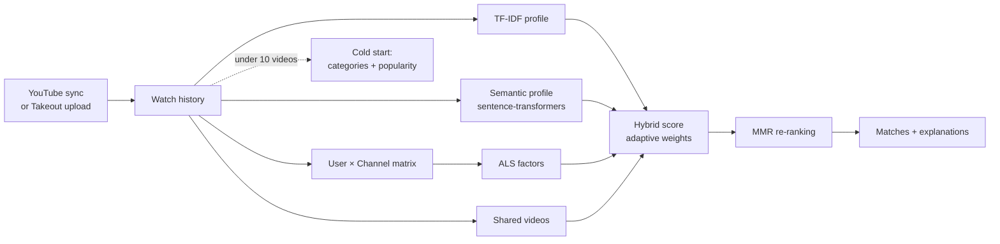

<picture>
  <source media="(prefers-color-scheme: dark)" srcset="assets/header-dark.svg">
  
</picture>

I build AI products end to end: from data and model training to the API and the interface people actually use. I work with LLMs and train my own vision and ranking models, and my full-stack background means they ship as working products, not notebooks.

**Currently:** measuring answer quality in RAG: faithfulness and citation precision.  
**Open to** AI engineering roles and freelance projects · [LinkedIn](https://www.linkedin.com/in/vadim-tkachenko-19842b241) · [vadim.tkach1378@gmail.com](mailto:vadim.tkach1378@gmail.com)

### Selected work

| Project | Result | Stack |
|---|---|---|
| [**rag-eval-service**](https://github.com/vadimtkacj1/rag-eval-service) | Six retrieval pipelines benchmarked on BEIR SciFact: dense nDCG@10 0.713, hybrid Recall@5 0.765, and an out-of-domain reranker that hurts. Served with FastAPI + pgvector | sentence-transformers · pgvector · FastAPI |
| [**hybrid-recommender**](https://github.com/vadimtkacj1/hybrid-recommendation-system-diplom) · thesis | Matches people by YouTube history: TF-IDF, sentence embeddings and ALS blended, MMR re-ranking, cold start. Full product with OAuth, Takeout import and live chat | FastAPI · sentence-transformers · implicit · React |
| [**vessel-segmentation**](https://github.com/vadimtkacj1/vessel-segmentation) | Retinal vessels on fundus images with DeepLabV3+ / ResNet-101, pixel IoU 0.944 over both classes | PyTorch · segmentation-models · Albumentations |
| [**brain-tumour-segmentation**](https://github.com/vadimtkacj1/brain-tumour-segmentation) | Three tumour sub-regions from 4-sequence MRI. Three architectures compared; Attention U-Net reaches about half the baseline's validation loss | PyTorch · h5py |
| [**lora-fine-tuning-service**](https://github.com/vadimtkacj1/fine-tuning-llama) | REST service that fine-tunes Llama 3 8B with 4-bit QLoRA on uploaded dialogues | FastAPI · Transformers · PEFT · bitsandbytes |
| [**real-estate-appraisal**](https://github.com/vadimtkacj1/real-estate-appraisal-agent) | An LLM parses a free-text listing, XGBoost prices it, the LLM explains the estimate | Gemini · XGBoost · Gradio |
| [**clip-retrieval**](https://github.com/vadimtkacj1/clip-retrieval-ai) | Text-to-image and image-to-image search, CLIP vs ResNet-18, cosine vs Euclidean | CLIP · PyTorch · NumPy |

**Product engineering:** [CRM with a Meta Ads analytics panel](https://github.com/vadimtkacj1/aiterra-crm), running in production · FastAPI · React · Docker

<b>How the recommender ranks people</b>

 

<b>Vessel segmentation: input, ground truth, prediction, heatmap</b>

 

<b>Brain tumour segmentation: what the attention gates look at</b>

 

### Training run

<picture>
  <source media="(prefers-color-scheme: dark)" srcset="assets/training-run-dark.svg">
  
</picture>

### Focus

- **LLM applications:** retrieval (RAG) with measured retrievers, structured extraction, tool-calling assistants, LoRA / QLoRA fine-tuning
- **Computer vision:** semantic segmentation (DeepLabV3+, U-Net, Attention U-Net), image embeddings for retrieval
- **Recommender systems:** hybrid content + collaborative ranking, diversification, cold start, offline evaluation
- **ML in production:** FastAPI services, background jobs, Docker Compose deployments, the frontend that uses the model

### Stack

<picture>
  <source media="(prefers-color-scheme: dark)" srcset="assets/stack-dark.svg">
  
</picture>

### Latest commits

<a href="https://github.com/vadimtkacj1?tab=repositories">
  <picture>
    <source media="(prefers-color-scheme: dark)" srcset="assets/recent-dark.svg">
    
  </picture>
</a>
