<picture>
  <source media="(prefers-color-scheme: dark)" srcset="assets/header-dark.svg">
  
</picture>

 

I build AI products end to end — from data and model training to the API and the interface people actually use. I work with LLMs and train my own vision and ranking models, and my full-stack background means they ship as working products, not notebooks.

**Currently:** LLM agents, retrieval (RAG), and fine-tuning open models.

 

<picture>
  <source media="(prefers-color-scheme: dark)" srcset="assets/training-run-dark.svg">
  
</picture>

 

<picture>
  <source media="(prefers-color-scheme: dark)" srcset="assets/agent-dark.svg">
  
</picture>

 

### Focus

- **LLM applications** — retrieval (RAG), agents with tool use, LoRA fine-tuning, evaluation of model output
- **Computer vision** — semantic segmentation (U-Net family), classification, detection, embeddings for retrieval
- **Recommender systems** — hybrid collaborative + content-based ranking, cold-start handling, offline evaluation
- **Applied NLP** — text classification, NER
- **ML in production** — FastAPI services, Docker, reproducible training, model serving behind real products

 

### Selected work

| Project | What it does | Stack |
|---|---|---|
| [**lora-fine-tuning-service**](https://github.com/vadimtkacj1/fine-tuning-llama) | REST service that fine-tunes LLaMA on uploaded dialogues | FastAPI · Transformers · PEFT |
| [**real-estate-appraisal**](https://github.com/vadimtkacj1/real-estate-appraisal-agent) | Price estimate from a plain-language description: LLM parses the query, XGBoost predicts, LLM explains | Gemini · XGBoost · Gradio |
| [**clip-retrieval**](https://github.com/vadimtkacj1/clip-retrieval-ai) | Text-to-image and image-to-image search, CLIP vs ResNet-18 embeddings | CLIP · ResNet · NumPy |
| [**vessel-segmentation**](https://github.com/vadimtkacj1/vessel-segmentation) | Retinal vessel segmentation on fundus images | PyTorch · segmentation-models · Albumentations |
| [**brain-tumour-segmentation**](https://github.com/vadimtkacj1/brain-tumour-segmentation) | Tumour region segmentation on MRI scans | PyTorch · OpenCV |
| [**hybrid-recommendation-system**](https://github.com/vadimtkacj1/hybrid-recommendation-system-diplom) | Thesis: hybrid recommender combining collaborative filtering and content features | Python · PyTorch · scikit-learn |
| [**crm**](https://github.com/vadimtkacj1/aiterra-crm) | Production CRM for a small business, shipped and in daily use | JavaScript · Node.js |

 

### Stack

<picture>
  <source media="(prefers-color-scheme: dark)" srcset="assets/inference-dark.svg">
  
</picture>

**LLM** &nbsp; Transformers · PEFT / LoRA · pgvector · OpenAI, Claude and Gemini APIs  
**ML** &nbsp; Python · PyTorch · TensorFlow · scikit-learn · XGBoost · OpenCV · pandas · NumPy  
**Serving** &nbsp; FastAPI · Docker · PostgreSQL · Linux  
**Product** &nbsp; TypeScript · React · Next.js · Node.js · Tailwind

 

### Contact

[LinkedIn](https://www.linkedin.com/in/vadim-tkachenko-19842b241) · [vadim.tkach1378@gmail.com](mailto:vadim.tkach1378@gmail.com)
